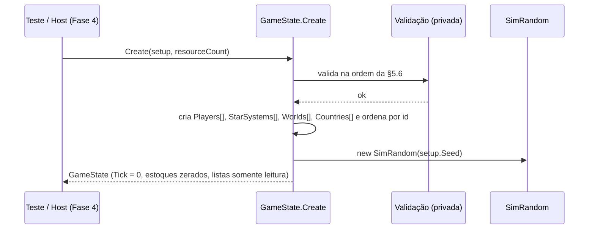
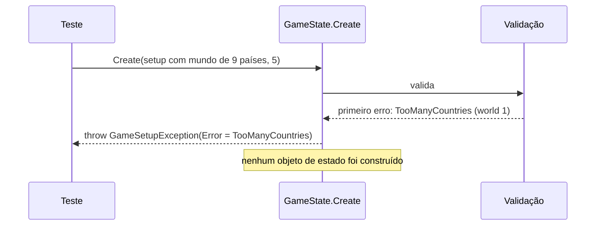

# AI-SPEC: Foundation — Fase 1: Base (solução, `Fixed`, `SimRandom`, `GameState`)

**Data**: 2026-11-22
**Status**: Proposta
**Modulo**: `src/Sim` (`Core`, `State`), `src/Sim.Tests` (`Core`, `State`, `Architecture`, `Fixtures`), raiz do repositório (`Rts.sln`, `.gitignore`), `src/Directory.Build.props`, `src/Directory.Packages.props`
**Pre-requisitos**:
- Inception concluída — Implementado (`docs/inception/`, ADR-001 a ADR-008)
- Proposta `Foundation` — Implementado como documento (`docs/features/Foundation/Proposal_Foundation.md`); esta spec cobre a Fase 1 da §16
- .NET 8 SDK — Implementado no host: `8.0.428` em `~/.dotnet` (verificado em 2026-11-22; carregar o PATH com `zsh -ic '...'`)
- Godot 4 .NET — Implementado no host: `4.7.2.stable.mono` em `~/bin/godot4` (não usado nesta fase; necessário na Fase 4)
**Dependencias externas**: .NET 8 SDK 8.0.428; NuGet só em `Rts.Sim.Tests`: `xunit` 2.9.3, `xunit.runner.visualstudio` 2.8.2, `Microsoft.NET.Test.Sdk` 17.12.0 (aprovados na proposta, DD-10). `Int128`/`UInt128` vêm do .NET 8 (sem pacote).
**Proposal**: `docs/features/Foundation/Proposal_Foundation.md`
**ADRs relacionados**: ADR-001 (Sim separada do Godot), ADR-002 (ponto fixo e RNG), ADR-004 (ids e controladores, parte do modelo), ADR-005 (nenhum id de conteúdo no código), ADR-006 (iteração por id). ADR-003, ADR-007 e ADR-008 não se aplicam a esta fase.

---

## 2. Descricao

Esta fase cria o **esqueleto compilável e testável** da simulação: a solução .NET com `Rts.Sim` (C# puro, sem Godot) e `Rts.Sim.Tests` (xUnit, headless), as flags de compilação obrigatórias, o `.gitignore` do projeto, o tipo numérico determinístico `Fixed` (Q32.32), o gerador `SimRandom` (xoshiro256\*\* semeado por SplitMix64) e o modelo de estado `GameState` com a hierarquia Universo → Sistema estelar → Mundo → País e ids fortes.

Ela existe porque todo o restante da Fase 1 do jogo (E1–E8) depende dessas peças, e porque o determinismo precisa valer desde o primeiro commit (decisão D1 da inception, ADR-002). O valor para o dev: compilar e testar a Sim sem abrir o Godot, com aritmética e aleatoriedade que dão o mesmo resultado em qualquer execução.

**Capacidades**
1. `dotnet build Rts.sln` e `dotnet test src/Sim.Tests` funcionam sem Godot, com `Nullable` e `TreatWarningsAsErrors`.
2. `Fixed` faz soma, subtração, negação, multiplicação, divisão, comparação, raiz quadrada, valor absoluto, mínimo/máximo/clamp, conversão de/para inteiro e texto decimal exato, sem `float`/`double`.
3. `SimRandom` gera a mesma sequência para a mesma semente e oferece inteiros sem viés e frações `[0, 1)` em `Fixed`.
4. `GameState.Create` monta o estado inicial a partir de um `GameSetup`, valida os limites (até 8 países por mundo, ids únicos, controlador válido) e guarda tudo em ordem canônica por id.
5. Nenhum tipo assume um único sistema ou um único mundo.

## 3. Escopo

### 3.1 In Scope (Fase 1 da proposta, §16)

1. **E0-1 (parte .NET)**: `Rts.sln`, `src/Sim/Rts.Sim.csproj`, `src/Sim.Tests/Rts.Sim.Tests.csproj`, `src/Directory.Build.props`, `src/Directory.Packages.props`, extensão do `.gitignore`.
2. **E0-2**: `Rts.Sim.Core.Fixed` e sua suíte de testes (RN-01 a RN-04 da proposta).
3. **E0-3**: `Rts.Sim.Core.SimRandom` e sua suíte de testes (RN-05 a RN-07 da proposta).
4. **E0-4**: ids fortes, `ControllerKind`, `ControllerRef`, `GameSetup` e registros filhos, `GameState`, `Universe`, `StarSystem`, `World`, `Country`, `Player`, `GameSetupException`, `GameSetupError`, `GameStateLimits`, e os testes (RN-08 e RN-10 da proposta; RN-09 parcial: `Tick == 0` após `Create`).
5. Teste de arquitetura mínimo: o assembly `Rts.Sim` não referencia nenhum assembly `Godot*`.

### 3.2 Out of Scope

1. **Projeto Godot (`game/`, `Rts.Game.csproj`, `project.godot`)**, embora citado na história E0-1: entra na **Fase 4** (§16 da proposta). Nesta fase o `.gitignore` já recebe as entradas do Godot.
2. `Command`, `CommandRegistry`, `CommandCodec`, `Simulation.Step`, `SimEvents`, `SimContext`, `ISimSystem` (E0-5): **Fase 2**. `GameState.Tick` só ganha incremento lá.
3. `IController`, `HumanController`, `AiController`, `ControllerSet` (E0-6): **Fase 2**.
4. `StateHasher`, `ComputeHash`, teste de determinismo de 1000 ticks e varredura de APIs proibidas (E0-7, RN-14 a RN-17 da proposta): **Fase 2**. Nesta fase a ausência de `float`/`double`/`System.Random`/Godot é verificada pelo comando de revisão do CA-F1-08.
5. `DataLoader`, `DataValidator`, `DataSet`, registries, `game/data/*.json` (E0-8): **Fase 3**. A sobrecarga `GameState.Create(GameSetup, DataSet)` nasce na Fase 3 (ver DD-P1-02).
6. `Ships[]` no `GameState` (CLAUDE.md §5.3): pertence à viagem entre mundos (marco 17, `[Depois]`). Nada nesta fase impede adicioná-lo depois.
7. Regras de estoque (limite, valor negativo, coleta): E4. Aqui o país tem só o vetor.
8. Trigonometria, `Fixed` com `int` misto (`Fixed * int`), `Parse` de texto: não pedidos por nenhuma história desta fase.
9. `.editorconfig` e Roslyn BannedApiAnalyzers: não pedidos (DD-04 da proposta).

## 4. Situacao Atual

| Aspecto | Estado | Caminho/Referencia |
|---|---|---|
| Solução e projetos .NET | Não existe | `Rts.sln`, `src/` (diretório inexistente em 2026-11-22) |
| Projeto Godot | Não existe (fora desta fase) | `game/` |
| .NET 8 SDK | **Instalado**: 8.0.428 | `~/.dotnet/sdk`; usar `zsh -ic 'dotnet ...'` |
| Godot 4 .NET | **Instalado**: 4.7.2.stable.mono | `~/bin/godot4` (só Fase 4) |
| Modelo de estado | Não existe | — |
| Testes | Não existe | — |
| `.gitignore` | Parcial: 4 linhas do harness (`.harness-db/`, `.harness-output/`, `.claude/skills/session-branchs/state/`, `.claude/skills/session-branchs/log.md`) | `.gitignore` — **MODIFY** (acrescentar, não substituir) |
| Pacotes NuGet de teste no cache local | Ausentes (`~/.nuget/packages` sem `xunit*`) | o `dotnet restore` baixa |
| ADRs | Existem | `docs/architecture/adr/ADR-001` a `ADR-008` |
| Specs de outras features | Nenhuma AI-SPEC existe; só propostas (`docs/features/*/Proposal_*.md`) | `docs/features/` |
| Descritores de módulo (`docs/features/*/README.md`) | Não existem | a feature fica direto em `docs/features/Foundation/` |

A proposta (§3) registrava o SDK e o Godot como ausentes (risco R-01). Em 2026-11-22 ambos estão instalados; R-01 está resolvido para esta fase.

Nada a modificar além do `.gitignore`. Todo o resto é criado.

## 5. Solucao

### 5.1 Arquitetura Geral

```
 Rts.sln
  ├─ src/Sim/Rts.Sim.csproj  (net8.0, sem PackageReference, sem ProjectReference)
  │    ├─ Core/   Fixed ─────────────► usado por State (estoque) e por SimRandom.NextFixed
  │    │          SimRandom
  │    └─ State/  ids · ControllerRef · GameSetup ──► GameState.Create ──► GameState
  │                                                         ├─ Players (ordenado por id)
  │                                                         ├─ Universe → StarSystems → Worlds → Countries
  │                                                         ├─ Countries (todos, ordenado por id)
  │                                                         └─ Random (internal, semeado por Seed)
  └─ src/Sim.Tests/Rts.Sim.Tests.csproj  (xUnit) ──ProjectReference──► Rts.Sim
         InternalsVisibleTo("Rts.Sim.Tests") permite aos testes usar os membros internal
```

Pontos de integração com as fases seguintes (contrato que esta fase fixa):
- Fase 2 usa `GameState.FindCountry`, `Country.Controller` (setter `internal`), `GameState.Tick` (setter `internal`), `GameState.Random.Snapshot()` e a ordem canônica para o hash.
- Fase 3 acrescenta `GameState.Create(GameSetup, DataSet)`, que delega para `Create(setup, data.Resources.Count)`.
- Fase 4 lê `GameState` a partir do Godot; por isso todas as coleções expostas são somente leitura de verdade (`ReadOnlyCollection<T>`) e os setters são `internal`.

Não há frontend nem armazenamento nesta fase.

### 5.2 Estrutura de Arquivos

```
/
├── Rts.sln                                   # NOVO: dotnet new sln --name Rts; contém os 2 projetos
├── .gitignore                                # MODIFY: acrescentar bloco (ver 5.2.4)
└── src/
    ├── Directory.Build.props                 # NOVO (ver 5.2.1)
    ├── Directory.Packages.props              # NOVO (ver 5.2.2)
    ├── Sim/
    │   ├── Rts.Sim.csproj                    # NOVO (ver 5.2.3)
    │   ├── Core/
    │   │   ├── Fixed.cs                      # NOVO
    │   │   └── SimRandom.cs                  # NOVO
    │   └── State/
    │       ├── Ids.cs                        # NOVO: PlayerId, StarSystemId, WorldId, CountryId, ResourceId, TechId
    │       ├── ControllerKind.cs             # NOVO
    │       ├── ControllerRef.cs              # NOVO
    │       ├── GameSetup.cs                  # NOVO: GameSetup, PlayerSetup, StarSystemSetup, WorldSetup, CountrySetup
    │       ├── GameSetupError.cs             # NOVO
    │       ├── GameSetupException.cs         # NOVO
    │       ├── GameStateLimits.cs            # NOVO
    │       ├── GameState.cs                  # NOVO (inclui a validação de Create em método privado)
    │       ├── Player.cs                     # NOVO
    │       ├── Universe.cs                   # NOVO
    │       ├── StarSystem.cs                 # NOVO
    │       ├── World.cs                      # NOVO
    │       └── Country.cs                    # NOVO
    └── Sim.Tests/
        ├── Rts.Sim.Tests.csproj              # NOVO (ver 5.2.3)
        ├── Architecture/
        │   └── SimAssemblyTests.cs           # NOVO: UT-BE-01
        ├── Core/
        │   ├── FixedTests.cs                 # NOVO: UT-BE-10 a UT-BE-21
        │   ├── SimRandomTests.cs             # NOVO: UT-BE-30 a UT-BE-38
        │   └── AllocationTests.cs            # NOVO: UT-BE-39
        ├── State/
        │   ├── GameStateCreateTests.cs       # NOVO: UT-BE-50 a UT-BE-53, UT-BE-62
        │   ├── GameSetupValidationTests.cs   # NOVO: UT-BE-54 a UT-BE-58
        │   ├── CountryStockTests.cs          # NOVO: UT-BE-59
        │   ├── StateEncapsulationTests.cs    # NOVO: UT-BE-60, UT-BE-61, UT-BE-63
        └── Fixtures/
            └── SetupFactory.cs               # NOVO: setups de teste reutilizáveis
```

Pastas `Commands/`, `Control/`, `Data/`, `Systems/` **não** são criadas nesta fase (vazias não entram no git).

#### 5.2.1 `src/Directory.Build.props` (conteúdo exato)

```xml
<Project>
  <PropertyGroup>
    <TargetFramework>net8.0</TargetFramework>
    <LangVersion>12.0</LangVersion>
    <Nullable>enable</Nullable>
    <ImplicitUsings>disable</ImplicitUsings>
    <TreatWarningsAsErrors>true</TreatWarningsAsErrors>
    <Deterministic>true</Deterministic>
    <CheckForOverflowUnderflow>false</CheckForOverflowUnderflow>
  </PropertyGroup>
</Project>
```

`CheckForOverflowUnderflow=false` é explícito: o comportamento de overflow vem só de `checked(...)`/`unchecked(...)` escritos no código (RN-P1-03, RN-P1-16), nunca de uma flag global.

#### 5.2.2 `src/Directory.Packages.props` (conteúdo exato)

```xml
<Project>
  <PropertyGroup>
    <ManagePackageVersionsCentrally>true</ManagePackageVersionsCentrally>
  </PropertyGroup>
  <ItemGroup>
    <PackageVersion Include="Microsoft.NET.Test.Sdk" Version="17.12.0" />
    <PackageVersion Include="xunit" Version="2.9.3" />
    <PackageVersion Include="xunit.runner.visualstudio" Version="2.8.2" />
  </ItemGroup>
</Project>
```

Se o `dotnet restore` não encontrar uma dessas versões, **parar e perguntar** ao operador (não trocar de versão nem acrescentar pacote por conta própria; CLAUDE.md §8).

#### 5.2.3 Arquivos de projeto (conteúdo exato)

`src/Sim/Rts.Sim.csproj`:

```xml
<Project Sdk="Microsoft.NET.Sdk">
  <PropertyGroup>
    <AssemblyName>Rts.Sim</AssemblyName>
    <RootNamespace>Rts.Sim</RootNamespace>
  </PropertyGroup>
  <ItemGroup>
    <InternalsVisibleTo Include="Rts.Sim.Tests" />
  </ItemGroup>
</Project>
```

`src/Sim.Tests/Rts.Sim.Tests.csproj`:

```xml
<Project Sdk="Microsoft.NET.Sdk">
  <PropertyGroup>
    <AssemblyName>Rts.Sim.Tests</AssemblyName>
    <RootNamespace>Rts.Sim.Tests</RootNamespace>
    <IsPackable>false</IsPackable>
    <IsTestProject>true</IsTestProject>
  </PropertyGroup>
  <ItemGroup>
    <PackageReference Include="Microsoft.NET.Test.Sdk" />
    <PackageReference Include="xunit" />
    <PackageReference Include="xunit.runner.visualstudio">
      <PrivateAssets>all</PrivateAssets>
      <IncludeAssets>runtime; build; native; contentfiles; analyzers; buildtransitive</IncludeAssets>
    </PackageReference>
  </ItemGroup>
  <ItemGroup>
    <ProjectReference Include="../Sim/Rts.Sim.csproj" />
  </ItemGroup>
</Project>
```

Não usar `dotnet new xunit` (o template acrescenta `coverlet.collector`, que não foi aprovado). Criar a solução com:

```bash
zsh -ic 'cd ~/workspace/oaks/vilhight && dotnet new sln --name Rts && dotnet sln Rts.sln add src/Sim/Rts.Sim.csproj src/Sim.Tests/Rts.Sim.Tests.csproj'
```

Como `ImplicitUsings` está desligado, cada arquivo declara seus `using` (ex.: `using System;`, `using Xunit;`).

#### 5.2.4 `.gitignore` (bloco a acrescentar ao final, mantendo as 4 linhas existentes)

```gitignore

# Godot
.godot/
.import/

# .NET
bin/
obj/
*.user
TestResults/
```

### 5.3 Modelos de Dados

Não há banco de dados nem migração. Os "modelos" são tipos C#. Assinaturas exatas abaixo; corpo descrito pelas regras da §5.7. Todos os tipos públicos são `sealed` (classes) ou `readonly` (structs).

#### 5.3.1 `Fixed` — `src/Sim/Core/Fixed.cs`

```csharp
using System;

namespace Rts.Sim.Core;

// design: Diretrizes técnicas (determinismo); ADR-002. Q32.32 em long: valor real = Raw / 2^32.
public readonly record struct Fixed(long Raw) : IComparable<Fixed>
{
    public const int FractionBits = 32;

    public static readonly Fixed Zero = new(0L);
    public static readonly Fixed One = new(1L << FractionBits);
    public static readonly Fixed MinValue = new(long.MinValue);
    public static readonly Fixed MaxValue = new(long.MaxValue);

    public static Fixed FromInt(int value);
    public static Fixed FromRaw(long raw);
    public static Fixed FromRatio(long numerator, long denominator);
    public int ToIntFloor();

    public static Fixed operator +(Fixed a, Fixed b);
    public static Fixed operator -(Fixed a, Fixed b);
    public static Fixed operator -(Fixed a);
    public static Fixed operator *(Fixed a, Fixed b);
    public static Fixed operator /(Fixed a, Fixed b);
    public static bool operator <(Fixed a, Fixed b);
    public static bool operator >(Fixed a, Fixed b);
    public static bool operator <=(Fixed a, Fixed b);
    public static bool operator >=(Fixed a, Fixed b);

    public static Fixed Sqrt(Fixed x);
    public static Fixed Abs(Fixed x);
    public static Fixed Min(Fixed a, Fixed b);
    public static Fixed Max(Fixed a, Fixed b);
    public static Fixed Clamp(Fixed value, Fixed min, Fixed max);

    public int CompareTo(Fixed other);
    public override string ToString();
}
```

Igualdade (`==`, `!=`, `Equals`, `GetHashCode`) é a gerada pelo `record struct` (compara `Raw`). `static readonly` de struct imutável não é estado estático mutável.

**Invariantes**
- `INV-FX-01`: `Fixed.FromInt(n).Raw == (long)n << 32` para todo `int n`.
- `INV-FX-02`: `x.ToIntFloor() == (int)(x.Raw >> 32)` (deslocamento aritmético = piso); sempre cabe em `int`.
- `INV-FX-03`: o resultado de toda operação está em `[long.MinValue, long.MaxValue]` em `Raw`; caso contrário a operação lança `OverflowException` (nunca satura, nunca dá a volta).
- `INV-FX-04`: nenhuma linha de `Fixed.cs` contém `float`, `double`, `decimal` ou `Math.Sqrt`.

#### 5.3.2 `SimRandom` — `src/Sim/Core/SimRandom.cs`

```csharp
namespace Rts.Sim.Core;

// ADR-002; DD-02 da proposta: xoshiro256** semeado por SplitMix64.
public sealed class SimRandom
{
    public SimRandom(ulong seed);
    public ulong NextU64();
    public int NextInt(int exclusiveMax);
    public Fixed NextFixed();
    public (ulong S0, ulong S1, ulong S2, ulong S3) Snapshot();
}
```

Estado privado: quatro campos `ulong _s0, _s1, _s2, _s3`. Sem outros campos.

**Invariantes**
- `INV-RNG-01`: `(_s0 | _s1 | _s2 | _s3) != 0` após o construtor, para qualquer semente (garantido pelo SplitMix64; verificado no teste das sementes 0, 1, 42 e `ulong.MaxValue`).
- `INV-RNG-02`: o estado só muda dentro de `NextU64` (e, por consequência, de `NextInt`/`NextFixed`). `Snapshot()` não altera o estado; chamadas que lançam exceção não alteram o estado.

#### 5.3.3 Ids fortes — `src/Sim/State/Ids.cs`

```csharp
namespace Rts.Sim.State;

public readonly record struct PlayerId(int Value);
public readonly record struct StarSystemId(int Value);
public readonly record struct WorldId(int Value);
public readonly record struct CountryId(int Value);
public readonly record struct ResourceId(int Value); // índice denso; resolvido pelos registries na Fase 3
public readonly record struct TechId(int Value);     // índice denso; usado a partir da Fase 3
```

Sem conversões implícitas para/de `int`.

#### 5.3.4 Controlador — `ControllerKind.cs`, `ControllerRef.cs`

```csharp
namespace Rts.Sim.State;

public enum ControllerKind : byte
{
    Human = 1,
    Ai = 2,
}

// Quem emite comandos para um país: o tipo de controlador e o jogador em nome de quem ele age.
public readonly record struct ControllerRef(ControllerKind Kind, PlayerId Player);
```

`default(ControllerKind)` (valor 0) é **inválido** de propósito: um país criado sem controlador explícito é rejeitado (RN-P1-29).

#### 5.3.5 Setup — `src/Sim/State/GameSetup.cs`

```csharp
using System.Collections.Generic;

namespace Rts.Sim.State;

public sealed record GameSetup(
    ulong Seed,
    IReadOnlyList<PlayerSetup> Players,
    IReadOnlyList<StarSystemSetup> StarSystems);

public sealed record PlayerSetup(PlayerId Id, string Name);

public sealed record StarSystemSetup(
    StarSystemId Id,
    PlayerId Owner,
    IReadOnlyList<WorldSetup> Worlds);

public sealed record WorldSetup(WorldId Id, IReadOnlyList<CountrySetup> Countries);

public sealed record CountrySetup(CountryId Id, string Name, ControllerRef Controller);
```

O setup é a entrada; a ordem das listas no setup **não** importa para o estado resultante (RN-P1-24).

#### 5.3.6 Limites e erros — `GameStateLimits.cs`, `GameSetupError.cs`, `GameSetupException.cs`

```csharp
namespace Rts.Sim.State;

public static class GameStateLimits
{
    public const int MaxCountriesPerWorld = 8;   // design: Planeta, países e espécies ("até 8 países")
    public const int MaxNameLength = 64;
}

public enum GameSetupError
{
    NegativeResourceCount = 1,
    NoPlayers = 2,
    NoStarSystems = 3,
    NegativeId = 4,
    InvalidName = 5,
    DuplicatePlayerId = 6,
    DuplicateStarSystemId = 7,
    DuplicateWorldId = 8,
    DuplicateCountryId = 9,
    UnknownStarSystemOwner = 10,
    TooManyCountries = 11,
    InvalidControllerKind = 12,
    UnknownControllerPlayer = 13,
}

public sealed class GameSetupException : System.ArgumentException
{
    public GameSetupException(GameSetupError error, string detail)
        : base($"{error}: {detail}") { Error = error; }

    public GameSetupError Error { get; }
}
```

#### 5.3.7 Estado — `GameState.cs`, `Player.cs`, `Universe.cs`, `StarSystem.cs`, `World.cs`, `Country.cs`

```csharp
using System;
using System.Collections.Generic;
using Rts.Sim.Core;

namespace Rts.Sim.State;

public sealed class GameState
{
    private GameState(/* privado: só Create constrói */);

    public ulong Seed { get; }
    public long Tick { get; internal set; }                 // 0 após Create; incrementado só por Step (Fase 2)
    internal SimRandom Random { get; }                      // semeado com Seed
    public int ResourceCount { get; }                       // tamanho do vetor de estoque de cada país
    public IReadOnlyList<Player> Players { get; }           // ordenado por Id.Value crescente
    public Universe Universe { get; }
    public IReadOnlyList<Country> Countries { get; }        // todos os países de todos os mundos, ordenado por Id.Value

    public Player? FindPlayer(PlayerId id);                 // busca binária em Players; null se não existe
    public Country? FindCountry(CountryId id);              // busca binária em Countries; null se não existe

    public static GameState Create(GameSetup setup, int resourceCount);
}

public sealed class Player
{
    internal Player(PlayerId id, string name);
    public PlayerId Id { get; }
    public string Name { get; }
}

public sealed class Universe
{
    internal Universe(StarSystem[] starSystems);
    public IReadOnlyList<StarSystem> StarSystems { get; }   // ordenado por Id.Value
}

public sealed class StarSystem
{
    internal StarSystem(StarSystemId id, PlayerId owner, World[] worlds);
    public StarSystemId Id { get; }
    public PlayerId Owner { get; }
    public IReadOnlyList<World> Worlds { get; }             // ordenado por Id.Value
}

public sealed class World
{
    internal World(WorldId id, StarSystemId starSystem, Country[] countries);
    public WorldId Id { get; }
    public StarSystemId StarSystem { get; }
    public IReadOnlyList<Country> Countries { get; }        // ordenado por Id.Value; 0..8 itens
}

public sealed class Country
{
    internal Country(CountryId id, WorldId world, string name, ControllerRef controller, int resourceCount);
    public CountryId Id { get; }
    public WorldId World { get; }
    public string Name { get; }
    public ControllerRef Controller { get; internal set; }
    public ReadOnlySpan<Fixed> Stock { get; }               // => _stock; comprimento == ResourceCount do estado
    public Fixed GetStock(ResourceId resource);
    internal void SetStock(ResourceId resource, Fixed amount);
}
```

Regras de implementação do estado:
- Toda coleção exposta como `IReadOnlyList<T>` é um `System.Collections.ObjectModel.ReadOnlyCollection<T>` criado com `Array.AsReadOnly(array)` no `Create`. Nenhum array interno é exposto diretamente.
- O vetor de estoque é um `Fixed[] _stock` privado, alocado uma vez no construtor com `resourceCount` posições, todas `Fixed.Zero`.
- Ordenação por id usa `Array.Sort(array, comparison)` com `comparison` comparando `Id.Value` (ids são únicos após a validação, então a ordenação instável não tem empate).
- `FindPlayer`/`FindCountry` fazem busca binária manual sobre os arrays internos ordenados (sem `Dictionary`, sem LINQ, sem alocação).
- Sem LINQ em `src/Sim` nesta fase.

**Invariantes do estado** (valem logo após `Create` e devem continuar valendo nas fases seguintes)
- `INV-GS-01`: `state.Players.Count >= 1` e `state.Universe.StarSystems.Count >= 1`.
- `INV-GS-02`: para cada lista `L` em {`Players`, `Countries`, `Universe.StarSystems`, cada `StarSystem.Worlds`, cada `World.Countries`}: `L[i].Id.Value < L[i+1].Id.Value` para todo `i` (ordem estritamente crescente ⇒ ids únicos).
- `INV-GS-03`: `Id.Value >= 0` para todo jogador, sistema, mundo e país.
- `INV-GS-04`: `world.Countries.Count <= GameStateLimits.MaxCountriesPerWorld` para todo mundo.
- `INV-GS-05`: `state.FindPlayer(system.Owner) != null` para todo sistema.
- `INV-GS-06`: para todo país `c`: `c.Controller.Kind ∈ {Human, Ai}` e `state.FindPlayer(c.Controller.Player) != null`.
- `INV-GS-07`: `state.Countries` contém exatamente os países de todos os mundos de todos os sistemas (mesmo conjunto de ids, mesma instância de objeto).
- `INV-GS-08`: para todo país `c` no mundo `w` do sistema `s`: `c.World == w.Id` e `w.StarSystem == s.Id`.
- `INV-GS-09`: `c.Stock.Length == state.ResourceCount` para todo país; `state.ResourceCount >= 0`.
- `INV-GS-10`: após `Create`, `state.Tick == 0` e `state.Random.Snapshot() == new SimRandom(setup.Seed).Snapshot()`.
- `INV-GS-11`: `1 <= name.Trim().Length` e `name.Length <= GameStateLimits.MaxNameLength` para todo nome de jogador e de país.

### 5.4 API pública (substitui "Endpoints"; não há HTTP)

| Membro | Descrição | Acesso | Sucesso | Erros |
|---|---|---|---|---|
| `Fixed.FromInt(int)` | Inteiro exato | público | `Fixed` | — |
| `Fixed.FromRaw(long)` | Valor bruto | público | `Fixed` | — |
| `Fixed.FromRatio(long, long)` | `num/den` truncado para zero | público | `Fixed` | `DivideByZeroException`, `OverflowException` |
| `Fixed.ToIntFloor()` | Piso | público | `int` | — |
| `+`, `-` (binário), `-` (unário) | Aritmética `checked` | público | `Fixed` | `OverflowException` |
| `*` | Produto 128 bits, piso | público | `Fixed` | `OverflowException` |
| `/` | Quociente 128 bits, truncado para zero | público | `Fixed` | `DivideByZeroException`, `OverflowException` |
| `<`, `>`, `<=`, `>=`, `CompareTo` | Comparação por `Raw` | público | `bool`/`int` | — |
| `Fixed.Sqrt(Fixed)` | Piso da raiz | público | `Fixed` | `ArgumentOutOfRangeException` (x < 0) |
| `Fixed.Abs(Fixed)` | Valor absoluto | público | `Fixed` | `OverflowException` (`MinValue`) |
| `Fixed.Min/Max(Fixed, Fixed)` | Menor/maior | público | `Fixed` | — |
| `Fixed.Clamp(v, min, max)` | Limita ao intervalo | público | `Fixed` | `ArgumentException` (min > max) |
| `Fixed.ToString()` | Decimal exato, cultura invariante | público | `string` | — |
| `new SimRandom(ulong)` | Semeia | público | instância | — |
| `SimRandom.NextU64()` | Próximo valor de 64 bits | público | `ulong` | — |
| `SimRandom.NextInt(int)` | Inteiro sem viés em `[0, n)` | público | `int` | `ArgumentOutOfRangeException` (n ≤ 0) |
| `SimRandom.NextFixed()` | Fração em `[0, 1)` | público | `Fixed` | — |
| `SimRandom.Snapshot()` | Estado atual, sem alterá-lo | público | tupla de 4 `ulong` | — |
| `GameState.Create(GameSetup, int)` | Valida e constrói o estado inicial | público | `GameState` | `ArgumentNullException` (setup ou listas/nomes nulos), `GameSetupException` (ver 5.6) |
| `GameState.FindPlayer(PlayerId)` | Busca | público | `Player?` | — |
| `GameState.FindCountry(CountryId)` | Busca | público | `Country?` | — |
| `Country.GetStock(ResourceId)` | Lê estoque | público | `Fixed` | `ArgumentOutOfRangeException` (índice fora de `[0, ResourceCount)`) |
| `Country.SetStock(ResourceId, Fixed)` | Escreve estoque | **internal** | — | `ArgumentOutOfRangeException` |
| `Country.Controller` (set) | Troca o controlador | **internal** | — | — |
| `GameState.Tick` (set) | Avança o tick | **internal** (usado na Fase 2) | — | — |
| `GameState.Random` | RNG da partida | **internal** | `SimRandom` | — |

Paginação, autenticação e anotações de API não se aplicam (biblioteca local).

### 5.5 Contratos de entrada (substitui "DTOs")

Os contratos de entrada são os registros de `GameSetup` (5.3.5). Validação aplicada por `GameState.Create` (ordem e códigos em 5.6/5.7):

| Campo | Regra |
|---|---|
| `GameSetup` | não nulo |
| `GameSetup.Players`, `StarSystems`, `StarSystemSetup.Worlds`, `WorldSetup.Countries` | não nulos; nenhum elemento nulo |
| `GameSetup.Players.Count` | `>= 1` |
| `GameSetup.StarSystems.Count` | `>= 1` |
| `StarSystemSetup.Worlds.Count` | `>= 0` (sistema sem mundo é válido) |
| `WorldSetup.Countries.Count` | `0..8` |
| `*.Id.Value` | `>= 0`; único entre todos os objetos do mesmo tipo no setup (países e mundos: únicos no setup inteiro, não só no pai) |
| `PlayerSetup.Name`, `CountrySetup.Name` | não nulo; `Trim().Length >= 1`; `Length <= 64` |
| `StarSystemSetup.Owner` | id de um `PlayerSetup` existente |
| `CountrySetup.Controller.Kind` | `Human` ou `Ai` |
| `CountrySetup.Controller.Player` | id de um `PlayerSetup` existente |
| `resourceCount` (parâmetro) | `>= 0` |
| `GameSetup.Seed` | qualquer `ulong`, inclusive 0 |

Saída: o `GameState` (5.3.7). Não há campo sensível.

### 5.6 Tratamento de erros

| Membro | Exceção | Condição | Mensagem |
|---|---|---|---|
| `Fixed.FromRatio` | `DivideByZeroException` | `denominator == 0` | padrão do .NET |
| `Fixed.FromRatio` | `OverflowException` | quociente fora de `long` em Raw | padrão do .NET |
| `+`, `-`, `-x` | `OverflowException` | resultado fora de `long` | padrão do .NET |
| `*` | `OverflowException` | `((Int128)a.Raw * b.Raw) >> 32` fora de `long` | padrão do .NET |
| `/` | `DivideByZeroException` | `b.Raw == 0` | padrão do .NET |
| `/` | `OverflowException` | `((Int128)a.Raw << 32) / b.Raw` fora de `long` | padrão do .NET |
| `Fixed.Sqrt` | `ArgumentOutOfRangeException` | `x.Raw < 0` | `paramName = "x"` |
| `Fixed.Abs` | `OverflowException` | `x.Raw == long.MinValue` | padrão do .NET |
| `Fixed.Clamp` | `ArgumentException` | `min.Raw > max.Raw` | `"min must be less than or equal to max"` |
| `SimRandom.NextInt` | `ArgumentOutOfRangeException` | `exclusiveMax <= 0` | `paramName = "exclusiveMax"` |
| `Country.GetStock/SetStock` | `ArgumentOutOfRangeException` | `resource.Value < 0 \|\| resource.Value >= ResourceCount` | `paramName = "resource"` |
| `GameState.Create` | `ArgumentNullException` | `setup` nulo, lista nula, elemento nulo ou nome nulo | `paramName` = nome do parâmetro/propriedade |
| `GameState.Create` | `GameSetupException(NegativeResourceCount)` | `resourceCount < 0` | `"NegativeResourceCount: resourceCount is {n}"` |
| `GameState.Create` | `GameSetupException(NoPlayers)` | `Players.Count == 0` | `"NoPlayers: setup has no players"` |
| `GameState.Create` | `GameSetupException(NoStarSystems)` | `StarSystems.Count == 0` | `"NoStarSystems: setup has no star systems"` |
| `GameState.Create` | `GameSetupException(NegativeId)` | algum `Id.Value < 0` | `"NegativeId: {type} {value}"` (`type` ∈ `player`, `starSystem`, `world`, `country`) |
| `GameState.Create` | `GameSetupException(InvalidName)` | nome vazio, só espaços ou > 64 caracteres | `"InvalidName: {type} {id}"` |
| `GameState.Create` | `GameSetupException(DuplicatePlayerId)` | id de jogador repetido | `"DuplicatePlayerId: {id}"` |
| `GameState.Create` | `GameSetupException(DuplicateStarSystemId)` | id de sistema repetido | `"DuplicateStarSystemId: {id}"` |
| `GameState.Create` | `GameSetupException(DuplicateWorldId)` | id de mundo repetido (em qualquer sistema) | `"DuplicateWorldId: {id}"` |
| `GameState.Create` | `GameSetupException(DuplicateCountryId)` | id de país repetido (em qualquer mundo) | `"DuplicateCountryId: {id}"` |
| `GameState.Create` | `GameSetupException(UnknownStarSystemOwner)` | `Owner` sem jogador | `"UnknownStarSystemOwner: starSystem {id} owner {owner}"` |
| `GameState.Create` | `GameSetupException(TooManyCountries)` | `Countries.Count > 8` | `"TooManyCountries: world {id} has {n} countries (max 8)"` |
| `GameState.Create` | `GameSetupException(InvalidControllerKind)` | `Kind` não é `Human` nem `Ai` | `"InvalidControllerKind: country {id} kind {(byte)kind}"` |
| `GameState.Create` | `GameSetupException(UnknownControllerPlayer)` | `Controller.Player` sem jogador | `"UnknownControllerPlayer: country {id} player {player}"` |

`{id}`, `{owner}`, `{player}` são o `Value` inteiro, formatado com `CultureInfo.InvariantCulture`.

**Ordem de validação** (determinística; lança o **primeiro** erro encontrado; a validação acontece inteira antes de qualquer objeto do estado ser construído):
1. `setup` nulo → `ArgumentNullException`.
2. `resourceCount < 0` → `NegativeResourceCount`.
3. `Players` nulo → `ArgumentNullException`; `Players.Count == 0` → `NoPlayers`.
4. Para cada jogador, na ordem do setup: elemento nulo → `ArgumentNullException`; `Id.Value < 0` → `NegativeId`; nome nulo → `ArgumentNullException`; nome inválido → `InvalidName`; id já visto → `DuplicatePlayerId`.
5. `StarSystems` nulo → `ArgumentNullException`; `StarSystems.Count == 0` → `NoStarSystems`.
6. Para cada sistema, na ordem do setup: elemento nulo → `ArgumentNullException`; `Id.Value < 0` → `NegativeId`; id já visto → `DuplicateStarSystemId`; dono inexistente → `UnknownStarSystemOwner`; `Worlds` nulo → `ArgumentNullException`; então, para cada mundo na ordem:
   1. elemento nulo → `ArgumentNullException`; `Id.Value < 0` → `NegativeId`; id já visto (global) → `DuplicateWorldId`; `Countries` nulo → `ArgumentNullException`; `Countries.Count > 8` → `TooManyCountries`;
   2. para cada país na ordem: elemento nulo → `ArgumentNullException`; `Id.Value < 0` → `NegativeId`; id já visto (global) → `DuplicateCountryId`; nome nulo → `ArgumentNullException`; nome inválido → `InvalidName`; `Kind` inválido → `InvalidControllerKind`; jogador do controlador inexistente → `UnknownControllerPlayer`.

"Id já visto" é verificado com um array temporário ordenado ou `HashSet<int>` usado **só para pertinência** (sem iterar), descartado ao fim do `Create`. `Create` pode alocar; a regra de "sem alocação" vale só para os caminhos por tick (5.7, RN-P1-33).

### 5.7 Regras de Negocio

Mapeamento com a proposta: RN-P1-01..09 ⇐ RN-01..04; RN-P1-10..18 ⇐ RN-05..07; RN-P1-20..33 ⇐ RN-08..10 e P-01/P-02/P-07.

**Fixed** (`src/Sim/Core/Fixed.cs`)

- `RN-P1-01 [BLOCK]`: representação Q32.32. Expression: `Fixed.One.Raw == 4294967296 && Fixed.FromInt(n).Raw == (long)n << 32`. Violação: teste UT-BE-10/11 falha.
- `RN-P1-02 [BLOCK]`: `ToIntFloor` é o piso. Expression: `x.ToIntFloor() == (int)(x.Raw >> 32)`. Violação: UT-BE-13 falha.
- `RN-P1-03 [BLOCK]`: `+`, `-` e `-x` são `checked`. Expression: `a + b == new Fixed(checked(a.Raw + b.Raw))`; `-x == new Fixed(checked(-x.Raw))`. Violação: `OverflowException`.
- `RN-P1-04 [BLOCK]`: multiplicação por piso. Expression: `(a * b).Raw == (long)(((Int128)a.Raw * b.Raw) >> 32)` (deslocamento aritmético de `Int128`, que arredonda para −∞), com conversão `checked`. Violação: `OverflowException` se fora de `long`.
- `RN-P1-05 [BLOCK]`: divisão truncada para zero. Expression: `(a / b).Raw == (long)(((Int128)a.Raw << 32) / b.Raw)` (divisão de `Int128` trunca para zero), conversão `checked`. Violação: `DivideByZeroException` se `b.Raw == 0`; `OverflowException` se fora de `long`.
- `RN-P1-06 [BLOCK]`: `FromRatio(num, den)`. Expression: `FromRatio(num, den).Raw == (long)(((Int128)num << 32) / den)`, conversão `checked`. Violação: `DivideByZeroException` (`den == 0`), `OverflowException`.
- `RN-P1-07 [BLOCK]`: raiz por piso. Expression: para `x.Raw >= 0`, com `n = (UInt128)(ulong)x.Raw << 32` e `r = Sqrt(x).Raw`: `(UInt128)r * (UInt128)r <= n && (UInt128)(r + 1) * (UInt128)(r + 1) > n`. Violação: `ArgumentOutOfRangeException` se `x.Raw < 0`. Algoritmo obrigatório (dígito a dígito, sem `Math.Sqrt`):
  ```
  UInt128 rem = n; UInt128 res = 0; UInt128 bit = (UInt128)1 << 126;
  while (bit > rem) bit >>= 2;
  while (bit != 0) {
      if (rem >= res + bit) { rem -= res + bit; res = (res >> 1) + bit; }
      else { res >>= 1; }
      bit >>= 2;
  }
  return new Fixed((long)res);   // res < 2^48, sempre cabe
  ```
- `RN-P1-08 [BLOCK]`: `Abs`, `Min`, `Max`, `Clamp`, comparação. Expression: `Abs(x).Raw == checked(x.Raw < 0 ? -x.Raw : x.Raw)`; `Min(a,b) == (a.Raw <= b.Raw ? a : b)`; `Max(a,b) == (a.Raw >= b.Raw ? a : b)`; `Clamp(v,lo,hi) == Max(lo, Min(v, hi))` com `lo.Raw <= hi.Raw`; `a < b ⇔ a.Raw < b.Raw`; `a.CompareTo(b) == a.Raw.CompareTo(b.Raw)`. Violação: `OverflowException` (`Abs(MinValue)`), `ArgumentException` (`Clamp` com `lo > hi`).
- `RN-P1-09 [BLOCK]`: `ToString` decimal exato, sem ponto flutuante. Expression: saída = `"-"` se `Raw < 0` + parte inteira de `|Raw| >> 32` em base 10 (invariante) + se a fração `f = |Raw| & 0xFFFFFFFF` ≠ 0: `"."` seguido dos dígitos obtidos repetindo `f *= 10; dígito = f >> 32; f &= 0xFFFFFFFF` até `f == 0` (no máximo 32 dígitos). `|Raw|` é calculado em `UInt128` para cobrir `long.MinValue`. Violação: UT-BE-20 falha.

**SimRandom** (`src/Sim/Core/SimRandom.cs`)

- `RN-P1-10 [BLOCK]`: semeadura SplitMix64. Expression: com `z` inicial = `seed`, cada saída é `z += 0x9E3779B97F4A7C15; t = z; t = (t ^ (t >> 30)) * 0xBF58476D1CE4E5B9; t = (t ^ (t >> 27)) * 0x94D049BB133111EB; return t ^ (t >> 31);` (tudo `unchecked`); `_s0.._s3` = as 4 primeiras saídas, nessa ordem. Violação: UT-BE-30 falha.
- `RN-P1-11 [BLOCK]`: passo xoshiro256\*\*. Expression (tudo `unchecked`, `rotl(x,k) = (x << k) | (x >> (64 - k))`): `result = rotl(_s1 * 5, 7) * 9; t = _s1 << 17; _s2 ^= _s0; _s3 ^= _s1; _s1 ^= _s2; _s0 ^= _s3; _s2 ^= t; _s3 = rotl(_s3, 45); return result;`. Violação: UT-BE-31 falha.
- `RN-P1-12 [BLOCK]`: reprodutibilidade. Expression: `∀ seed, k: new SimRandom(seed)` produz a mesma sequência de `k` valores em duas instâncias. Violação: UT-BE-32 falha.
- `RN-P1-13 [BLOCK]`: divergência. Expression: para cada par distinto de sementes em {0, 1, 42, `ulong.MaxValue`}, as sequências dos 8 primeiros `NextU64()` não são iguais. Violação: UT-BE-33 falha.
- `RN-P1-14 [BLOCK]`: `NextInt(n)` sem viés por rejeição. Expression: `n <= 0` ⇒ `ArgumentOutOfRangeException` **sem consumir valor**; senão `bound = (ulong)n; threshold = (0UL - bound) % bound; loop { x = NextU64(); if (x >= threshold) return (int)(x % bound); }`. Violação: UT-BE-34/35/36 falham.
- `RN-P1-15 [BLOCK]`: `NextFixed()` em `[0, 1)`. Expression: `NextFixed().Raw == (long)(NextU64() >> 32)`, logo `0 <= Raw < 2^32`. Violação: UT-BE-37 falha.
- `RN-P1-16 [BLOCK]`: aritmética do RNG é explicitamente `unchecked` (independente da flag do projeto). Expression: o corpo de `NextU64` e da semeadura está dentro de `unchecked { ... }`. Violação: revisão de código.
- `RN-P1-17 [BLOCK]`: `Snapshot()` é puro. Expression: `r.Snapshot() == r.Snapshot()` e o próximo `NextU64()` é o mesmo com ou sem a chamada. Violação: UT-BE-30 falha.
- `RN-P1-18 [BLOCK]`: sem alocação. Expression: `GC.GetAllocatedBytesForCurrentThread()` não muda em 10 000 chamadas de `NextU64`/`NextInt`/`NextFixed` após aquecimento. Violação: UT-BE-39 falha.

**GameState** (`src/Sim/State/`)

- `RN-P1-20 [BLOCK]`: limite de países. Expression: `∀ world ∈ setup: world.Countries.Count <= GameStateLimits.MaxCountriesPerWorld`. Violação: `GameSetupException(TooManyCountries)`.
- `RN-P1-21 [BLOCK]`: ids únicos por tipo, no setup inteiro. Expression: `distinct(ids do tipo).Count == count(ids do tipo)` para jogador, sistema, mundo e país. Violação: `GameSetupException(Duplicate{Tipo}Id)`.
- `RN-P1-22 [BLOCK]`: controlador válido. Expression: `country.Controller.Kind is ControllerKind.Human or ControllerKind.Ai && players.Contains(country.Controller.Player)`. Violação: `InvalidControllerKind` / `UnknownControllerPlayer`.
- `RN-P1-23 [BLOCK]`: dono do sistema existe. Expression: `players.Contains(system.Owner)`. Violação: `UnknownStarSystemOwner`.
- `RN-P1-24 [BLOCK]`: ordem canônica. Expression: INV-GS-02 vale para qualquer permutação das listas do setup; dois setups que diferem só pela ordem das listas produzem as mesmas sequências de ids em todas as listas do estado. Violação: UT-BE-52 falha.
- `RN-P1-25 [BLOCK]`: hierarquia sem suposição de cardinalidade. Expression: `Create` aceita `StarSystems.Count >= 1`, `Worlds.Count >= 0` por sistema e `Countries.Count ∈ [0, 8]` por mundo, e `FindCountry` encontra países de qualquer mundo de qualquer sistema. Violação: UT-BE-51 falha.
- `RN-P1-26 [BLOCK]`: estado inicial. Expression: INV-GS-09 e INV-GS-10; `∀ c, i: c.Stock[i] == Fixed.Zero`. Violação: UT-BE-50/62 falham.
- `RN-P1-27 [BLOCK]`: nomes. Expression: INV-GS-11. Violação: `InvalidName` (ou `ArgumentNullException` se nulo).
- `RN-P1-28 [BLOCK]`: ids não negativos. Expression: INV-GS-03. Violação: `NegativeId`.
- `RN-P1-29 [BLOCK]`: `default(ControllerRef)` é rejeitado. Expression: `(byte)default(ControllerKind) == 0 ∉ {1, 2}`. Violação: `InvalidControllerKind`.
- `RN-P1-30 [BLOCK]`: validação determinística e antes da construção. Expression: o erro lançado é o primeiro na ordem da §5.6; nenhuma instância de `Country`/`World`/`StarSystem`/`Player` é criada se houver erro. Violação: UT-BE-58 falha.
- `RN-P1-31 [BLOCK]`: a apresentação não muda o estado (P-02, RN-26 da proposta). Expression: os setters de `GameState.Tick` e `Country.Controller`, o getter de `GameState.Random`, `Country.SetStock` e os construtores de `Player/Universe/StarSystem/World/Country` não são `public`; nenhuma lista exposta é um array nem aceita `Add`. Violação: UT-BE-60 falha.
- `RN-P1-32 [BLOCK]`: acesso ao estoque por índice válido. Expression: `0 <= resource.Value < state.ResourceCount`. Violação: `ArgumentOutOfRangeException`.
- `RN-P1-33 [BLOCK]`: busca sem alocação. Expression: `GC.GetAllocatedBytesForCurrentThread()` não muda em 10 000 chamadas de `FindCountry`/`FindPlayer`/`GetStock` após aquecimento. Violação: UT-BE-63 falha.

**Projeto**

- `RN-P1-40 [BLOCK]`: `Rts.Sim` não referencia Godot. Expression: `typeof(Fixed).Assembly.GetReferencedAssemblies().All(a => !a.Name!.StartsWith("Godot", StringComparison.OrdinalIgnoreCase))` (LINQ permitido no teste). Violação: UT-BE-01 falha.
- `RN-P1-41 [BLOCK]`: nenhum `float`, `double`, `decimal`, `System.Random`, `DateTime`, `Stopwatch`, `Guid.NewGuid`, `Thread`, `Task.Run`, `using Godot` nem campo `static` não-`readonly`/não-`const` em `src/Sim`. Expression: o comando de CA-F1-08 não imprime nada. Violação: revisão rejeita (o teste automático vem na Fase 2).
- `RN-P1-42 [BLOCK]`: nenhum id de conteúdo em `src/Sim` (P-03). Expression: `src/Sim` não contém literais de string de conteúdo (nesta fase não há nenhum literal de id; só mensagens de erro de 5.6). Violação: revisão rejeita.

### 5.8 Fluxos e Diagramas de Sequencia

**Fluxo principal: criar o estado**



**Caminho de erro principal: 9 países num mundo**



**Máquina de estados**: nenhuma entidade desta fase tem ciclo de vida. `GameState` só tem o estado inicial (`Tick == 0`); a progressão `Tick → Tick + 1` é definida na Fase 2 (`Simulation.Step`). `Country.Controller` é atribuível internamente, mas a transição Humano ↔ IA é regra do E7 (troca de controle) e não é implementada aqui.

## 6. Frontend

Não há frontend nesta fase. A apresentação Godot (`game/`, `SimHost`, `IsoGrid`, `CameraRig`, `HudTick`) é a Fase 4. Nada de views, rotas, stores, cliente HTTP ou i18n (`capabilities.i18n = false`).

## 7. Integracoes

Nenhuma integração em tempo de execução nesta fase. Dependências de compilação:

| Módulo | Tipo | Direção | Ponto | Observação |
|---|---|---|---|---|
| `Rts.Sim.Tests` → `Rts.Sim` | `ProjectReference` + `InternalsVisibleTo` | Consome | todos os tipos públicos e `internal` | testes headless |
| Fase 2 (Ciclo) | Contrato de código | Consome | `GameState.FindCountry`, `Tick` (set internal), `Country.Controller` (set internal), `Random.Snapshot()`, ordem canônica | hash e comandos |
| Fase 3 (Dados) | Contrato de código | Estende | nova sobrecarga `GameState.Create(GameSetup, DataSet)`; `ResourceId`/`TechId` como índices densos | registries |
| Fase 4 (Apresentação) | `ProjectReference` de `game/Rts.Game.csproj` | Consome | leitura de `GameState`; conversão `Fixed → float` só em `game/` | P-06 |

Não há eventos nem handlers; idempotência não se aplica.

## 8. Seguranca

### 8.1 Data Isolation
Não aplicável: `capabilities.multiTenant = false`. O isolamento de jogo (cada país só recebe comandos do seu controlador, RF-03) é implementado na Fase 2; esta fase só garante que cada país tem um `ControllerRef` válido (RN-P1-22).

### 8.2 Authorization
Não há RBAC (`capabilities.rbac = false`) nem autenticação. O controle equivalente nesta fase é de **encapsulamento**: só código do assembly `Rts.Sim` (e os testes, via `InternalsVisibleTo`) pode alterar `Tick`, `Controller`, estoque e o RNG (RN-P1-31). O Godot (Fase 4) não terá acesso a esses membros.

### 8.3 Data Sensitivity
Nenhum campo sensível nesta feature. Não há credencial, rede nem dado pessoal; `Name` é texto livre de jogo.

## 9. Performance

### 9.1 Índices
Não há banco. A estrutura de busca equivalente:

| Estrutura | Chave | Operação | Custo | Justificativa |
|---|---|---|---|---|
| `GameState` (array interno de jogadores) | `PlayerId.Value` crescente | `FindPlayer` | O(log n), 0 alocação | ordem canônica (P-07) e sem `Dictionary` |
| `GameState` (array interno de países) | `CountryId.Value` crescente | `FindCountry` | O(log n), 0 alocação | idem; usado por comando na Fase 2 |
| `Country._stock` | `ResourceId.Value` | `GetStock` | O(1), 0 alocação | Opção A da proposta (§4.1) |

### 9.2 Paginação
Não aplicável (sem listagem remota).

### 9.3 Padrões de risco

| Risco | Mitigação |
|---|---|
| Alocação em operações por tick (`Fixed`, `SimRandom`, busca) | structs e arrays pré-alocados; UT-BE-39 e UT-BE-63 medem 0 byte |
| Custo de `Int128` em `*` e `/` | aceito (ADR-002); medição global de tick só em E3-3 |
| `ToString` aloca | só para depuração/HUD, nunca em laço de simulação |
| Ordem de iteração indefinida | nenhuma coleção sem ordem é iterada; o `HashSet<int>` de validação só testa pertinência |

Orçamentos medidos (informativos, registrar o valor real em `docs/history.md` na conclusão da fase, sem falhar o teste): 10⁶ multiplicações `Fixed` < 20 ms; 10⁶ `NextU64` < 10 ms (`assumed`).

## 10. Observabilidade

### 10.1 Domain Events
Nenhum evento nesta fase (`SimEvents` nasce na Fase 2).

### 10.2 Logging
A Sim não loga (sem `GD.Print`, `Console`, relógio). Erros chegam como exceções com o código em 5.6.

### 10.3 Auditoria
Nenhuma ação auditável nesta fase.

## 11. Testes

Framework: xUnit 2.9.3. Comando: `zsh -ic 'cd ~/workspace/oaks/vilhight && dotnet test src/Sim.Tests'`. **Ordem obrigatória (CLAUDE.md §8, passo 4)**: escrever os testes primeiro, confirmar que falham (não compilam ou falham por `NotImplementedException`), depois implementar até passarem.

Convenções: classes de teste `public sealed class XxxTests`; nomes de métodos `Metodo_Condicao_Resultado`; `[Fact]` para casos únicos e `[Theory]` + `[InlineData]` para tabelas. Valores hexadecimais abaixo são `ulong` (`0x...UL`). Os vetores esperados foram calculados por uma implementação de referência independente das regras RN-P1-04..15.

### 11.1 Unit Tests — Sim

```
UT-BE-01: SimAssemblyTests.SimAssembly_DoesNotReferenceGodot
  - Dado: o assembly de typeof(Fixed)
  - Quando: GetReferencedAssemblies()
  - Então: nenhum nome começa com "Godot" (OrdinalIgnoreCase)
  - Assert: typeof(Fixed).Assembly.GetName().Name == "Rts.Sim"
  - Assert: referencedNames.Any(n => n.StartsWith("Godot", OrdinalIgnoreCase)) == false
```

**Fixed** (`src/Sim.Tests/Core/FixedTests.cs`)

```
UT-BE-10: FromInt_IsExact (Theory: 0, 1, -1, 12345, int.MaxValue, int.MinValue)
  - Assert: Fixed.FromInt(v).Raw == (long)v << 32
  - Assert: Fixed.FromInt(v).ToIntFloor() == v

UT-BE-11: Constants_HaveExpectedRaw
  - Assert: Fixed.Zero.Raw == 0; Fixed.One.Raw == 4294967296
  - Assert: Fixed.MinValue.Raw == long.MinValue; Fixed.MaxValue.Raw == long.MaxValue
  - Assert: Fixed.FromRaw(123).Raw == 123; Fixed.FractionBits == 32

UT-BE-12: FromRatio_TruncatesTowardZero (Theory)
  - (1, 3)   → Raw 1431655765
  - (-1, 3)  → Raw -1431655765
  - (1, -3)  → Raw -1431655765
  - (7, 2)   → Raw 15032385536
  - (0, 5)   → Raw 0
  - Assert: Throws<DivideByZeroException>(() => Fixed.FromRatio(1, 0))
  - Assert: Throws<OverflowException>(() => Fixed.FromRatio(long.MaxValue, 1))

UT-BE-13: ToIntFloor_IsFloor (Theory)
  - FromRatio(7, 2) → 3;  FromRatio(-1, 2) → -1;  FromRaw(-1) → -1;  FromRaw(1) → 0
  - MinValue → int.MinValue;  MaxValue → int.MaxValue

UT-BE-14: AddSubtractNegate
  - Assert: FromInt(2) + FromInt(3) == FromInt(5)
  - Assert: (FromRatio(1, 2) + FromRatio(1, 4)).Raw == 3221225472
  - Assert: FromInt(2) - FromInt(5) == FromInt(-3)
  - Assert: -FromInt(5) == FromInt(-5)
  - Assert: Throws<OverflowException>(() => Fixed.MaxValue + Fixed.FromRaw(1))
  - Assert: Throws<OverflowException>(() => Fixed.MinValue - Fixed.FromRaw(1))
  - Assert: Throws<OverflowException>(() => -Fixed.MinValue)

UT-BE-15: Multiply_RoundsDownAndChecksOverflow
  - Assert: (FromRatio(3, 2) * FromRatio(3, 2)).Raw == 9663676416        // 2.25
  - Assert: (FromRaw(-1) * FromRaw(1)).Raw == -1                         // piso, não truncamento
  - Assert: (FromRaw(1) * FromRaw(1)).Raw == 0
  - Assert: FromInt(-3) * FromInt(4) == FromInt(-12)
  - Assert: Fixed.MaxValue * Fixed.One == Fixed.MaxValue
  - Assert: Fixed.MinValue * Fixed.One == Fixed.MinValue
  - Assert: Throws<OverflowException>(() => FromInt(46341) * FromInt(46341))

UT-BE-16: Divide_TruncatesTowardZeroAndChecks
  - Assert: (FromInt(1) / FromInt(3)).Raw == 1431655765
  - Assert: (FromInt(-1) / FromInt(3)).Raw == -1431655765
  - Assert: (FromRaw(-1) / FromInt(2)).Raw == 0                          // trunca para zero
  - Assert: FromInt(10) / FromInt(4) == FromRatio(5, 2)
  - Assert: Throws<DivideByZeroException>(() => FromInt(1) / Fixed.Zero)
  - Assert: Throws<OverflowException>(() => Fixed.MinValue / FromInt(-1))
  - Assert: Throws<OverflowException>(() => FromInt(65536) / FromRatio(1, 65536))

UT-BE-17: Sqrt_IsFloorOfRoot
  - Assert: Sqrt(Zero) == Zero; Sqrt(One) == One; Sqrt(FromInt(4)) == FromInt(2)
  - Assert: Sqrt(FromInt(2)).Raw == 6074000999
  - Assert: Sqrt(FromRatio(1, 4)).Raw == 2147483648
  - Assert: Sqrt(Fixed.MaxValue).Raw == 199032864766430
  - Assert: Throws<ArgumentOutOfRangeException>(() => Fixed.Sqrt(FromRaw(-1)))
  - Propriedade: para 1000 valores x com Raw = (long)(new SimRandom(7).NextU64() >> 1) (sequência),
    r = Sqrt(x).Raw, n = (UInt128)(ulong)x.Raw << 32:
    Assert: (UInt128)r * (UInt128)r <= n && (UInt128)(r + 1) * (UInt128)(r + 1) > n

UT-BE-18: AbsMinMaxClamp
  - Assert: Abs(FromInt(-3)) == FromInt(3); Abs(FromInt(3)) == FromInt(3)
  - Assert: Throws<OverflowException>(() => Fixed.Abs(Fixed.MinValue))
  - Assert: Min(FromInt(1), FromInt(2)) == FromInt(1); Max(FromInt(1), FromInt(2)) == FromInt(2)
  - Assert: Clamp(FromInt(5), Zero, FromInt(3)) == FromInt(3)
  - Assert: Clamp(FromInt(-5), Zero, FromInt(3)) == Zero
  - Assert: Clamp(FromInt(2), Zero, FromInt(3)) == FromInt(2)
  - Assert: Throws<ArgumentException>(() => Fixed.Clamp(One, FromInt(3), Zero))

UT-BE-19: Comparison
  - Assert: FromInt(1) < FromInt(2); FromInt(2) > FromInt(1); FromInt(2) <= FromInt(2); FromInt(2) >= FromInt(2)
  - Assert: FromRaw(-1) < Zero
  - Assert: FromInt(1).CompareTo(FromInt(2)) < 0; FromInt(2).CompareTo(FromInt(2)) == 0
  - Assert: FromInt(3) == FromRatio(6, 2); FromInt(3).GetHashCode() == FromRatio(6, 2).GetHashCode()
  - Assert: Array.Sort de [3, -1, 2] (FromInt) resulta em [-1, 2, 3]

UT-BE-20: ToString_IsExactDecimal (Theory: raw → texto)
  - 0 → "0";  4294967296 → "1";  -6442450944 → "-1.5";  1073741824 → "0.25"
  - 1 → "0.00000000023283064365386962890625"
  - -1 → "-0.00000000023283064365386962890625"
  - long.MinValue → "-2147483648"
  - long.MaxValue → "2147483647.99999999976716935634613037109375"

UT-BE-21: Properties_AndGoldenChecksum
  - Dado: rng = new SimRandom(20261122); acc = 14695981039346656037UL
  - Quando: 10 000 iterações:
      a = FromRaw((long)(rng.NextU64() >> 17) - (1L << 46))
      b = FromRaw((long)(rng.NextU64() >> 17) - (1L << 46))
      acc = Mix(acc, (a + b).Raw); acc = Mix(acc, (a - b).Raw); acc = Mix(acc, (a * b).Raw)
      se b != Zero: acc = Mix(acc, (a / b).Raw)
      acc = Mix(acc, Sqrt(Abs(a)).Raw)
    onde Mix(acc, v) = unchecked((acc ^ (ulong)v) * 1099511628211UL)
  - Assert em cada iteração: a + b == b + a; a * b == b * a; (a + b) - b == a;
    a * One == a; a / One == a; a + Zero == a; -(-a) == a
  - Assert: acc == 128333051705741941UL (0x01C7EE3B07DCD275)
  - Assert: rodar o mesmo laço uma segunda vez produz o mesmo acc
```

**SimRandom** (`src/Sim.Tests/Core/SimRandomTests.cs`)

```
UT-BE-30: Seeding_MatchesSplitMix64
  - Assert: new SimRandom(0).Snapshot() ==
      (0xE220A8397B1DCDAF, 0x6E789E6AA1B965F4, 0x06C45D188009454F, 0xF88BB8A8724C81EC)
  - Assert: new SimRandom(42).Snapshot() ==
      (0xBDD732262FEB6E95, 0x28EFE333B266F103, 0x47526757130F9F52, 0x581CE1FF0E4AE394)
  - Assert: new SimRandom(ulong.MaxValue).Snapshot() ==
      (0xE4D971771B652C20, 0xE99FF867DBF682C9, 0x382FF84CB27281E9, 0x6D1DB36CCBA982D2)
  - Assert: r.Snapshot() == r.Snapshot() (sem efeito colateral); o 1º NextU64 após Snapshot é o vetor de UT-BE-31
  - Assert (INV-RNG-01): para sementes 0, 1, 42, ulong.MaxValue, (S0|S1|S2|S3) != 0

UT-BE-31: NextU64_MatchesXoshiro256StarStar (4 primeiros valores)
  - seed 0:              0x99EC5F36CB75F2B4, 0xBF6E1F784956452A, 0x1A5F849D4933E6E0, 0x6AA594F1262D2D2C
  - seed 42:             0x15780B2E0C2EC716, 0x6104D9866D113A7E, 0xAE17533239E499A1, 0xECB8AD4703B360A1
  - seed ulong.MaxValue: 0x8F5520D52A7EAD08, 0xC476A018CAA1802D, 0x81DE31C0D260469E, 0xBF658D7E065F3C2F

UT-BE-32: SameSeed_SameSequence
  - Dado: duas instâncias com seed 123456789
  - Assert: os 1000 primeiros NextU64 são iguais, um a um

UT-BE-33: DifferentSeeds_Diverge
  - Dado: sementes {0, 1, 42, ulong.MaxValue}
  - Assert: para cada par distinto, a sequência dos 8 primeiros NextU64 não é igual (Assert.NotEqual em arrays)

UT-BE-34: NextInt_VectorsAndGuards
  - Assert: new SimRandom(42), 8× NextInt(6) == [0, 0, 5, 5, 4, 0, 4, 3]
  - Assert: new SimRandom(42), 3× NextInt(1) == [0, 0, 0]
  - Assert: Throws<ArgumentOutOfRangeException>(() => r.NextInt(0)) e NextInt(-1)
  - Assert: Snapshot antes e depois das chamadas que lançaram é igual (não consome valor)

UT-BE-35: NextInt_DistributionIsExactForSeed42
  - Dado: new SimRandom(42); 60 000× NextInt(6), contando por valor
  - Assert: contagens == [9802, 10053, 10182, 10023, 10038, 9902]
  - Assert: todo valor em [0, 6)

UT-BE-36: NextInt_LargeBound
  - Assert: new SimRandom(7), 3× NextInt(int.MaxValue) == [900426827, 1577101311, 1125130284]

UT-BE-37: NextFixed_InUnitInterval
  - Assert: new SimRandom(42), 4× NextFixed().Raw == [360188718, 1627707782, 2920764210, 3971525959]
  - Assert: 10 000 valores com seed 99 satisfazem Zero <= v && v < One

UT-BE-38: Seed0_IsValid
  - Assert: new SimRandom(0) não lança e 1000 NextU64 não são todos iguais
```

**Alocação** (`src/Sim.Tests/Core/AllocationTests.cs`)

```
UT-BE-39: FixedAndRandom_DoNotAllocate
  - Dado: rng = new SimRandom(1); aquecimento de 100 iterações do mesmo laço
  - Quando: before = GC.GetAllocatedBytesForCurrentThread();
            10 000× { u = rng.NextU64(); i = rng.NextInt(1000); f = rng.NextFixed();
                      x = (f + One) * f / (One + One); y = Fixed.Sqrt(x); acumular y.Raw num long local }
            after = GC.GetAllocatedBytesForCurrentThread()
  - Assert: after - before == 0
  - Assert: o acumulador é usado (Assert.NotEqual(0, acc)) para não ser eliminado
```

**GameState** (`src/Sim.Tests/State/*.cs`; setups em `Fixtures/SetupFactory.cs`)

`SetupFactory` (estático, só em testes):
- `OneSystemThreeCountries(ulong seed = 42)`: jogador `P1 = PlayerId(1)` "Player One"; sistema `StarSystemId(1)` dono `P1`; mundo `WorldId(1)`; países `CountryId(1)` "Alpha" (`Human`, `P1`), `CountryId(2)` "Beta" (`Ai`, `P1`), `CountryId(3)` "Gamma" (`Ai`, `P1`).
- `TwoSystemsThreeCountries(ulong seed = 42)`: jogadores `PlayerId(1)` "Player One" e `PlayerId(2)` "Player Two"; sistema `StarSystemId(10)` dono 1 com mundo `WorldId(100)` (países 1 `Human`/P1 e 3 `Ai`/P1) e mundo `WorldId(101)` sem países; sistema `StarSystemId(20)` dono 2 com mundo `WorldId(200)` (país 2 `Human`/P2).
- `WorldWithCountries(int count)`: 1 jogador, 1 sistema, 1 mundo com `count` países de ids `1..count`, nomes `"C{id}"`, `Ai`/P1.

```
UT-BE-50: Create_OneSystemThreeCountries (critério do E0-4)
  - Dado: SetupFactory.OneSystemThreeCountries(), resourceCount 5
  - Assert: state.Tick == 0; state.Seed == 42; state.ResourceCount == 5
  - Assert: state.Players.Count == 1; state.Universe.StarSystems.Count == 1
  - Assert: state.Universe.StarSystems[0].Worlds.Count == 1; state.Countries.Count == 3
  - Assert: ids de state.Countries == [1, 2, 3]
  - Assert: FindCountry(new CountryId(1))!.Controller == new ControllerRef(ControllerKind.Human, new PlayerId(1))
  - Assert: todo país tem Stock.Length == 5 e todos os valores == Fixed.Zero
  - Assert: Countries[0] é a mesma instância que Universe.StarSystems[0].Worlds[0].Countries[0] (INV-GS-07)

UT-BE-51: Create_TwoSystemsTwoPlayers (RN-10 da proposta, RN-P1-25)
  - Dado: SetupFactory.TwoSystemsThreeCountries(), resourceCount 3
  - Assert: StarSystems ids == [10, 20]; Worlds de 10 == [100, 101]; Worlds de 20 == [200]
  - Assert: world 101 tem 0 países
  - Assert: state.Countries ids == [1, 2, 3]
  - Assert: FindCountry(2)!.World == new WorldId(200); world 200 .StarSystem == new StarSystemId(20)
  - Assert: StarSystems[1].Owner == new PlayerId(2)

UT-BE-52: Create_OrdersCanonically (RN-P1-24)
  - Dado: o setup de UT-BE-51 com TODAS as listas em ordem inversa
  - Assert: as sequências de ids de Players, StarSystems, cada Worlds, cada World.Countries e Countries
            são iguais às do setup original
  - Assert: cada lista é estritamente crescente por Id.Value

UT-BE-53: Find_ReturnsNullForMissing
  - Assert: FindCountry(new CountryId(99)) == null; FindPlayer(new PlayerId(99)) == null
  - Assert: FindCountry(new CountryId(-1)) == null
  - Assert: FindPlayer(new PlayerId(2))!.Name == "Player Two" (setup de UT-BE-51)

UT-BE-54: Create_CountryLimit (RN-P1-20)
  - Assert: Create(WorldWithCountries(8), 0) não lança; World.Countries.Count == 8
  - Assert: Create(WorldWithCountries(9), 0) lança GameSetupException com Error == TooManyCountries
  - Assert: Create(WorldWithCountries(0), 0) não lança

UT-BE-55: Create_RejectsDuplicateIds (Theory, RN-P1-21)
  - jogador 1 repetido                                  → DuplicatePlayerId
  - sistema 1 repetido                                  → DuplicateStarSystemId
  - mundo 100 em dois sistemas diferentes               → DuplicateWorldId
  - país 1 em dois mundos diferentes                    → DuplicateCountryId
  - Assert: ex.Error == código esperado; ex é ArgumentException; ex.Message começa com "{código}:"

UT-BE-56: Create_RejectsInvalidController (RN-P1-22, RN-P1-29)
  - Kind = (ControllerKind)0 → InvalidControllerKind
  - Kind = (ControllerKind)3 → InvalidControllerKind
  - default(ControllerRef)   → InvalidControllerKind
  - Kind Human, Player 7 inexistente → UnknownControllerPlayer

UT-BE-57: Create_RejectsOtherInvalidSetups (Theory)
  - resourceCount -1                         → NegativeResourceCount
  - Players vazio                            → NoPlayers
  - StarSystems vazio                        → NoStarSystems
  - PlayerId(-1) / StarSystemId(-1) / WorldId(-1) / CountryId(-1) → NegativeId
  - nome de país "" / "   " / 65× 'a'      → InvalidName
  - nome de jogador ""                       → InvalidName
  - nome de 64× 'a'                          → aceito
  - Owner = PlayerId(9) inexistente          → UnknownStarSystemOwner
  - Assert: Throws<ArgumentNullException>(() => GameState.Create(null!, 0))
  - Assert: Throws<ArgumentNullException> para Players nulo e para nome de país nulo

UT-BE-58: Create_ValidationOrderIsDeterministic (RN-P1-30)
  - Dado: mundo com 9 países, dos quais um com nome "" → Assert: Error == TooManyCountries
  - Dado: mundo com países, nesta ordem, [1 válido, 1 válido (duplicado), 5 com Kind 0] → Assert: Error == DuplicateCountryId
  - Dado: mundo com países, nesta ordem, [5 com Kind 0, 1 válido, 1 válido (duplicado)] → Assert: Error == InvalidControllerKind
  - Dado: resourceCount -1 E Players vazio → Assert: Error == NegativeResourceCount
  - Assert: chamar Create duas vezes com o mesmo setup inválido lança o mesmo Error e a mesma Message

UT-BE-59: Country_Stock (RN-P1-32)
  - Dado: OneSystemThreeCountries, resourceCount 5; c = FindCountry(1)!
  - Quando: c.SetStock(new ResourceId(2), FromInt(7))   // internal, via InternalsVisibleTo
  - Assert: c.GetStock(new ResourceId(2)) == FromInt(7); c.Stock[2] == FromInt(7); c.Stock[1] == Zero
  - Assert: FindCountry(2)!.GetStock(new ResourceId(2)) == Zero (estoques independentes)
  - Assert: Throws<ArgumentOutOfRangeException> para GetStock(new ResourceId(5)) e GetStock(new ResourceId(-1))
  - Assert: Throws<ArgumentOutOfRangeException> para SetStock(new ResourceId(5), One)
  - Assert: com resourceCount 0, c.Stock.Length == 0

UT-BE-60: State_IsReadOnlyForPresentation (RN-P1-31)
  - Assert: typeof(GameState).GetProperty("Tick")!.SetMethod!.IsPublic == false
  - Assert: typeof(Country).GetProperty("Controller")!.SetMethod!.IsPublic == false
  - Assert: typeof(GameState).GetProperty("Random", BindingFlags.Instance | BindingFlags.NonPublic) != null
            e typeof(GameState).GetProperty("Random") == null (não é público)
  - Assert: typeof(Country).GetMethod("SetStock") == null (não é público)
  - Assert: typeof(Country/World/StarSystem/Universe/Player).GetConstructors() (públicos) está vazio
  - Assert: state.Countries não é Country[]; Throws<NotSupportedException>(() => ((IList<Country>)state.Countries).Add(c))
  - Assert: o mesmo para state.Players e Universe.StarSystems

UT-BE-61: Ids_AreStrongAndValueEqual
  - Assert: new CountryId(1) == new CountryId(1); new CountryId(1) != new CountryId(2)
  - Assert: ((object)new CountryId(1)).Equals(new WorldId(1)) == false

UT-BE-62: Create_SeedsRandom (INV-GS-10)
  - Dado: OneSystemThreeCountries(seed: 42)
  - Assert: state.Random.Snapshot() == new SimRandom(42).Snapshot()
  - Assert: duas chamadas de Create com o mesmo setup dão Snapshot iguais; com seed 43, diferentes

UT-BE-63: Lookups_DoNotAllocate (RN-P1-33)
  - Dado: TwoSystemsThreeCountries, resourceCount 3; aquecimento de 100 iterações
  - Quando: 10 000× { FindCountry(new CountryId(i % 4)); FindPlayer(new PlayerId(i % 3)); GetStock(new ResourceId(i % 3)) }
  - Assert: delta de GC.GetAllocatedBytesForCurrentThread() == 0
```

### 11.2 Unit Tests — Frontend
Sem frontend nesta fase. A apresentação Godot (Fase 4) não tem infraestrutura de teste automatizado; isso será registrado na spec da Fase 4.

### 11.3 Unit Tests — outros serviços
Não se aplica.

### 11.4 E2E Tests — Backend
Não há fluxo entre módulos nesta fase. O E2E headless (1000 ticks com hash) é a Fase 2.

### 11.5 / 11.6
Não se aplica (sem outros serviços, sem E2E de frontend).

## 12. Migracao / Seed

### 12.1 Migration
Nenhuma. Não há banco nem dados anteriores.

### 12.2 Seed Data
Nenhum arquivo de dados nesta fase (`game/data/` é a Fase 3). Os setups de teste ficam em `src/Sim.Tests/Fixtures/SetupFactory.cs` (§11.1) e usam só ids numéricos e nomes de teste, nunca ids de conteúdo.

### 12.3 Environment Variables
Nenhuma nova variável de ambiente. O PATH do `dotnet` vem do perfil do zsh; rodar os comandos com `zsh -ic '...'`.

## 13. Dependencias de Pacotes

| Pacote | Versão | Camada | Justificativa |
|---|---|---|---|
| `xunit` | 2.9.3 | `Rts.Sim.Tests` | framework de teste do CLAUDE.md §3 |
| `xunit.runner.visualstudio` | 2.8.2 | `Rts.Sim.Tests` | descoberta e execução pelo `dotnet test` |
| `Microsoft.NET.Test.Sdk` | 17.12.0 | `Rts.Sim.Tests` | host de testes do `dotnet test` |

Aprovados na proposta (DD-10). `Rts.Sim` não tem nenhum pacote. Nenhum outro pacote (inclusive `coverlet.collector`) entra sem nova aprovação.

## 14. Fases de Implementacao

Esta spec é a **Fase 1** das quatro definidas na proposta (§16):

| Fase | Escopo | Dependências | Entregável | Spec |
|---|---|---|---|---|
| **Fase 1: Base** | E0-1 (parte .NET), E0-2, E0-3, E0-4 | .NET 8 SDK (instalado) | Sim compila e testa; `Fixed`, `SimRandom`, `GameState` | **este documento** |
| Fase 2: Ciclo | E0-5, E0-6, E0-7 | Fase 1 | `Step`, comandos, controladores, hash, determinismo, varredura de APIs | `AI-SPEC_Foundation_Phase_2.md` |
| Fase 3: Dados | E0-8 | Fase 1 | carregador/validador, `game/data` de exemplo, `Create(GameSetup, DataSet)` | `AI-SPEC_Foundation_Phase_3.md` |
| Fase 4: Apresentação | E0-9 e o projeto Godot de E0-1 | Fases 2 e 3; Godot 4.7.2 .NET | jogo abre rodando a Sim a 20 ticks/s | `AI-SPEC_Foundation_Phase_4.md` |

Ordem de trabalho dentro da Fase 1:
1. Solução, projetos, props, `.gitignore`; `dotnet build` verde com um projeto de teste vazio.
2. Esqueleto de `Fixed` (assinaturas da §5.3.1 com corpo `throw new NotImplementedException()`), necessário porque `SimRandom.NextFixed` devolve `Fixed`.
3. Testes de `SimRandom` (UT-BE-30..38) → falham → implementar `SimRandom` → passam (UT-BE-37 depende só de `Fixed.Raw`, `Zero`, `One` e comparação; implementar esses membros aqui).
4. Testes de `Fixed` (UT-BE-10..21; UT-BE-17 e UT-BE-21 usam `SimRandom`, já pronto) → falham → implementar `Fixed` → passam.
5. UT-BE-39 (alocação).
6. Testes de estado (UT-BE-50..63) → falham → implementar `State/` → passam.
7. UT-BE-01; `dotnet build`, `dotnet test`, `dotnet format --verify-no-changes`; comando do CA-F1-08.

### Decisões de design desta fase (para aprovação)

- **DD-P1-01 · Props em `src/`, não na raiz** (difere da §5.1 da proposta, que coloca `Directory.Build.props`/`Directory.Packages.props` na raiz). O MSBuild aplica esses arquivos a todo projeto abaixo do diretório; na raiz, eles atingiriam também `game/Rts.Game.csproj` (SDK do Godot) na Fase 4, impondo `TreatWarningsAsErrors`, gestão central de pacotes e `LangVersion` a código gerado pelo Godot. Em `src/`, valem exatamente para `Sim` e `Sim.Tests`, que é o que o CLAUDE.md §6 pede. A Fase 4 decide as flags do projeto Godot.
- **DD-P1-02 · `GameState.Create(GameSetup, int resourceCount)` nesta fase** (a proposta mostra `Create(GameSetup, DataSet)`). `DataSet` só existe na Fase 3, e a Fase 1 precisa ser entregável sozinha. A Fase 3 acrescenta a sobrecarga com `DataSet`, que delega para esta. O contrato fica compatível: nada é removido.
- **DD-P1-03 · `GameState.Random` é `internal`** (a proposta mostra `public`). Um `SimRandom` público permitiria à apresentação chamar `NextU64()` e mudar o estado fora de `Step`, quebrando P-02 e o determinismo. `Seed` continua público para o HUD.
- **DD-P1-04 · Estoque encapsulado** (a proposta mostra `public Fixed[] Stock`). Leitura pública por `ReadOnlySpan<Fixed> Stock` e `GetStock`; escrita só por `internal SetStock`. Mesmo motivo de DD-P1-03 (P-02, RN-26 da proposta).
- **DD-P1-05 · Ids de mundo e país únicos no setup inteiro**, não só dentro do pai. Comandos (Fase 2) endereçam o país só por `CountryId`; ids repetidos em mundos diferentes tornariam `FindCountry` ambíguo.
- **DD-P1-06 · Mundo com 0 países e sistema com 0 mundos são válidos.** O design só fixa o máximo ("até 8 países"); exigir mínimo seria inventar regra. Jogadores ≥ 1 e sistemas ≥ 1 são exigidos porque `Owner` e `Controller.Player` precisam de referência e um universo vazio não roda partida.
- **DD-P1-07 · Validação de setup para no primeiro erro** (diferente da validação de dados da Fase 3, que coleta todos, P-05). O setup é construído por código (teste ou host), não editado à mão; o primeiro erro basta, e a ordem fixa da §5.6 mantém o resultado determinístico.

## 15. Criterios de Aceitacao

### 15.1 Fase 1

- `CA-F1-01`: `zsh -ic 'dotnet build Rts.sln'` termina com 0 erros e 0 avisos; `Rts.sln` contém exatamente `Rts.Sim` e `Rts.Sim.Tests`. (CA-01 da proposta)
- `CA-F1-02`: `src/Directory.Build.props` tem `Nullable=enable`, `TreatWarningsAsErrors=true`, `ImplicitUsings=disable`, `TargetFramework=net8.0`; `Rts.Sim.csproj` não tem `PackageReference` nem `ProjectReference`. (E0-1)
- `CA-F1-03`: `zsh -ic 'dotnet test src/Sim.Tests'` passa todos os testes UT-BE-01, UT-BE-10..21, UT-BE-30..39, UT-BE-50..63, sem Godot instalado no PATH do processo. (CA-02)
- `CA-F1-04`: `zsh -ic 'dotnet format Rts.sln --verify-no-changes'` termina com código 0. (CA-01)
- `CA-F1-05`: `Fixed` cumpre RN-P1-01..09, incluindo overflow, divisão por zero e `Sqrt` (UT-BE-10..21), e o checksum de UT-BE-21 é `128333051705741941`. (CA-14, E0-2)
- `CA-F1-06`: `SimRandom` reproduz os vetores de UT-BE-30, UT-BE-31, UT-BE-34..37; mesma semente ⇒ mesma sequência; sementes distintas divergem nos 8 primeiros valores. (CA-14, E0-3)
- `CA-F1-07`: `GameState.Create` monta 1 sistema/1 mundo/3 países (UT-BE-50) e 2 sistemas/3 mundos/3 países (UT-BE-51); recusa 9 países, ids duplicados e controlador inválido com o `GameSetupError` correto (UT-BE-54..58). (E0-4, RN-08/RN-10 da proposta)
- `CA-F1-08`: os dois comandos abaixo não imprimem nenhuma linha (RN-P1-41). O primeiro procura APIs proibidas; o segundo procura campos `static` que não são `readonly` (declarações terminadas em `=` ou `;`, excluindo `=>` de propriedades e métodos, que têm parênteses):
  ```bash
  grep -rnP '\b(float|double|decimal)\b|System\.Random|\bnew Random\b|DateTime|Stopwatch|Guid\.NewGuid|\bThread\b|Task\.Run|using Godot' src/Sim --include='*.cs'
  grep -rnP '^\s*(public|private|internal|protected)?\s*static\s+(?!readonly\b|class\b|partial\b)[\w<>\[\],?. ]+\s+\w+\s*(=(?!>)|;)' src/Sim --include='*.cs'
  ```
  A checagem é textual; o teste automático de varredura (Fase 2, RN-17 da proposta) a substitui.
- `CA-F1-09`: nenhuma lista pública do estado é array mutável e nenhum membro que altera estado é público (UT-BE-60).
- `CA-F1-10`: operações de `Fixed`, `SimRandom` e buscas do estado não alocam (UT-BE-39, UT-BE-63). (CA-15 em espírito)
- `CA-F1-11`: `.gitignore` mantém as 4 linhas do harness e contém `.godot/`, `.import/`, `bin/`, `obj/`, `*.user`, `TestResults/`; `git status` após `dotnet build` e `dotnet test` não mostra `bin/`, `obj/` nem `TestResults/`.
- `CA-F1-12`: `docs/history.md` recebe START/END da implementação da fase com o tempo real gasto (Definição de pronto, gate G-3).

### 15.2 Final (feature Foundation, após as 4 fases)

- `CA-FINAL-01`: os CA-01 a CA-15 da proposta estão verdes, cada um verificado na spec da fase correspondente.
- `CA-FINAL-02`: i18n não se aplica (`capabilities.i18n = false`).
- `CA-FINAL-03`: `dotnet test src/Sim.Tests` passa, incluindo o teste de determinismo de 1000 ticks (Fase 2).
- `CA-FINAL-04`: `dotnet build Rts.sln` e `godot4 --headless --path game --build-solutions --quit` compilam sem erros (Fase 4).

## 16. Cross-Layer Mapping

Não há banco, DTO HTTP nem frontend; o mapeamento equivalente vai do setup ao estado e às fases que o consomem.

| Entrada (`GameSetup`) | Estado (`GameState`) | Invariante / Regra | Consumidor futuro |
|---|---|---|---|
| `GameSetup.Seed` | `GameState.Seed`; `GameState.Random` (internal) | INV-GS-10 | hash (Fase 2), HUD (Fase 4) |
| `resourceCount` (parâmetro) | `GameState.ResourceCount`; `Country.Stock.Length` | INV-GS-09 | `DataSet.Resources.Count` (Fase 3) |
| `PlayerSetup.Id`, `.Name` | `Player.Id`, `.Name`; `GameState.Players` | INV-GS-02, -03, -11 | hash (Fase 2) |
| `StarSystemSetup.Id`, `.Owner` | `StarSystem.Id`, `.Owner`; `Universe.StarSystems` | INV-GS-02, -05 | hash (Fase 2) |
| `WorldSetup.Id` | `World.Id`, `World.StarSystem` | INV-GS-02, -08 | mapa (E1) |
| `WorldSetup.Countries.Count` | `World.Countries.Count` | INV-GS-04, RN-P1-20 | — |
| `CountrySetup.Id`, `.Name` | `Country.Id`, `.Name`, `.World`; `GameState.Countries` | INV-GS-02, -07, -08 | `Command.Country` (Fase 2) |
| `CountrySetup.Controller` | `Country.Controller` (set internal) | INV-GS-06, RN-P1-22 | validação de emissor (Fase 2), troca de controle (E7) |
| — | `GameState.Tick` (set internal, 0) | INV-GS-10 | `Simulation.Step` (Fase 2) |
| — | `Country.Stock` (tudo `Fixed.Zero`) | RN-P1-26 | economia (E4), HUD (Fase 4, via `Fixed → float` só em `game/`) |

---

## Checklist de qualidade (autoverificação)

- [x] Invariantes `INV-FX-*`, `INV-RNG-*`, `INV-GS-*` como predicados
- [x] Toda regra com id, severidade e expressão (`RN-P1-*`)
- [x] Máquina de estados: declarada inexistente nesta fase, com justificativa
- [x] Auditoria: "nenhuma"
- [x] Sem termos vagos; vetores numéricos exatos nos testes
- [x] Rastreio: E0-x → RN da proposta → RN-P1 → UT-BE → arquivo
- [x] Estrutura de arquivos e conteúdo exato dos arquivos de projeto
- [x] Pacotes justificados; fora de escopo explícito
- [x] Divergências da proposta registradas (DD-P1-01..04) para aprovação
- [x] Módulo-alvo: sem descritores de módulo; feature em `docs/features/Foundation/`
