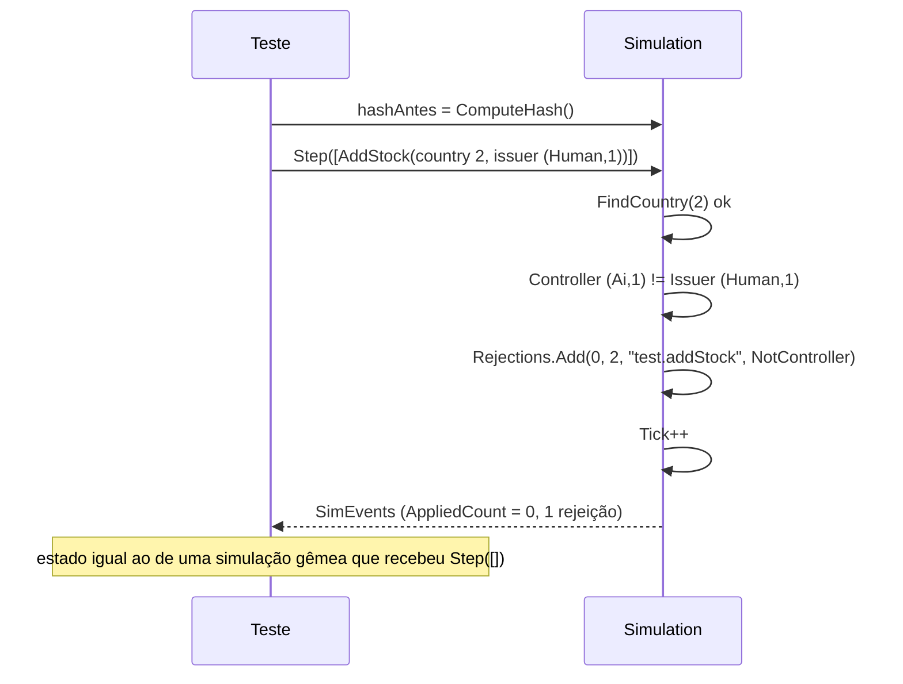

# AI-SPEC: Foundation — Fase 2: Ciclo (`Command`, `Step`, controladores, hash e determinismo)

**Data**: 2026-11-23
**Status**: Proposta
**Modulo**: `src/Sim` (`Core`, `Commands`, `Control`, `Systems`), `src/Sim.Tests` (`Core`, `Commands`, `Control`, `Determinism`, `Architecture`, `Fixtures`)
**Pre-requisitos**:
- Fase 1 (Base) — Implementado e revisado (`AI-SPEC_Foundation_Phase_1.md`, `Review_Phase_1.md`: APPROVED_WITH_OBSERVATIONS, 71 testes verdes)
- `Fixed`, `SimRandom`, `GameState.Create(GameSetup, int)`, `Country.SetStock` (internal), `GameState.Tick` (set internal), `GameState.Random` (internal) — Implementado em `src/Sim/Core` e `src/Sim/State`
- .NET 8 SDK 8.0.428 — Implementado no host (`~/.dotnet`; rodar com `zsh -ic '...'`)
**Dependencias externas**: nenhuma nova. `System.Text.Json` vem no .NET 8 (shared framework, sem pacote). Pacotes de teste inalterados (`xunit` 2.9.3, `xunit.runner.visualstudio` 2.8.2, `Microsoft.NET.Test.Sdk` 17.12.0).
**Proposal**: `docs/features/Foundation/Proposal_Foundation.md` (Fase 2 da §16)
**ADRs relacionados**: ADR-001 (Sim sem Godot), ADR-002 (determinismo: ponto fixo, RNG, hash), ADR-003 (tick fixo de 20/s; `Step` = 1 tick), ADR-004 (comandos serializáveis e `IController` comum), ADR-006 (iteração por id, sem alocação no laço quente). ADR-005, ADR-007 e ADR-008 não se aplicam a esta fase.

---

## 2. Descricao

Esta fase liga as peças da Fase 1 num **ciclo de simulação determinístico e verificado**. Toda mudança de estado passa a ocorrer só dentro de `Simulation.Step`, por um comando serializável validado contra o controlador do país ou por um sistema registrado. Humano e IA emitem comandos pela mesma interface `IController`. O estado inteiro se resume a um hash de 64 bits, e um teste de 1000 ticks prova que mesma semente + mesmos comandos dão o mesmo hash em todos os ticks. Uma varredura automática das fontes de `src/Sim` falha o build de testes se alguém introduzir `float`, `System.Random`, relógio, thread ou Godot.

O motivo é o risco F4 (score 12): o determinismo quebra por acidente e só aparece muito depois. Sem esta rede, os épicos E1–E8 construiriam sobre um núcleo não verificado. Para o dev, o valor é ter contratos estáveis (`Command`, `ISimSystem`, `IController`) e detectar no `dotnet test` qualquer regressão de determinismo.

**Capacidades**
1. `CommandRegistry` registra tipos de comando com nome estável e handler; `CommandCodec` serializa e desserializa comandos em JSON sem perda e sem `double`.
2. `CommandQueue` agenda comandos para um tick e os entrega em ordem estável no tick pedido.
3. `Simulation.Step` valida cada comando (país existe, emissor é o controlador, tipo registrado), aplica ou rejeita com evento sem lançar, roda os sistemas em ordem fixa e avança o tick em 1.
4. `IController`, `HumanController`, `AiController` (vazio) e `ControllerSet` coletam os comandos de todos os países em ordem de id, sem que a Sim distinga humano de IA.
5. `StateHasher` calcula o FNV-1a 64 do estado numa ordem canônica de bytes; `Step` vazio e `ComputeHash` não alocam memória.
6. Teste de determinismo de 1000 ticks com valores de hash fixados, controle negativo e varredura de APIs proibidas com arquivo e linha.

## 3. Escopo

### 3.1 In Scope (Fase 2 da proposta, §16)

1. **E0-5**: `Command`, `CommandHandler<T>`, `CommandRegistry`, `CommandCodec` (+ conversores JSON), `CommandRejectReason`, `CommandRejected`, `CommandQueue`, `Simulation`, `SimContext`, `SimEvents`, `ISimSystem`. RN-09 (parte do `Step`), RN-11, RN-12, RN-13 da proposta.
2. **E0-6**: `IController`, `HumanController`, `AiController` (stub), `ControllerSet`. RF-05.
3. **E0-7**: `StateHasher`, `Simulation.ComputeHash`, teste de determinismo de 1000 ticks com controle negativo, varredura de APIs proibidas. RN-14 a RN-17 da proposta.
4. Testes de alocação zero para `Step` e `ComputeHash` (CA-15 da proposta).
5. Comandos e sistema **de teste** (só em `Sim.Tests`, DD-07 da proposta) para exercitar o contrato.

### 3.2 Out of Scope

1. **Comandos de jogo** (mover, parar, construir, trocar controle): E2/E5/E7. Esta fase não cria nenhum comando em `src/Sim` (DD-07 da proposta).
2. **Rejeição de comando para unidade em batalha** (ADR-004): não há unidades; entra no E10 (combate). O enum `CommandRejectReason` será estendido lá.
3. **Troca de controle** (Humano ↔ IA) e o destino dos comandos pendentes do `HumanController` para países que ele deixou de controlar: E7.
4. **Cadência da IA** (decide a cada 10 ticks, deslocada por país) e doutrina: E6. `AiController` não emite nada.
5. **Sistemas de jogo** (Map, Movement, Economy, ...): épicos seguintes. A ordem fixa da arquitetura (`Control/AI → Tech → Production → Economy → Movement → Combat → Events`) é responsabilidade de quem monta a lista de sistemas; esta fase só garante que `Step` respeita a ordem recebida.
6. **Salvar/carregar e replay em arquivo**: Fase 2+ do jogo. Só a serialização de comando entra.
7. **`DataSet` e registries de conteúdo**: Fase 3. `GameState.Create(GameSetup, int)` continua sendo a única fábrica.
8. **Host Godot (`SimHost`) e HUD**: Fase 4. O laço de host está especificado em 5.8 só como contrato.
9. **Roslyn BannedApiAnalyzers**: não aprovado (DD-04 da proposta); a varredura é textual.
10. **Eventos por país e "o que aconteceu"**: E7/E12. `SimEvents` só tem rejeições e o tick concluído.

## 4. Situacao Atual

| Aspecto | Estado | Caminho/Referencia |
|---|---|---|
| Solução e projetos | Existe | `Rts.sln`, `src/Sim/Rts.Sim.csproj` (sem pacotes, `InternalsVisibleTo("Rts.Sim.Tests")`), `src/Sim.Tests/Rts.Sim.Tests.csproj` |
| Flags de build | Existe | `src/Directory.Build.props` (`Nullable`, `TreatWarningsAsErrors`, `ImplicitUsings=disable`, `LangVersion 12.0`, `CheckForOverflowUnderflow=false`) |
| `Fixed` | Existe, completo | `src/Sim/Core/Fixed.cs` (`readonly record struct Fixed(long Raw)`) |
| `SimRandom` | Existe, completo | `src/Sim/Core/SimRandom.cs` (`NextU64`, `NextInt`, `NextFixed`, `Snapshot`) |
| Modelo de estado | Existe, completo | `src/Sim/State/*.cs`: `GameState` (`Seed`, `Tick { get; internal set; }`, `internal Random`, `ResourceCount`, `Players`, `Universe`, `Countries`, `FindPlayer`, `FindCountry`, `Create(GameSetup, int)`), `Country` (`Controller { get; internal set; }`, `Stock` como `ReadOnlySpan<Fixed>`, `GetStock`, `internal SetStock`) |
| Ids fortes, `ControllerRef`, `ControllerKind` | Existe | `src/Sim/State/Ids.cs`, `ControllerRef.cs`, `ControllerKind.cs` (`Human = 1`, `Ai = 2`) |
| `Command`, `Step`, eventos, sistemas | Não existe | pastas `src/Sim/Commands/`, `src/Sim/Control/`, `src/Sim/Systems/` ainda não criadas |
| Hash de estado | Não existe | — |
| Varredura de APIs proibidas | Só manual (greps do CA-F1-08) | `AI-SPEC_Foundation_Phase_1.md` §15.1 |
| Fixtures de teste | Existe | `src/Sim.Tests/Fixtures/SetupFactory.cs` (`OneSystemThreeCountries`, `TwoSystemsThreeCountries`, `WorldWithCountries`, `WithCountries`, `Country(...)`) — **reusar sem modificar** |
| Teste de arquitetura | Existe | `src/Sim.Tests/Architecture/SimAssemblyTests.cs` (sem Godot) |
| Teste de alocação | Existe (padrão a seguir) | `src/Sim.Tests/Core/AllocationTests.cs` (aquecimento + `GC.GetAllocatedBytesForCurrentThread`) |

Comportamento de `System.Text.Json` no SDK 8.0.428, verificado em experimento descartável em 2026-11-23 (base para 5.5): polimorfismo com discriminador `"type"` configurado por modificador de resolver funciona com `record` posicional; `JsonPropertyInfo.IsRequired = true` é respeitado também em parâmetros de construtor (JSON sem `"country"` lança `JsonException`); `UnmappedMemberHandling.Disallow` rejeita propriedade desconhecida; discriminador fora da primeira posição ou ausente lança `NotSupportedException`; número `5.5` num `long` lança `JsonException`; o literal `null` devolve `null` sem lançar.

**Nada da Fase 1 é modificado.** Todos os arquivos desta fase são novos. Os pontos de contrato da Fase 1 usados aqui: `GameState.Tick` (set internal), `GameState.Random` (internal), `GameState.FindCountry`, `Country.Controller`, `Country.SetStock` (internal, só em handlers e sistemas de teste), ordem canônica por id das listas.

## 5. Solucao

### 5.1 Arquitetura Geral

```
 Host (teste; Godot na Fase 4)
  │  buffer.Clear()
  │  queue.TakeDue(state.Tick, buffer)          ← CommandQueue (comandos agendados)
  │  controllers.Collect(buffer)                ← ControllerSet → IController por país, em ordem de CountryId
  │                                                (HumanController | AiController)
  ▼
 Simulation.Step(buffer) ─────────────────────────────────────────────────────────────┐
  │ 1. events.Begin(T = state.Tick)                                                    │
  │ 2. para cada comando i, na ordem recebida:                                         │
  │      FindCountry? ─não→ Rejected(UnknownCountry)                                   │
  │      Issuer == country.Controller? ─não→ Rejected(NotController)                   │
  │      registry.TryGetEntry(tipo)? ─não→ Rejected(UnknownCommandType)                │
  │      handler(state, ctx, cmd) → None ⇒ Applied++ | outro ⇒ Rejected(motivo)        │
  │ 3. para cada ISimSystem, na ordem do construtor: system.Tick(state, ctx)           │
  │ 4. state.Tick = T + 1                                                              │
  └─► devolve SimEvents (mesma instância a cada Step) ──► host lê State e eventos      │
                                                                                       │
 Simulation.ComputeHash() ──► StateHasher.Compute(state) ──► ulong (FNV-1a 64) ◄───────┘

 CommandCodec(registry) : Command ⇄ JSON  (System.Text.Json, conversores de Fixed e ids)
```

Integração com a Fase 1: `Simulation` só altera o estado por `GameState.Tick` (setter internal) e pelos handlers/sistemas, que usam `Country.SetStock`, `Country.Controller` e `GameState.Random` (internal). Integração com a Fase 4: o `SimHost` executa exatamente o laço acima a cada 50 ms de tempo real acumulado.

### 5.2 Estrutura de Arquivos

```
src/
├── Sim/
│   ├── Core/
│   │   ├── Simulation.cs                 # NOVO
│   │   ├── SimContext.cs                 # NOVO
│   │   ├── SimEvents.cs                  # NOVO
│   │   └── StateHasher.cs                # NOVO
│   ├── Commands/
│   │   ├── Command.cs                    # NOVO: abstract record Command
│   │   ├── CommandHandler.cs             # NOVO: delegate CommandHandler<T>
│   │   ├── CommandRejectReason.cs        # NOVO: enum
│   │   ├── CommandRejected.cs            # NOVO: readonly record struct
│   │   ├── CommandRegistry.cs            # NOVO
│   │   ├── CommandCodec.cs               # NOVO
│   │   ├── CommandQueue.cs               # NOVO
│   │   └── Json/
│   │       ├── FixedJsonConverter.cs     # NOVO (internal)
│   │       └── IdJsonConverters.cs       # NOVO (internal; 6 conversores, um por tipo de id)
│   ├── Control/
│   │   ├── IController.cs                # NOVO
│   │   ├── HumanController.cs            # NOVO
│   │   ├── AiController.cs               # NOVO
│   │   └── ControllerSet.cs              # NOVO
│   └── Systems/
│       └── ISimSystem.cs                 # NOVO
└── Sim.Tests/
    ├── Fixtures/
    │   ├── SetupFactory.cs               # EXISTENTE — não modificar
    │   ├── TestCommands.cs               # NOVO: AddStockCommand, RollCommand, TestCommands.CreateRegistry()
    │   ├── TestIncomeSystem.cs           # NOVO
    │   ├── RecordingSystem.cs            # NOVO: sistema que registra (nome, tick) numa lista compartilhada
    │   └── DeterminismScenario.cs        # NOVO: script de 1000 ticks (5.8.3)
    ├── Commands/
    │   ├── CommandRegistryTests.cs       # NOVO: UT-BE-70..72
    │   ├── CommandCodecTests.cs          # NOVO: UT-BE-73..76
    │   └── CommandQueueTests.cs          # NOVO: UT-BE-77..79
    ├── Core/
    │   ├── SimulationStepTests.cs        # NOVO: UT-BE-80..89
    │   ├── StateHasherTests.cs           # NOVO: UT-BE-100..104
    │   └── CycleAllocationTests.cs       # NOVO: UT-BE-105
    ├── Control/
    │   └── ControllerTests.cs            # NOVO: UT-BE-90..95
    ├── Determinism/
    │   └── DeterminismTests.cs           # NOVO: E2E-BE-01..03
    └── Architecture/
        ├── SimAssemblyTests.cs           # EXISTENTE — não modificar
        ├── ForbiddenApiScanner.cs        # NOVO (só em testes)
        ├── ForbiddenApiScannerTests.cs   # NOVO: UT-BE-110..112
        └── CycleEncapsulationTests.cs    # NOVO: UT-BE-113
```

Nenhum `.csproj`, `.props` ou arquivo da Fase 1 muda. Convenções mantidas da Fase 1: `ImplicitUsings` desligado (cada arquivo declara `using`), tipos públicos `sealed`, sem LINQ em `src/Sim`, comentários só onde a regra não é óbvia, com referência ao design/ADR.

### 5.3 Modelos de Dados

Não há banco nem migração. Os modelos são tipos C#. Assinaturas exatas abaixo; o comportamento está nas regras da §5.7.

#### 5.3.1 Comando — `src/Sim/Commands/Command.cs`, `CommandHandler.cs`, `CommandRejectReason.cs`, `CommandRejected.cs`

```csharp
using System.Text.Json.Serialization;
using Rts.Sim.State;

namespace Rts.Sim.Commands;

// ADR-004: toda ação é um comando serializável com o país-alvo e o emissor.
public abstract record Command(
    [property: JsonPropertyOrder(-2)] CountryId Country,
    [property: JsonPropertyOrder(-1)] ControllerRef Issuer);
```

```csharp
using Rts.Sim.Core;
using Rts.Sim.State;

namespace Rts.Sim.Commands;

// Devolve None se aplicou; qualquer outro valor rejeita o comando.
// Contrato: o handler NÃO altera o estado quando devolve um valor diferente de None.
public delegate CommandRejectReason CommandHandler<in T>(GameState state, SimContext context, T command)
    where T : Command;
```

```csharp
namespace Rts.Sim.Commands;

public enum CommandRejectReason : byte
{
    None = 0,               // não é rejeição: handler aplicou
    UnknownCountry = 1,
    NotController = 2,
    UnknownCommandType = 3,
    InvalidArguments = 4,   // devolvido por handler (argumento fora do domínio)
}
```

```csharp
using Rts.Sim.State;

namespace Rts.Sim.Commands;

// CommandIndex: posição do comando na lista recebida por Step.
// CommandType: nome registrado; para tipo não registrado, command.GetType().Name.
public readonly record struct CommandRejected(
    int CommandIndex,
    CountryId Country,
    string CommandType,
    CommandRejectReason Reason);
```

Comandos concretos são `sealed record` derivados de `Command`, com as propriedades de payload anotadas com `[property: JsonPropertyOrder(n)]`, `n >= 1`, crescente na ordem de declaração. Nesta fase os únicos comandos concretos são os de teste (5.3.8).

**Invariantes**
- `INV-CMD-01`: todo comando que `Step` aplica tem `FindCountry(cmd.Country) != null && FindCountry(cmd.Country).Controller == cmd.Issuer`.
- `INV-CMD-02`: `CommandRejected.Reason != CommandRejectReason.None` para todo item de `SimEvents.Rejections`.
- `INV-CMD-03`: para cada `Step`, `events.AppliedCount + events.Rejections.Count == commands.Count`.

#### 5.3.2 Registro — `src/Sim/Commands/CommandRegistry.cs`

```csharp
using System;
using System.Collections.Generic;

namespace Rts.Sim.Commands;

public sealed class CommandRegistry
{
    public const int MaxTypeNameLength = 64;

    public CommandRegistry();

    public int Count { get; }                       // tipos registrados
    public bool IsFrozen { get; }

    public void Register<T>(string typeName, CommandHandler<T> handler) where T : Command;
    public void Freeze();                           // idempotente
    public bool TryGetTypeName(Type commandType, out string typeName);
    public bool TryGetCommandType(string typeName, out Type commandType);

    internal bool TryGetEntry(Type commandType, out Entry entry);   // usado por Step

    internal readonly record struct Entry(
        string TypeName,
        Type CommandType,
        Func<GameState, SimContext, Command, CommandRejectReason> Invoke);
}
```

Armazenamento interno: `Dictionary<Type, Entry>` e `Dictionary<string, Entry>` **só para busca** (nunca iterados) e `List<Entry>` em ordem de registro (a única coleção iterada, pelo `CommandCodec`). `Invoke` é criado uma vez no `Register` como `(s, c, cmd) => handler(s, c, (T)cmd)`.

**Invariantes**
- `INV-REG-01`: nomes e tipos CLR registrados são únicos (bijeção nome ↔ tipo).
- `INV-REG-02`: todo nome satisfaz `^[a-z][A-Za-z0-9]*(\.[a-z][A-Za-z0-9]*)*$` e `Length <= 64`.
- `INV-REG-03`: depois de `Freeze()`, `Count` não muda.

#### 5.3.3 Codec — `src/Sim/Commands/CommandCodec.cs`, `Json/*.cs`

```csharp
namespace Rts.Sim.Commands;

public sealed class CommandCodec
{
    public CommandCodec(CommandRegistry registry);   // chama registry.Freeze()
    public string Serialize(Command command);
    public Command Deserialize(string json);
}
```

`JsonSerializerOptions` criado uma vez no construtor (campo de instância `readonly`, nunca estático):

```csharp
var resolver = new DefaultJsonTypeInfoResolver();
resolver.Modifiers.Add(typeInfo =>
{
    if (typeInfo.Type == typeof(Command))
    {
        typeInfo.PolymorphismOptions = new JsonPolymorphismOptions
        {
            TypeDiscriminatorPropertyName = "type",
            UnknownDerivedTypeHandling = JsonUnknownDerivedTypeHandling.FailSerialization,
        };
        // um JsonDerivedType(entry.CommandType, entry.TypeName) por entrada, na ordem de registro
    }

    if (typeInfo.Kind == JsonTypeInfoKind.Object)
    {
        foreach (var property in typeInfo.Properties)
        {
            property.IsRequired = true;
        }
    }
});

_options = new JsonSerializerOptions
{
    PropertyNamingPolicy = JsonNamingPolicy.CamelCase,
    UnmappedMemberHandling = JsonUnmappedMemberHandling.Disallow,
    NumberHandling = JsonNumberHandling.Strict,
    WriteIndented = false,
    TypeInfoResolver = resolver,
};
// Converters: FixedJsonConverter, PlayerIdJsonConverter, StarSystemIdJsonConverter,
//             WorldIdJsonConverter, CountryIdJsonConverter, ResourceIdJsonConverter, TechIdJsonConverter
```

Conversores (todos `internal sealed class ... : JsonConverter<T>`):
- `FixedJsonConverter`: `Write` → `writer.WriteNumberValue(value.Raw)`; `Read` → `Fixed.FromRaw(reader.GetInt64())`. Nenhum `double`.
- `IdJsonConverters.cs`: um conversor por id (`PlayerId`, `StarSystemId`, `WorldId`, `CountryId`, `ResourceId`, `TechId`); `Write` → `writer.WriteNumberValue(value.Value)`; `Read` → `new XxxId(reader.GetInt32())`.
- `ControllerRef` usa o contrato padrão: `{"kind":<byte>,"player":<int>}` (enum numérico; `player` pelo conversor de `PlayerId`).

#### 5.3.4 Fila por tick — `src/Sim/Commands/CommandQueue.cs`

```csharp
using System.Collections.Generic;

namespace Rts.Sim.Commands;

// E0-5: "comandos aplicados no tick pedido, em ordem estável".
public sealed class CommandQueue
{
    public CommandQueue();
    public int Count { get; }                    // comandos pendentes
    public long LastTakenTick { get; }           // -1 antes do primeiro TakeDue
    public void Enqueue(long tick, Command command);
    public void TakeDue(long tick, List<Command> output);   // acrescenta; não limpa output
}
```

Armazenamento: `List<Entry>` privado, `private readonly record struct Entry(long Tick, long Sequence, Command Command)`, mantido ordenado por `(Tick, Sequence)`; `Sequence` é um contador `long` de instância incrementado a cada `Enqueue`.

**Invariantes**
- `INV-Q-01`: entradas em ordem estritamente crescente de `(Tick, Sequence)`.
- `INV-Q-02`: `∀ entrada: entrada.Tick > LastTakenTick`.

#### 5.3.5 Simulação — `src/Sim/Core/Simulation.cs`, `SimContext.cs`, `SimEvents.cs`, `src/Sim/Systems/ISimSystem.cs`

```csharp
using System.Collections.Generic;
using Rts.Sim.Commands;
using Rts.Sim.State;
using Rts.Sim.Systems;

namespace Rts.Sim.Core;

public sealed class Simulation
{
    public Simulation(GameState state, IReadOnlyList<ISimSystem> systems, CommandRegistry registry);
    public GameState State { get; }
    public SimEvents Step(IReadOnlyList<Command> commands);   // avança 1 tick
    public ulong ComputeHash();                               // => StateHasher.Compute(State)
}

public sealed class SimContext
{
    internal SimContext(SimEvents events);
    public long Tick { get; internal set; }   // tick em execução (valor de State.Tick no início do Step)
    public SimEvents Events { get; }
}

public sealed class SimEvents
{
    public const int InitialRejectionCapacity = 16;
    internal SimEvents();
    public long CompletedTick { get; }                          // -1 antes do primeiro Step
    public int AppliedCount { get; }
    public IReadOnlyList<CommandRejected> Rejections { get; }   // ReadOnlyCollection sobre List interna, criada uma vez
    internal void Begin(long tick);                             // limpa a lista, zera AppliedCount, guarda o tick
    internal void AddApplied();
    internal void AddRejection(CommandRejected rejection);
}
```

```csharp
using Rts.Sim.Core;
using Rts.Sim.State;

namespace Rts.Sim.Systems;

// CLAUDE.md §6: sistemas são funções do estado; sem dependências ocultas.
public interface ISimSystem
{
    void Tick(GameState state, SimContext context);
}
```

`Simulation` guarda: `State`, `ISimSystem[] _systems` (cópia da lista recebida), `CommandRegistry _registry`, `SimContext _context`, `SimEvents _events`. O construtor chama `registry.Freeze()`.

#### 5.3.6 Hash — `src/Sim/Core/StateHasher.cs`

```csharp
using Rts.Sim.State;

namespace Rts.Sim.Core;

// ADR-002; DD-03 da proposta: FNV-1a 64, não criptográfico, só detecta divergência.
public static class StateHasher
{
    public const ulong OffsetBasis = 14695981039346656037UL;
    public const ulong Prime = 1099511628211UL;
    public static ulong Compute(GameState state);
}
```

Implementação: um `ulong h` local, funções privadas estáticas `MixByte(ulong h, byte b) => unchecked((h ^ b) * Prime)`, `MixInt32`, `MixInt64`, `MixUInt64`, `MixString` (todas puras, recebem e devolvem `h`); bytes em little-endian extraídos por deslocamento (`(byte)(v >> (8 * i))`), nunca por `BitConverter` (que depende da arquitetura). Ordem canônica na §5.7 (RN-P2-51).

#### 5.3.7 Controladores — `src/Sim/Control/*.cs`

```csharp
using System.Collections.Generic;
using Rts.Sim.Commands;
using Rts.Sim.State;

namespace Rts.Sim.Control;

// ADR-004, RF-05: humano e IA usam a mesma API; a Sim não os distingue.
public interface IController
{
    ControllerRef Identity { get; }
    // Acrescenta a output os comandos do país para o tick. Não limpa output. Não altera o estado.
    void Collect(GameState state, CountryId country, long tick, List<Command> output);
}

public sealed class HumanController : IController
{
    public HumanController(PlayerId player);             // Identity = (Human, player)
    public ControllerRef Identity { get; }
    public int PendingCount { get; }
    public void Enqueue(Command command);                // entrada da apresentação
    public void Collect(GameState state, CountryId country, long tick, List<Command> output);
}

public sealed class AiController : IController
{
    public AiController(PlayerId player);                // Identity = (Ai, player)
    public ControllerRef Identity { get; }
    public void Collect(GameState state, CountryId country, long tick, List<Command> output); // não emite (E6)
}

public sealed class ControllerSet
{
    public ControllerSet(GameState state);
    public void Assign(CountryId country, IController controller);
    public IController? Get(CountryId country);
    public void Collect(List<Command> output);           // acrescenta; países em ordem de CountryId
}
```

`HumanController` guarda os pendentes em `List<Command>` privada. `ControllerSet` guarda `IController?[] _byCountry` com o mesmo índice de `state.Countries` (já ordenado por id na Fase 1); `Assign`/`Get` acham o índice por busca binária sobre `state.Countries` (mesmo padrão de `GameState.FindCountry`).

#### 5.3.8 Fixtures de teste — `src/Sim.Tests/Fixtures/*.cs` (só em testes)

```csharp
namespace Rts.Sim.Tests.Fixtures;

public sealed record AddStockCommand(
    CountryId Country,
    ControllerRef Issuer,
    [property: JsonPropertyOrder(1)] ResourceId Resource,
    [property: JsonPropertyOrder(2)] Fixed Amount) : Command(Country, Issuer);

public sealed record RollCommand(
    CountryId Country,
    ControllerRef Issuer,
    [property: JsonPropertyOrder(1)] ResourceId Resource,
    [property: JsonPropertyOrder(2)] int Max) : Command(Country, Issuer);

public static class TestCommands
{
    public const string AddStock = "test.addStock";
    public const string Roll = "test.roll";
    public static CommandRegistry CreateRegistry();   // registra os dois, nesta ordem, com os handlers abaixo
}
```

Handlers (em `TestCommands`):
- `test.addStock`: se `cmd.Resource.Value < 0 || cmd.Resource.Value >= state.ResourceCount` → devolve `InvalidArguments` sem alterar nada; senão `country.SetStock(r, country.GetStock(r) + cmd.Amount)` e devolve `None`. `country = state.FindCountry(cmd.Country)!` (garantido por `Step`).
- `test.roll`: se `cmd.Max <= 0` ou recurso fora do intervalo → `InvalidArguments` **sem consumir o RNG**; senão `v = state.Random.NextInt(cmd.Max)`; `SetStock(r, GetStock(r) + Fixed.FromInt(v))`; `None`.

`TestIncomeSystem : ISimSystem`: para cada país de `state.Countries` (ordem de id), se `state.ResourceCount > 0`: `SetStock(new ResourceId(0), GetStock(new ResourceId(0)) + Fixed.FromRatio(1, 20))` (`FromRatio(1, 20).Raw == 214748364`).

`RecordingSystem : ISimSystem`: construtor `(string name, List<string> log)`; `Tick` acrescenta `$"{name}@{context.Tick}"` ao `log`.

`DeterminismScenario`: ver 5.8.3.

### 5.4 API pública (substitui "Endpoints"; não há HTTP)

| Membro | Descrição | Acesso | Sucesso | Erros |
|---|---|---|---|---|
| `CommandRegistry.Register<T>(string, CommandHandler<T>)` | Registra tipo e handler | público | — | `ArgumentNullException`, `ArgumentException` (nome inválido, `T` abstrato), `InvalidOperationException` (nome/tipo repetido, registro congelado) |
| `CommandRegistry.Freeze()` | Congela (idempotente) | público | — | — |
| `CommandRegistry.TryGetTypeName(Type, out string)` | Nome de um tipo | público | `bool` | `ArgumentNullException` |
| `CommandRegistry.TryGetCommandType(string, out Type)` | Tipo de um nome | público | `bool` | `ArgumentNullException` |
| `new CommandCodec(CommandRegistry)` | Cria e congela o registro | público | instância | `ArgumentNullException` |
| `CommandCodec.Serialize(Command)` | JSON estável | público | `string` | `ArgumentNullException`, `ArgumentException` (tipo não registrado) |
| `CommandCodec.Deserialize(string)` | Comando a partir de JSON | público | `Command` | `ArgumentNullException`, `FormatException` |
| `CommandQueue.Enqueue(long, Command)` | Agenda para um tick | público | — | `ArgumentNullException`, `ArgumentOutOfRangeException` |
| `CommandQueue.TakeDue(long, List<Command>)` | Entrega os devidos | público | — | `ArgumentNullException`, `ArgumentOutOfRangeException` |
| `new Simulation(GameState, IReadOnlyList<ISimSystem>, CommandRegistry)` | Cria; congela o registro | público | instância | `ArgumentNullException`, `ArgumentException` (sistema nulo) |
| `Simulation.Step(IReadOnlyList<Command>)` | Avança 1 tick | público | `SimEvents` (mesma instância sempre) | `ArgumentNullException` (lista), `ArgumentException` (elemento nulo); **nunca** por comando inválido |
| `Simulation.ComputeHash()` | Hash do estado | público | `ulong` | — |
| `StateHasher.Compute(GameState)` | Hash do estado | público | `ulong` | `ArgumentNullException` |
| `SimEvents.CompletedTick / AppliedCount / Rejections` | Leitura | público | — | — |
| `SimEvents.Begin / AddApplied / AddRejection` | Escrita | **internal** | — | — |
| `SimContext.Tick` (set), construtor | Escrita | **internal** | — | — |
| `HumanController.Enqueue(Command)` | Entrada do jogador | público | — | `ArgumentNullException` |
| `IController.Collect(...)` | Emite comandos | público | — | `ArgumentNullException` (`state`, `output`) |
| `ControllerSet.Assign(CountryId, IController)` | Liga controlador ao país | público | — | `ArgumentNullException`, `ArgumentException` (país inexistente) |
| `ControllerSet.Get(CountryId)` | Controlador do país | público | `IController?` | — |
| `ControllerSet.Collect(List<Command>)` | Coleta de todos os países | público | — | `ArgumentNullException` |

Paginação, autenticação e anotações de API não se aplicam (biblioteca local).

### 5.5 Contratos de entrada e formato JSON (substitui "DTOs")

**Comando em JSON** (produzido por `Serialize`, aceito por `Deserialize`):

```json
{"type":"test.addStock","country":1,"issuer":{"kind":1,"player":1},"resource":2,"amount":30064771072}
```

| Campo | Posição | Tipo JSON | Regra |
|---|---|---|---|
| `type` | **1ª propriedade** (obrigatória nessa posição) | string | nome registrado; desconhecido ⇒ `FormatException` |
| `country` | 2ª | inteiro (`int`) | `CountryId.Value`; obrigatório |
| `issuer` | 3ª | objeto `{"kind":<int>,"player":<int>}` | ambos obrigatórios; `kind` numérico (não validado aqui: `Step` rejeita emissor errado) |
| payload | 4ª em diante, por `JsonPropertyOrder` | conforme o tipo | todos obrigatórios; `Fixed` = `Raw` inteiro de 64 bits; ids = inteiro |
| outro nome | — | — | proibido ⇒ `FormatException` |

Sem espaços nem quebras de linha. Nomes em camelCase, sensíveis a maiúsculas. Números de ponto flutuante (`5.5`, `1e3`) e números em string são recusados.

**Entradas de `Step`**: `IReadOnlyList<Command>` não nula, sem elementos nulos. Qualquer comando não nulo é aceito como entrada; a validação de país, emissor e tipo gera rejeição, não exceção.

### 5.6 Tratamento de erros

| Membro | Exceção | Condição | Mensagem / `paramName` |
|---|---|---|---|
| `Register<T>` | `ArgumentNullException` | `typeName` ou `handler` nulo | `paramName` do argumento |
| `Register<T>` | `ArgumentException` | nome fora de `INV-REG-02` | `"invalid command type name: {typeName}"`, `paramName = "typeName"` |
| `Register<T>` | `ArgumentException` | `typeof(T).IsAbstract` | `"command type must be concrete: {typeof(T).Name}"` |
| `Register<T>` | `InvalidOperationException` | registro congelado | `"registry is frozen"` |
| `Register<T>` | `InvalidOperationException` | nome já registrado | `"duplicate command type name: {typeName}"` |
| `Register<T>` | `InvalidOperationException` | `typeof(T)` já registrado | `"command type already registered: {typeof(T).Name}"` |
| `CommandCodec(..)` | `ArgumentNullException` | `registry` nulo | `paramName = "registry"` |
| `Serialize` | `ArgumentNullException` | `command` nulo | `paramName = "command"` |
| `Serialize` | `ArgumentException` | tipo de `command` não registrado (checar com `TryGetTypeName` antes de serializar) | `"command type not registered: {GetType().Name}"` |
| `Deserialize` | `ArgumentNullException` | `json` nulo | `paramName = "json"` |
| `Deserialize` | `FormatException` | qualquer `JsonException` ou `NotSupportedException` do `System.Text.Json`, ou resultado `null` | `"invalid command json: {mensagem interna}"`; `InnerException` = exceção original (nula no caso `null`) |
| `CommandQueue.Enqueue` | `ArgumentNullException` | `command` nulo | `paramName = "command"` |
| `CommandQueue.Enqueue` | `ArgumentOutOfRangeException` | `tick < 0 \|\| tick <= LastTakenTick` | `paramName = "tick"` |
| `CommandQueue.TakeDue` | `ArgumentNullException` | `output` nulo | `paramName = "output"` |
| `CommandQueue.TakeDue` | `ArgumentOutOfRangeException` | `tick <= LastTakenTick` | `paramName = "tick"` |
| `Simulation(..)` | `ArgumentNullException` | `state`, `systems` ou `registry` nulo | `paramName` do argumento |
| `Simulation(..)` | `ArgumentException` | `systems[i] == null` | `"systems[{i}] is null"`, `paramName = "systems"` |
| `Step` | `ArgumentNullException` | `commands` nulo | `paramName = "commands"` |
| `Step` | `ArgumentException` | `commands[i] == null` (varredura completa **antes** de qualquer mudança) | `"commands[{i}] is null"`, `paramName = "commands"` |
| `Step` | (propaga) | exceção lançada por handler ou sistema | bug do handler/sistema; `Tick` não avança; estado pode estar parcialmente alterado |
| `StateHasher.Compute` | `ArgumentNullException` | `state` nulo | `paramName = "state"` |
| `HumanController.Enqueue` | `ArgumentNullException` | `command` nulo | `paramName = "command"` |
| `*.Collect` | `ArgumentNullException` | `state`/`output` nulo | `paramName` do argumento |
| `ControllerSet(..)` | `ArgumentNullException` | `state` nulo | `paramName = "state"` |
| `ControllerSet.Assign` | `ArgumentNullException` | `controller` nulo | `paramName = "controller"` |
| `ControllerSet.Assign` | `ArgumentException` | país não existe no estado | `"unknown country: {id}"`, `paramName = "country"` |

Rejeições de comando **não** são exceções: viram `CommandRejected` em `SimEvents.Rejections` (P-04 da proposta).

| Motivo | Condição (avaliada nesta ordem) |
|---|---|
| `UnknownCountry` | `state.FindCountry(cmd.Country) == null` |
| `NotController` | `country.Controller != cmd.Issuer` (igualdade de `ControllerRef`: `Kind` e `Player`) |
| `UnknownCommandType` | `!registry.TryGetEntry(cmd.GetType(), out _)` |
| `InvalidArguments` (ou outro ≠ `None`) | devolvido pelo handler |

Inteiros formatados em mensagens usam `CultureInfo.InvariantCulture`.

### 5.7 Regras de Negocio

Mapeamento com a proposta: RN-P2-01..08 ⇐ RN-13; RN-P2-10..12 ⇐ critério do E0-5 ("tick pedido, ordem estável"); RN-P2-20..30 ⇐ RN-09, RN-11, RN-12, P-02, P-04, CA-15; RN-P2-40..44 ⇐ RF-03, RF-05, E0-6; RN-P2-50..55 ⇐ RN-14, RN-16; RN-P2-60..61 ⇐ RN-15, RN-16; RN-P2-70..71 ⇐ RN-17.

**Registro e codec** (`src/Sim/Commands/`)

- `RN-P2-01 [BLOCK]`: nome de tipo válido. Expression: `Regex.IsMatch(name, "^[a-z][A-Za-z0-9]*(\\.[a-z][A-Za-z0-9]*)*$") && name.Length <= 64`. Violação: `ArgumentException`. (Implementar sem `Regex` se preferir, com o mesmo resultado; `Regex` é permitido, não é API proibida.)
- `RN-P2-02 [BLOCK]`: bijeção nome ↔ tipo. Expression: `!names.Contains(name) && !types.Contains(typeof(T))`. Violação: `InvalidOperationException`.
- `RN-P2-03 [BLOCK]`: congelamento. Expression: `IsFrozen ⇒ Register lança`; `new Simulation(..)` e `new CommandCodec(..)` deixam `registry.IsFrozen == true`; `Freeze()` duas vezes não lança. Violação: `InvalidOperationException`.
- `RN-P2-04 [BLOCK]`: formato exato. Expression: `codec.Serialize(new AddStockCommand(new CountryId(1), new ControllerRef(ControllerKind.Human, new PlayerId(1)), new ResourceId(2), Fixed.FromInt(7))) == "{\"type\":\"test.addStock\",\"country\":1,\"issuer\":{\"kind\":1,\"player\":1},\"resource\":2,\"amount\":30064771072}"`. Violação: UT-BE-73 falha.
- `RN-P2-05 [BLOCK]`: ida e volta sem perda. Expression: `∀ c registrado: codec.Deserialize(codec.Serialize(c)) == c` (igualdade de `record`) `&& codec.Serialize(codec.Deserialize(s)) == s` para `s` canônico. Violação: UT-BE-74 falha.
- `RN-P2-06 [BLOCK]`: entrada inválida. Expression: `type` desconhecido, `type` ausente, `type` fora da 1ª posição, propriedade obrigatória ausente (inclusive `issuer.player`), propriedade desconhecida, número não inteiro, JSON malformado ou literal `null` ⇒ `FormatException`. Violação: UT-BE-75 falha.
- `RN-P2-07 [BLOCK]`: serializar tipo não registrado ⇒ `ArgumentException` (checado antes de chamar o serializador). Violação: UT-BE-76 falha.
- `RN-P2-08 [BLOCK]`: `Fixed` e ids em JSON só como inteiros. Expression: `FixedJsonConverter` usa `GetInt64`/`WriteNumberValue(long)`; nenhum `double` em `Commands/` (varredura RN-P2-70). Violação: UT-BE-110 falha.

**Fila por tick** (`CommandQueue`)

- `RN-P2-10 [BLOCK]`: só agenda para o futuro. Expression: `Enqueue(t, c)` exige `t >= 0 && t > LastTakenTick`. Violação: `ArgumentOutOfRangeException`.
- `RN-P2-11 [BLOCK]`: entrega no tick pedido, em ordem estável. Expression: `TakeDue(t, out)` acrescenta a `out` exatamente as entradas com `Tick <= t`, em ordem crescente de `(Tick, Sequence)`, remove-as e faz `LastTakenTick = t`; entradas com `Tick > t` ficam. Com chamadas em ticks consecutivos (uso normal), só saem as de `Tick == t`. Violação: UT-BE-77/78 falham.
- `RN-P2-12 [BLOCK]`: `TakeDue` monotônico. Expression: `t > LastTakenTick`. Violação: `ArgumentOutOfRangeException`.

**Step** (`Simulation`)

- `RN-P2-20 [BLOCK]`: entrada nula. Expression: `commands == null ⇒ ArgumentNullException`; `∃ i: commands[i] == null ⇒ ArgumentException`, detectado antes de aplicar qualquer comando; nos dois casos `State.Tick` e `ComputeHash()` ficam iguais aos de antes. Violação: UT-BE-88 falha.
- `RN-P2-21 [BLOCK]`: ordem recebida. Expression: comandos processados para `i = 0 .. commands.Count - 1`; cada um vê o estado deixado pelos anteriores; `Step` não reordena (DD-08 da proposta). Violação: UT-BE-81 falha.
- `RN-P2-22 [BLOCK]`: validação por comando, na ordem da tabela da §5.6 (`UnknownCountry` → `NotController` → `UnknownCommandType` → handler). Violação: UT-BE-82/83/84 falham.
- `RN-P2-23 [BLOCK]`: rejeição não muda o estado. Expression: para um `Step` cujo único comando é rejeitado (qualquer motivo) e sem sistemas, `hashDepois == StateHasher.Compute(estado equivalente com Tick + 1 sem o comando)`; na prática: duas simulações gêmeas, uma com `Step([rejeitado])` e outra com `Step([])`, têm o mesmo hash. `Step` não lança. Violação: UT-BE-82..85 falham.
- `RN-P2-24 [BLOCK]`: resultado do handler. Expression: `handler(...) == None ⇒ AppliedCount++`; senão `Rejections.Add(new CommandRejected(i, cmd.Country, typeName, motivo))`. Violação: UT-BE-85 falha.
- `RN-P2-25 [BLOCK]`: sistemas. Expression: depois de todos os comandos, cada `systems[k]` roda uma vez por `Step`, em ordem crescente de `k`, com `context.Tick == T` (tick em execução) e `state.Tick == T`. Violação: UT-BE-86 falha.
- `RN-P2-26 [BLOCK]`: avanço do tick. Expression: ao fim de `Step`, `State.Tick == T + 1` e `events.CompletedTick == T` (o valor inicial interno `-1` não é observável, pois `SimEvents` só chega ao host como retorno de `Step`). Tick só muda dentro de `Step` (RN-09 da proposta). Violação: UT-BE-80 falha.
- `RN-P2-27 [BLOCK]`: `Step` nunca lança por comando inválido (P-04). Expression: para qualquer lista sem nulos cujos handlers não lançam, `Step` retorna normalmente. Violação: UT-BE-82..84 falham.
- `RN-P2-28 [BLOCK]`: eventos reutilizados. Expression: `ReferenceEquals(sim.Step(a), sim.Step(b))`; `Rejections` e `AppliedCount` refletem só o último `Step`. Violação: UT-BE-87 falha.
- `RN-P2-29 [BLOCK]`: sem alocação por tick. Expression: delta de `GC.GetAllocatedBytesForCurrentThread()` == 0 para (a) 1000× `Step` com lista vazia e sem sistemas; (b) 1000× `Step` com a mesma lista de 3 `AddStockCommand` válidos pré-criados e `TestIncomeSystem`; (c) 1000× `ComputeHash()`. Violação: UT-BE-105 falha.
- `RN-P2-30 [BLOCK]`: construtor. Expression: copia `systems` para array próprio (mudar a lista original depois não altera a simulação); congela o registro. Violação: UT-BE-89 falha.

**Controladores** (`src/Sim/Control/`)

- `RN-P2-40 [BLOCK]`: `Collect` só acrescenta. Expression: `output.Count` depois `>=` antes, e os itens que já estavam ficam nas mesmas posições. Violação: UT-BE-90 falha.
- `RN-P2-41 [BLOCK]`: `HumanController`. Expression: `Identity == new ControllerRef(ControllerKind.Human, player)`; `Collect(state, X, tick, out)` move para `out` os pendentes com `Country == X`, em ordem de `Enqueue`, e mantém os demais na ordem original; `PendingCount` cai pelo número movido. Não altera nem valida `Issuer` (a autoridade é o `Step`, RF-03). Violação: UT-BE-91 falha.
- `RN-P2-42 [BLOCK]`: `AiController` (stub). Expression: `Identity == new ControllerRef(ControllerKind.Ai, player)`; `Collect` não acrescenta nada. Violação: UT-BE-92 falha.
- `RN-P2-43 [BLOCK]`: `ControllerSet.Collect(out)`. Expression: para `i = 0 .. state.Countries.Count - 1` (ordem de `CountryId`), se `_byCountry[i] != null`, chama `_byCountry[i].Collect(state, state.Countries[i].Id, state.Tick, out)`; país sem controlador não emite. Um mesmo controlador pode estar ligado a vários países. `Assign` repetido substitui. Violação: UT-BE-93 falha.
- `RN-P2-44 [BLOCK]`: a Sim não distingue humano de IA (RF-05). Expression: `Step` só compara `cmd.Issuer` com `country.Controller`; um comando idêntico tem o mesmo efeito e o mesmo hash resultante, venha de `HumanController`, de um `IController` de teste ou direto da lista. Violação: UT-BE-94/95 falham.

**Hash** (`StateHasher`)

- `RN-P2-50 [BLOCK]`: FNV-1a 64. Expression: `h = 14695981039346656037`; para cada byte `b`: `h = unchecked((h ^ b) * 1099511628211)`. Violação: UT-BE-100 falha.
- `RN-P2-51 [BLOCK]`: ordem canônica de bytes (todos little-endian; `i32` = 4 bytes de `int`, `i64`/`u64` = 8 bytes, `u8` = 1 byte, `str(s)` = `i32(s.Length)` seguido de cada `char` como 2 bytes little-endian):
  ```
  i64(state.Tick)
  u64(state.Seed)
  u64(S0) u64(S1) u64(S2) u64(S3)                     // state.Random.Snapshot()
  i32(state.ResourceCount)
  i32(state.Players.Count)
  para cada p em state.Players (ordem de id):         i32(p.Id.Value) str(p.Name)
  i32(state.Universe.StarSystems.Count)
  para cada s em StarSystems (ordem de id):
      i32(s.Id.Value) i32(s.Owner.Value) i32(s.Worlds.Count)
      para cada w em s.Worlds (ordem de id):
          i32(w.Id.Value) i32(w.Countries.Count)
          para cada c em w.Countries (ordem de id):
              i32(c.Id.Value) str(c.Name) u8((byte)c.Controller.Kind) i32(c.Controller.Player.Value)
              i32(c.Stock.Length)
              para cada v em c.Stock:                 i64(v.Raw)
  ```
  `state.Countries` (lista plana), `World.StarSystem` e `Country.World` não entram (são redundantes com a hierarquia). Violação: UT-BE-101 falha.
- `RN-P2-52 [BLOCK]`: valor fixado. Expression: `StateHasher.Compute(GameState.Create(SetupFactory.OneSystemThreeCountries(42), 5)) == 210089492672693724UL` (`0x02EA6347CDCC45DC`). Violação: UT-BE-101 falha.
- `RN-P2-53 [BLOCK]`: canônico e puro. Expression: o setup de `TwoSystemsThreeCountries` com todas as listas invertidas tem o mesmo hash que o original; `Compute` chamado duas vezes devolve o mesmo valor e não altera `Random.Snapshot()`. Violação: UT-BE-102 falha.
- `RN-P2-54 [BLOCK]`: sensibilidade (controle negativo, RN-16 da proposta). Expression, a partir do estado de RN-P2-52: semente 43 ⇒ `6213880399494383774UL`; `FindCountry(1).SetStock(new ResourceId(2), Fixed.FromInt(7))` ⇒ `2484201149338628319UL`; um `state.Random.NextU64()` ⇒ `13100547816691564996UL`; `Tick = 1` ⇒ diferente de `210089492672693724UL`; trocar `Controller` do país 2 para `(Human, 1)` ⇒ diferente. Violação: UT-BE-103 falha.
- `RN-P2-55 [BLOCK]`: `sim.ComputeHash() == StateHasher.Compute(sim.State)`. Violação: UT-BE-104 falha.

**Determinismo** (`src/Sim.Tests/Determinism/`)

- `RN-P2-60 [BLOCK]`: mesma semente + mesmos comandos ⇒ mesmo hash em **todos** os ticks. Expression: para o cenário da §5.8.3, duas execuções independentes têm `hashA[t] == hashB[t]` para `t = 1..1000`; e os valores fixados: `hash[1] == 7140252220498885332UL`, `hash[100] == 14189062733609157557UL`, `hash[1000] == 11368851551727198225UL` (`0x9DC6464064D92011`); total de aplicados `1495`, de rejeitados `20` (todos `NotController`). Violação: E2E-BE-01 falha.
- `RN-P2-61 [BLOCK]`: controle negativo. Expression: (a) mudar o `Amount` do comando de índice 1 do tick 503 de `FromInt(9)` para `FromInt(10)` ⇒ `hash[t]` igual para `t <= 503` e diferente para todo `t >= 504`; (b) semente 43 ⇒ `hash[1000]` diferente; (c) somar `Fixed.FromRaw(1)` ao estoque 0 do país 3 antes do tick 0 ⇒ `hash[t]` diferente para todo `t`. Violação: E2E-BE-02 falha.

**Varredura de APIs proibidas** (`src/Sim.Tests/Architecture/`)

- `RN-P2-70 [BLOCK]`: nenhum arquivo `*.cs` sob `src/Sim` (recursivo, excluindo qualquer caminho com segmento `bin` ou `obj`) contém, depois de remover comentários, uma linha que case com algum padrão abaixo. Expression: `ForbiddenApiScanner.ScanDirectory(simDir).Count == 0`. Violação: o teste falha e a mensagem lista cada violação como `{caminho relativo à raiz do repo}:{linha}: {regra} {texto da linha sem espaços nas pontas}`, uma por linha, em ordem de caminho (ordinal) e linha.

  | Regra | Padrão (`System.Text.RegularExpressions`, sem opções) | Motivo |
  |---|---|---|
  | `FB-01` | `\b(float\|double\|decimal\|Half)\b` | ponto flutuante (ADR-002) |
  | `FB-02` | `\bMathF\b\|\bMath\.(Sqrt\|Pow\|Exp\|Log\|Log2\|Log10\|Sin\|Cos\|Tan\|Asin\|Acos\|Atan\|Atan2\|Sinh\|Cosh\|Tanh\|Round\|Floor\|Ceiling\|Truncate\|Cbrt)\b` | funções que operam em `double` |
  | `FB-03` | `System\.Random\|\bnew\s+Random\s*\(\|\bRandom\.Shared\b` | aleatoriedade não semeada |
  | `FB-04` | `\bDateTime\b\|\bDateTimeOffset\b\|\bStopwatch\b\|\bTimeProvider\b\|Environment\.TickCount` | relógio de parede |
  | `FB-05` | `Guid\.NewGuid` | valor não determinístico |
  | `FB-06` | `\bThread\b\|\bThreadPool\b\|Task\.Run\|\bParallel\.\|\basync\b\|\bawait\b` | threads/concorrência na lógica |
  | `FB-07` | `using\s+Godot\|\bGodot\.\|\bGD\.\|res://` | Godot na Sim (ADR-001) |
  | `FB-08` | `\.GetHashCode\s*\(\|\bHashCode\.` | hash de objeto/string varia por processo |
  | `FB-09` | `^\s*((public\|private\|internal\|protected)\s+)*static\s+(?!readonly\b\|class\b\|partial\b\|void\b)[\w<>\[\],?. ]+\s+\w+\s*(=(?!>)\|;)` | campo `static` mutável (mesmo padrão do CA-F1-08) |

  Na tabela, `\|` é o `|` da regex (escape do Markdown). Com o código atual da Fase 1, a única ocorrência textual é um comentário em `Fixed.cs:60` (`sem Math.Sqrt`), que a remoção de comentários elimina (verificado em 2026-11-23).

  Remoção de comentários (por arquivo, antes de casar): percorrer o texto caractere a caractere com quatro modos — código, string `"..."` (com escape `\"` e `\\`), char `'...'` (com escape) e comentário de bloco `/* ... */`; em modo código, `//` descarta o resto da linha; `/*` entra em comentário de bloco até `*/`; texto em comentário é trocado por espaço, preservando as quebras de linha (a numeração de linhas não muda). Strings literais **não** são removidas (por isso `res://` dentro de string é pego). Strings verbatim `@"..."`/`$@"..."` e raw `"""` são tratadas como string comum (limitação aceita: `src/Sim` não as usa; ver DD-P2-09).
- `RN-P2-71 [BLOCK]`: o scanner detecta o que deve e só isso. Expression: os casos de UT-BE-110 e UT-BE-111 dão exatamente as violações listadas. Violação: o teste falha.

**Encapsulamento (mantém RN-P1-31)**

- `RN-P2-80 [BLOCK]`: a apresentação não muda estado pelos novos tipos. Expression: `SimEvents.Begin/AddApplied/AddRejection`, o construtor de `SimEvents`, o construtor de `SimContext`, o setter de `SimContext.Tick` e `CommandRegistry.TryGetEntry` não são públicos; `SimEvents.Rejections` não é `List<T>` e lança `NotSupportedException` em `Add`. Violação: UT-BE-113 falha.
- `RN-P2-81 [BLOCK]`: nenhum id de conteúdo em `src/Sim` (P-03). Expression: os únicos literais de string novos em `src/Sim` são mensagens de erro (§5.6), o nome do discriminador `"type"` e formatação. Nomes `test.*` existem só em `Sim.Tests`. Violação: revisão rejeita.

### 5.8 Fluxos e Diagramas de Sequencia

#### 5.8.1 Caminho feliz: comando do jogador aplicado

```mermaid
sequenceDiagram
  participant P as Apresentação/Teste
  participant H as HumanController
  participant CS as ControllerSet
  participant Q as CommandQueue
  participant S as Simulation
  participant R as CommandRegistry
  P->>H: Enqueue(AddStock(country 1, issuer (Human,1)))
  Note over P: a cada tick devido
  P->>Q: TakeDue(state.Tick, buffer)
  P->>CS: Collect(buffer)
  CS->>H: Collect(state, 1, tick, buffer)
  H-->>CS: move o comando para buffer
  CS->>CS: país 2 e 3 (AiController): nada
  P->>S: Step(buffer)
  S->>S: FindCountry(1) ok; Issuer == Controller ok
  S->>R: TryGetEntry(AddStockCommand)
  R-->>S: entry
  S->>S: entry.Invoke(state, ctx, cmd) → None; AppliedCount++
  S->>S: sistemas em ordem; Tick++
  S-->>P: SimEvents (CompletedTick = T, AppliedCount = 1)
```

#### 5.8.2 Caminho de erro: emissor não controla o país



#### 5.8.3 Cenário de determinismo (`DeterminismScenario`)

```csharp
public static class DeterminismScenario
{
    public const int Ticks = 1000;
    public const ulong StateSeed = 42;
    public const ulong ScriptSeed = 777;
    public const int ResourceCount = 5;

    // Gera a lista de comandos de cada tick (índice = tick). Mesma entrada ⇒ mesma saída.
    public static List<Command>[] BuildScript();

    // Cria estado (OneSystemThreeCountries(stateSeed), ResourceCount), registro de teste e
    // sistemas [TestIncomeSystem]; chama beforeFirstStep(state) se não nulo; roda script.Length Steps
    // passando script[t] a Step; devolve hash[t] para t = 0..Ticks (hash[0] depois de beforeFirstStep
    // e antes do primeiro Step; hash[t] depois do t-ésimo Step) e os totais somados de AppliedCount e
    // Rejections.Count.
    public static ScenarioResult Run(List<Command>[] script, ulong stateSeed = StateSeed,
        Action<GameState>? beforeFirstStep = null);
}

public sealed record ScenarioResult(ulong[] Hashes, int Applied, int Rejected, GameState FinalState);
```

`BuildScript` (ordem exata das chamadas ao RNG de script; o RNG do estado não é usado aqui):

```
script = new SimRandom(777)
issuerOf(1) = (Human, P1); issuerOf(2) = (Ai, P1); issuerOf(3) = (Ai, P1)
para t = 0 .. 999:
    lista = new List<Command>()
    n = script.NextInt(4)
    repetir n vezes:
        c    = 1 + script.NextInt(3)
        kind = script.NextInt(2)
        r    = script.NextInt(5)
        se kind == 0: lista.Add(new AddStockCommand(CountryId(c), issuerOf(c), ResourceId(r), Fixed.FromInt(script.NextInt(10))))
        senão:        lista.Add(new RollCommand(CountryId(c), issuerOf(c), ResourceId(r), 1 + script.NextInt(6)))
    se t % 50 == 49:
        lista.Add(new AddStockCommand(CountryId(2), (Human, P1), ResourceId(0), Fixed.FromInt(1000)))   // NotController
    script[t] = lista
```

Valores de referência (calculados por implementação independente das RN-P1-10/11/14 e RN-P2-50/51): 1515 comandos no total; o tick 0 tem 1 comando, `AddStock(country 1, (Human,1), resource 4, FromInt(7))`; o comando de índice 1 do tick 503 é `AddStock(country 2, (Ai,1), resource 4, FromInt(9))`; estoques finais em `Raw`: país 1 `[1529008356576, 1468878815232, 1086626725888, 1258425417728, 1292785156096]`, país 2 `[1425929141472, 1108101562368, 1331439861760, 1078036791296, 1254130450432]`, país 3 `[1348619730144, 1172526071808, 1236950581248, 1181116006400, 1387274436608]`.

#### 5.8.4 Laço de host (contrato para a Fase 4)

```
buffer = new List<Command>(capacity: 64)              // criado uma vez
a cada tick devido (no máximo 5 por quadro, RN-25 da proposta):
    buffer.Clear()
    queue.TakeDue(sim.State.Tick, buffer)
    controllers.Collect(buffer)
    events = sim.Step(buffer)
```

#### 5.8.5 Máquina de estados

Nenhuma entidade desta fase tem ciclo de vida com estados nomeados. O único estado que progride é `GameState.Tick`: transição única `T -> T + 1 [Step terminou sem exceção] (Simulation.Step)`; não há transição para trás nem salto. `CommandRegistry` tem dois estados: `Aberto -> Congelado [Freeze() ou new Simulation/CommandCodec]`; `Congelado -> Congelado [Freeze()]`; `Congelado -> Aberto` é proibido.

## 6. Frontend

Não há frontend nesta fase. `SimHost` e HUD (que consomem `Step`, `ComputeHash` e `SimEvents`) são a Fase 4. `capabilities.i18n = false`.

## 7. Integracoes

| Módulo | Tipo | Direção | Ponto | Payload |
|---|---|---|---|---|
| `State` (Fase 1) | Código | Consome | `GameState.Tick` (set internal), `Random` (internal), `FindCountry`, `Country.Controller`, `Countries` | — |
| Fase 3 (Dados) | Contrato | Nenhuma mudança | `GameState.Create(GameSetup, DataSet)` delegará para `Create(setup, int)`; `Simulation` não depende de `DataSet` | — |
| Fase 4 (Apresentação) | Contrato | Emite | laço de 5.8.4; `SimEvents`; `ComputeHash` para o HUD (8 hex) | `SimEvents` |
| E2, E5, E7 (comandos de jogo) | Contrato | Emite | registram comandos com `CommandRegistry.Register<T>` antes de criar a `Simulation` | `Command` |
| E3+ (sistemas) | Contrato | Emite | implementam `ISimSystem`; a lista em ordem fixa é passada ao construtor | — |

`SimEvents` não tem consumidores com efeito colateral nesta fase; idempotência não se aplica.

## 8. Seguranca

### 8.1 Data Isolation
Não aplicável (`capabilities.multiTenant = false`). O isolamento de jogo é a autorização de comandos (8.2).

### 8.2 Authorization
Sem RBAC nem autenticação. O controle equivalente é **o emissor do comando** (RF-03): `Step` aplica um comando só se `cmd.Issuer == country.Controller` (RN-P2-22). `HumanController` não carimba nem filtra o emissor; a única autoridade é o `Step`. Encapsulamento: só código do assembly `Rts.Sim` (e testes, por `InternalsVisibleTo`) altera estado, eventos e contexto (RN-P2-80).

### 8.3 Data Sensitivity
Nenhum campo sensível. JSON de comando é entrada não confiável: `Deserialize` aceita só tipos registrados, recusa propriedades desconhecidas e números não inteiros (RN-P2-06).

## 9. Performance

### 9.1 Índices (estruturas de busca)

| Estrutura | Chave | Operação | Custo | Justificativa |
|---|---|---|---|---|
| `CommandRegistry` (`Dictionary<Type, Entry>`) | tipo CLR | despacho em `Step` | O(1), 0 alocação | só busca, nunca iterado (CLAUDE.md §5.4) |
| `CommandRegistry` (`Dictionary<string, Entry>`) | nome | `TryGetCommandType` | O(1) | só busca |
| `GameState` (array ordenado) | `CountryId` | `FindCountry` em `Step` | O(log n), 0 alocação | Fase 1 |
| `ControllerSet._byCountry` | índice em `state.Countries` | `Collect` | O(n países) | ordem de id |
| `CommandQueue` (`List<Entry>` ordenada) | `(Tick, Sequence)` | `TakeDue` | O(k + n) | fila pequena; fora do laço quente |

### 9.2 Paginação
Não aplicável.

### 9.3 Padrões de risco

| Risco | Mitigação |
|---|---|
| Alocação por tick em `Step` | listas e eventos reutilizados; `Invoke` criado no registro; iteração por índice (sem `foreach` em interface); UT-BE-105 mede 0 byte |
| Alocação em `ComputeHash` | só locais `ulong`; strings lidas por índice; `Stock` como `ReadOnlySpan`; UT-BE-105 |
| Ordem de iteração indefinida | dicionários só para busca; sistemas e países iterados por índice em ordem fixa |
| `Rejections` crescendo além de 16 | `List.Add` aloca só no caminho de rejeição; aceito |
| `Serialize`/`Deserialize` alocam | só na borda (entrada, replay), nunca dentro de `Step` |

Orçamentos informativos (registrar o valor medido em `docs/history.md`, sem falhar teste; `assumed`): `Step` vazio < 0,1 ms; `ComputeHash` com 3 países e 5 recursos < 0,05 ms; cenário E2E-BE-01 completo < 500 ms.

## 10. Observabilidade

### 10.1 Domain Events

| Evento | Quando | Payload | Consumidor |
|---|---|---|---|
| `SimEvents.CompletedTick` | todo `Step` | `long` tick executado | HUD (Fase 4) |
| `SimEvents.AppliedCount` | todo `Step` | `int` | testes, HUD |
| `CommandRejected` | comando rejeitado | `CommandIndex`, `Country`, `CommandType`, `Reason` | testes; feedback de interface (E2) |

### 10.2 Logging
A Sim não loga (sem `Console`, `GD.Print`, relógio). Diagnóstico por eventos e exceções.

### 10.3 Auditoria
Nenhuma ação auditável. A sequência de comandos serializados é a base futura de replay (fora de escopo).

## 11. Testes

Framework xUnit 2.9.3. Comando: `zsh -ic 'cd ~/workspace/oaks/vilhight && dotnet test src/Sim.Tests'`. **Ordem obrigatória (CLAUDE.md §8, passo 4)**: escrever os testes primeiro, confirmar que falham (não compilam ou falham por `NotImplementedException`), depois implementar até passarem. Convenções da Fase 1: `public sealed class XxxTests`, nomes `Metodo_Condicao_Resultado`, `[Fact]`/`[Theory]`; **primeira linha de cada teste com o comentário `// UT-BE-xx`** (atende ao m-02 da revisão da Fase 1).

Abreviações usadas abaixo: `Human1 = new ControllerRef(ControllerKind.Human, new PlayerId(1))`; `Ai1 = new ControllerRef(ControllerKind.Ai, new PlayerId(1))`; `S0 = GameState.Create(SetupFactory.OneSystemThreeCountries(42), 5)` (cada menção a `S0`, `S0'`, `S0b` ou "S0 novo" cria uma instância nova e independente pela mesma chamada); `NewSim(state, systems...) = new Simulation(state, systems, TestCommands.CreateRegistry())`; `AddStock(c, issuer, r, amount)` = `new AddStockCommand(new CountryId(c), issuer, new ResourceId(r), amount)`; `Roll(c, issuer, r, max)` = `new RollCommand(new CountryId(c), issuer, new ResourceId(r), max)`; "simB.Step([])" é a simulação gêmea de controle.

### 11.1 Unit Tests — Sim

**Registro e codec** (`Commands/CommandRegistryTests.cs`, `CommandCodecTests.cs`)

```
UT-BE-70: Register_ValidatesNamesAndUniqueness
  - Assert: TestCommands.CreateRegistry().Count == 2
  - Assert: Throws<ArgumentException> para nomes "", "Test", "1a", "a..b", "a.", "a-b", 65× 'a'
  - Assert: nomes "a", "test.addStock", "x9.y8Z" aceitos (em registros novos)
  - Assert: Throws<InvalidOperationException> ao registrar "test.addStock" de novo (outro tipo de teste)
  - Assert: Throws<InvalidOperationException> ao registrar AddStockCommand com outro nome
  - Assert: Throws<ArgumentNullException> para nome nulo e handler nulo
  - Assert: Throws<ArgumentException> para Register<Command>(...) (abstrato)

UT-BE-71: Registry_FreezeRules
  - Assert: registry.IsFrozen == false; Freeze(); IsFrozen == true; Freeze() de novo não lança
  - Assert: Throws<InvalidOperationException> em Register depois de Freeze; Count inalterado
  - Assert: new Simulation(S0, [], r1) ⇒ r1.IsFrozen; new CommandCodec(r2) ⇒ r2.IsFrozen

UT-BE-72: Registry_Lookups
  - Assert: TryGetTypeName(typeof(AddStockCommand), out n) == true && n == "test.addStock"
  - Assert: TryGetCommandType("test.roll", out t) == true && t == typeof(RollCommand)
  - Assert: TryGetTypeName(typeof(string), out _) == false; TryGetCommandType("nope", out _) == false

UT-BE-73: Serialize_ExactFormat (RN-P2-04)
  - Assert: Serialize(AddStock(1, Human1, 2, FromInt(7))) ==
      {"type":"test.addStock","country":1,"issuer":{"kind":1,"player":1},"resource":2,"amount":30064771072}
  - Assert: Serialize(Roll(3, Ai1, 0, 6)) ==
      {"type":"test.roll","country":3,"issuer":{"kind":2,"player":1},"resource":0,"max":6}
  - Assert: Serialize(AddStock(1, Human1, 0, FromRaw(-1))) contém "\"amount\":-1"
  - Assert: Serialize do mesmo comando duas vezes dá strings idênticas

UT-BE-74: Codec_RoundTrip (RN-P2-05)
  - Dado: os 1515 comandos de DeterminismScenario.BuildScript()
  - Assert: para cada c: Deserialize(Serialize(c)) == c e o tipo concreto é o mesmo
  - Assert: AddStock com Amount Fixed.MinValue e Fixed.MaxValue fazem ida e volta exata
  - Assert: Serialize(Deserialize(s)) == s para as duas strings de UT-BE-73

UT-BE-75: Deserialize_RejectsInvalid (Theory, RN-P2-06) — todos ⇒ FormatException
  - {"type":"nope","country":1,"issuer":{"kind":1,"player":1}}
  - {"country":1,"issuer":{"kind":1,"player":1},"resource":2,"amount":5}               (sem type)
  - {"country":1,"type":"test.addStock","issuer":{"kind":1,"player":1},"resource":2,"amount":5}
  - {"type":"test.addStock","issuer":{"kind":1,"player":1},"resource":2,"amount":5}     (sem country)
  - {"type":"test.addStock","country":1,"issuer":{"kind":1},"resource":2,"amount":5}     (sem player)
  - {"type":"test.addStock","country":1,"issuer":{"kind":1,"player":1},"resource":2,"amount":5,"x":1}
  - {"type":"test.addStock","country":1,"issuer":{"kind":1,"player":1},"resource":2,"amount":5.5}
  - {"type":"test.addStock","country":1,"issuer":{"kind":1,"player":1},"resource":2,"amount":"5"}
  - {"type":"test.addStock","Country":1,"issuer":{"kind":1,"player":1},"resource":2,"amount":5}
  - null   |   {   |   []   |   "" (string vazia)
  - Assert adicional: Throws<ArgumentNullException>(() => codec.Deserialize(null!))
  - Assert adicional: para o primeiro caso, ex.InnerException é JsonException

UT-BE-76: Serialize_UnregisteredType (RN-P2-07)
  - Dado: registro só com test.addStock; codec sobre ele
  - Assert: Throws<ArgumentException>(() => codec.Serialize(Roll(1, Human1, 0, 6)))
  - Assert: Throws<ArgumentNullException>(() => codec.Serialize(null!))
```

**Fila** (`Commands/CommandQueueTests.cs`)

```
UT-BE-77: Queue_DeliversAtRequestedTickInStableOrder (RN-P2-11)
  - Dado: q; a=AddStock(1,..,amount 1), b=(amount 2), c=(amount 3), d=(amount 4)
  - Quando: Enqueue(2, a); Enqueue(1, b); Enqueue(2, c); Enqueue(1, d)
  - Assert: LastTakenTick == -1; Count == 4
  - Quando: TakeDue(0, out) ⇒ out vazio; TakeDue(1, out) ⇒ out == [b, d] (mesmas instâncias)
  - Quando: TakeDue(2, out) ⇒ out == [b, d, a, c] (acrescentou, não limpou); Count == 0; LastTakenTick == 2

UT-BE-78: Queue_TakeDueCatchesUpSkippedTicks
  - Dado: Enqueue(3, a); Enqueue(5, b); Enqueue(4, c)
  - Quando: TakeDue(4, out) ⇒ out == [a, c]; Count == 1

UT-BE-79: Queue_Guards (RN-P2-10, RN-P2-12)
  - Assert: Throws<ArgumentOutOfRangeException> Enqueue(-1, a)
  - Depois de TakeDue(5, out): Throws<ArgumentOutOfRangeException> Enqueue(5, a) e TakeDue(5, out) e TakeDue(4, out); Enqueue(6, a) ok
  - Assert: Throws<ArgumentNullException> Enqueue(0, null!) e TakeDue(0, null!)
  - Integração com Step: Enqueue(5, AddStock(1, Human1, 0, FromInt(3))); laço de 5.8.4 sem controladores;
    Assert: GetStock(0) do país 1 == Zero depois de 5 Steps (Tick == 5) e == FromInt(3) depois de 6 Steps
```

**Step** (`Core/SimulationStepTests.cs`)

```
UT-BE-80: Step_AdvancesTickByOne (RN-P2-26)
  - Dado: sim = NewSim(S0)
  - Assert: sim.State.Tick == 0; Step([]).CompletedTick == 0; State.Tick == 1
  - Assert: depois de mais 9 Steps vazios: State.Tick == 10 e o último CompletedTick == 9
  - Assert: Step([]) devolve AppliedCount == 0 e Rejections.Count == 0

UT-BE-81: Step_AppliesInReceivedOrder (RN-P2-21)
  - Dado: simA = NewSim(S0), simB = NewSim(S0') (estados iguais e independentes)
  - Quando: simA.Step([Roll(1, Human1, 0, 1000), Roll(1, Human1, 1, 1000), AddStock(1, Human1, 0, FromInt(5))])
            simB.Step([Roll(1, Human1, 1, 1000), Roll(1, Human1, 0, 1000), AddStock(1, Human1, 0, FromInt(5))])
            (os dois primeiros NextInt(1000) de new SimRandom(42) são 742 e 102)
  - Assert: simA: AppliedCount == 3; país 1: GetStock(0) == FromInt(747); GetStock(1) == FromInt(102)
  - Assert: simB: país 1: GetStock(1) == FromInt(742); GetStock(0) == FromInt(107)
  - Assert: simA.ComputeHash() != simB.ComputeHash()

UT-BE-82: Step_RejectsUnknownCountry
  - Dado: simA = NewSim(S0'), simB = NewSim(S0'') (dois estados iguais)
  - Quando: eventsA = simA.Step([AddStock(99, Human1, 0, One)]); simB.Step([])
  - Assert: eventsA.Rejections == [CommandRejected(0, CountryId(99), "test.addStock", UnknownCountry)]
  - Assert: eventsA.AppliedCount == 0; simA.ComputeHash() == simB.ComputeHash()

UT-BE-83: Step_RejectsNotController (RF-03, CA-06 da proposta)
  - Quando: simA.Step([AddStock(2, Human1, 0, One)])   // país 2 é (Ai, 1)
  - Assert: Rejections == [CommandRejected(0, CountryId(2), "test.addStock", NotController)]
  - Assert: hash igual ao de simB.Step([]); nenhuma exceção
  - Assert: AddStock(1, new ControllerRef(Human, PlayerId(2)), 0, One) também ⇒ NotController (jogador diferente)

UT-BE-84: Step_RejectsUnknownCommandType
  - Dado: UnregisteredCommand (sealed record de teste em SimulationStepTests, derivado de Command, não registrado)
  - Quando: simA.Step([new UnregisteredCommand(CountryId(1), Human1)])
  - Assert: Rejections == [CommandRejected(0, CountryId(1), "UnregisteredCommand", UnknownCommandType)]
  - Assert: hash igual ao de simB.Step([])
  - Assert (ordem de validação): UnregisteredCommand(CountryId(99), Human1) ⇒ UnknownCountry;
            UnregisteredCommand(CountryId(2), Human1) ⇒ NotController

UT-BE-85: Step_HandlerRejection (RN-P2-24)
  - Quando: Step([AddStock(1, Human1, ResourceId(5), One), Roll(1, Human1, 0, 0), AddStock(1, Human1, 0, One)])
  - Assert: AppliedCount == 1; Rejections == [(0, 1, "test.addStock", InvalidArguments), (1, 1, "test.roll", InvalidArguments)]
  - Assert: GetStock(0) == One; state.Random.Snapshot() == new SimRandom(42).Snapshot() (Roll inválido não consumiu RNG)
  - Assert (INV-CMD-03): AppliedCount + Rejections.Count == 3

UT-BE-86: Step_RunsSystemsInOrderAfterCommands (RN-P2-25)
  - Dado: log = new List<string>(); sim = NewSim(S0, RecordingSystem("A", log), RecordingSystem("B", log))
  - Quando: Step([]) duas vezes
  - Assert: log == ["A@0", "B@0", "A@1", "B@1"]
  - Dado: sim2 = NewSim(S0b, TestIncomeSystem); Step([AddStock(1, Human1, 0, FromInt(2))])
  - Assert: GetStock(0) do país 1 == FromInt(2) + FromRatio(1, 20); dos países 2 e 3 == FromRatio(1, 20)

UT-BE-87: Step_ReusesEvents (RN-P2-28)
  - Assert: ReferenceEquals(sim.Step([AddStock(2, Human1, 0, One)]), sim.Step([]))
  - Assert: depois do 2º Step: Rejections.Count == 0, AppliedCount == 0, CompletedTick == 1

UT-BE-88: Step_NullInputsThrowWithoutChangingState (RN-P2-20)
  - Assert: Throws<ArgumentNullException>(() => sim.Step(null!))
  - Assert: Throws<ArgumentException>(() => sim.Step(new Command[] { AddStock(1, Human1, 0, One), null! }))
  - Assert: depois das duas: State.Tick == 0; GetStock(0) do país 1 == Zero; ComputeHash() == 210089492672693724UL

UT-BE-89: Simulation_Constructor (RN-P2-30)
  - Assert: Throws<ArgumentNullException> para state, systems e registry nulos
  - Assert: Throws<ArgumentException> para systems = [null!]
  - Dado: systems = new List<ISimSystem> { RecordingSystem("A", log) }; sim = NewSim(..., systems); systems.Add(RecordingSystem("B", log))
  - Quando: Step([]); Assert: log == ["A@0"]
  - Assert: ReferenceEquals(sim.State, state)
```

**Controladores** (`Control/ControllerTests.cs`)

```
UT-BE-90: Collect_OnlyAppends (RN-P2-40)
  - Dado: output = [x] (um comando qualquer); human com 1 pendente para o país 1
  - Quando: human.Collect(state, CountryId(1), 0, output)
  - Assert: output.Count == 2; ReferenceEquals(output[0], x)

UT-BE-91: HumanController_FiltersByCountryInEnqueueOrder (RN-P2-41)
  - Dado: h = new HumanController(PlayerId(1)); Enqueue(a: país 1), Enqueue(b: país 2), Enqueue(c: país 1)
  - Assert: h.Identity == Human1; h.PendingCount == 3
  - Quando: h.Collect(state, CountryId(1), 0, out) ⇒ out == [a, c]; PendingCount == 1
  - Quando: h.Collect(state, CountryId(2), 0, out2) ⇒ out2 == [b]; PendingCount == 0
  - Assert: Throws<ArgumentNullException> Enqueue(null!), Collect(null!, ...), Collect(state, .., null!)

UT-BE-92: AiController_IsEmptyStub (RN-P2-42)
  - Assert: new AiController(PlayerId(1)).Identity == Ai1
  - Assert: 100 chamadas de Collect para os países 1..3 deixam output vazio

UT-BE-93: ControllerSet_CollectsInCountryIdOrder (RN-P2-43)
  - Dado: state = Create(TwoSystemsThreeCountries(), 3) (países 1, 2, 3 em mundos distintos);
          set = new ControllerSet(state); RecordingController (IController de teste que acrescenta um comando
          marcador AddStock(país, Identity, 0, FromInt(id)) e registra a ordem de chamada)
  - Quando: Assign(CountryId(3), rc); Assign(CountryId(1), rc); (país 2 sem controlador); Collect(out)
  - Assert: ordem de chamada == [1, 3]; out.Count == 2; out[0].Country == CountryId(1)
  - Assert: Get(CountryId(2)) == null; Get(CountryId(1)) == rc; Get(CountryId(99)) == null
  - Assert: Assign(CountryId(1), outro) substitui: Get(CountryId(1)) == outro
  - Assert: Throws<ArgumentException> Assign(CountryId(99), rc); Throws<ArgumentNullException> Assign(CountryId(1), null!)
  - Assert: o tick passado ao controlador é state.Tick (0, e 1 depois de um Step)

UT-BE-94: SimDoesNotDistinguishHumanFromAi (RF-05, RN-P2-44)
  - Dado: três simulações gêmeas de S0
  - Quando: sim1: HumanController(P1) com AddStock(1, Human1, 0, FromInt(4)) via ControllerSet + laço 5.8.4
            sim2: o mesmo comando passado direto em Step
            sim3: RecordingController com Identity Human1 emitindo o mesmo comando
  - Assert: os três hashes depois do Step são iguais e AppliedCount == 1 em todos

UT-BE-95: ControllerSet_EndToEndWithAiCountries
  - Dado: S0; Assign país 1 → HumanController(P1); países 2 e 3 → AiController(P1)
  - Quando: human.Enqueue(AddStock(1, Human1, 0, One)); human.Enqueue(AddStock(2, Human1, 0, One)); laço 5.8.4
  - Assert: AppliedCount == 1; Rejections == [] e human.PendingCount == 1
            (o comando do país 2 só seria coletado se o país 2 fosse ligado ao human; fica pendente — E7)
  - Quando: Step([AddStock(2, Human1, 0, One)]) direto ⇒ Rejections[0].Reason == NotController
```

**Hash** (`Core/StateHasherTests.cs`)

```
UT-BE-100: Fnv1a_Constants (RN-P2-50)
  - Assert: StateHasher.OffsetBasis == 14695981039346656037UL; Prime == 1099511628211UL

UT-BE-101: Compute_GoldenValue (RN-P2-51, RN-P2-52)
  - Assert: StateHasher.Compute(S0) == 210089492672693724UL
  - Assert: Throws<ArgumentNullException>(() => StateHasher.Compute(null!))

UT-BE-102: Compute_IsCanonicalAndPure (RN-P2-53)
  - Assert: Compute(Create(TwoSystemsThreeCountries(), 3)) == Compute(Create(<mesmo setup com todas as listas invertidas>, 3))
  - Assert: Compute(S0) chamado 2× dá o mesmo valor; S0.Random.Snapshot() inalterado

UT-BE-103: Compute_IsSensitive (RN-P2-54)
  - Assert: Compute(Create(OneSystemThreeCountries(43), 5)) == 6213880399494383774UL
  - Assert: depois de FindCountry(1).SetStock(ResourceId(2), FromInt(7)): == 2484201149338628319UL
  - Assert: num S0 novo, depois de Random.NextU64(): == 13100547816691564996UL
  - Assert: num S0 novo com Tick = 1 (setter internal): != 210089492672693724UL
  - Assert: num S0 novo com FindCountry(2).Controller = Human1: != 210089492672693724UL
  - Assert: Compute(Create(OneSystemThreeCountries(42), 4)) != 210089492672693724UL (ResourceCount entra)

UT-BE-104: SimulationComputeHash_DelegatesToHasher (RN-P2-55)
  - Assert: NewSim(S0).ComputeHash() == StateHasher.Compute(S0); idem depois de 3 Steps com comandos
```

**Alocação** (`Core/CycleAllocationTests.cs`, padrão de `AllocationTests.cs`)

```
UT-BE-105: Step_AndHash_DoNotAllocate (RN-P2-29, CA-15 da proposta)
  - (a) sim = NewSim(S0) sem sistemas; empty = Array.Empty<Command>(); 100 Steps de aquecimento;
        before; 1000× sim.Step(empty); after ⇒ Assert.Equal(0, after - before)
  - (b) sim = NewSim(S0b, TestIncomeSystem); cmds = new List<Command> { AddStock(1, Human1, 0, One),
        AddStock(1, Human1, 1, One), AddStock(1, Human1, 2, One) } (criados antes da medição);
        100 Steps de aquecimento; 1000× Step(cmds) ⇒ delta 0; Assert: último AppliedCount == 3
  - (c) 1000× sim.ComputeHash() acumulando num ulong local (Assert.NotEqual(0UL, acc)) ⇒ delta 0
```

**Varredura e encapsulamento** (`Architecture/*.cs`)

`ForbiddenApiScanner` (estático, só em testes):
- `public static string StripComments(string source)` — algoritmo de RN-P2-70.
- `public static IReadOnlyList<Violation> ScanSource(string relativePath, string source)`.
- `public static IReadOnlyList<string> ListSourceFiles(string repoRoot, string relativeDir)` — `*.cs` recursivos, excluindo caminhos com segmento `bin` ou `obj`; caminhos relativos à raiz com `/` como separador, em ordem ordinal.
- `public static IReadOnlyList<Violation> ScanDirectory(string repoRoot, string relativeDir)` — `ScanSource` de cada arquivo de `ListSourceFiles`, concatenado nessa ordem.
- `public static string FindRepoRoot()` — sobe a partir de `AppContext.BaseDirectory` até um diretório que contenha `Rts.sln`; se não achar, lança `InvalidOperationException("Rts.sln not found above " + base)`.
- `public sealed record Violation(string Path, int Line, string Rule, string Text)`; `ToString()` ⇒ `"{Path}:{Line}: {Rule} {Text}"`.

```
UT-BE-110: Scanner_DetectsForbiddenApis (Theory: fonte de 1 linha → regra esperada; linha esperada 1)
  - "float x = 1;" → FB-01            - "var d = 2.0d; double y;" → FB-01
  - "decimal m;" → FB-01              - "var r = Math.Sqrt(v);" → FB-02
  - "var r = MathF.PI;" → FB-02       - "var r = new System.Random(1);" → FB-03
  - "var r = new Random(1);" → FB-03  - "var t = DateTime.Now;" → FB-04
  - "var s = Stopwatch.StartNew();" → FB-04   - "var t = Environment.TickCount64;" → FB-04
  - "var g = Guid.NewGuid();" → FB-05 - "Task.Run(() => { });" → FB-06
  - "new Thread(Work);" → FB-06       - "using Godot;" → FB-07
  - "var p = \"res://data\";" → FB-07 - "var h = name.GetHashCode();" → FB-08
  - "private static int _count;" → FB-09   - "static List<int> Cache = new();" → FB-09
  - Assert adicional: fonte "int a;\nint b;\nfloat c;" ⇒ uma violação com Line == 3

UT-BE-111: Scanner_IgnoresCommentsAndAllowedForms (Theory: fonte → 0 violações)
  - "// double is forbidden"          - "int x = 1; // DateTime.Now"
  - "/* float\n double */ int y;"     - "public static readonly Fixed Zero = new(0L);"
  - "public const int Max = 8;"       - "public static Fixed operator +(Fixed a, Fixed b) => new(a.Raw + b.Raw);"
  - "private static string Num(int v) => v.ToString();"   - "public static class StateHasher"
  - "var r = Math.Max(a, b);"         - "var s = \"// not a comment\"; int z;"
  - "long doubled = 2;"               (palavra contém "double" mas não casa \bdouble\b)
  - Assert adicional: StripComments("a /* x\ny */ b") == "a     \n     b" (mesmo número de quebras de linha;
    comentário trocado por espaços, 1 por caractere)

UT-BE-112: SimSources_HaveNoForbiddenApis (RN-P2-70, CA-10 da proposta)
  - Dado: root = FindRepoRoot(); violations = ScanDirectory(root, "src/Sim")
  - Assert: ListSourceFiles(root, "src/Sim") contém "src/Sim/Core/Fixed.cs", "src/Sim/Core/Simulation.cs" e
            "src/Sim/State/GameState.cs", e nenhum caminho com segmento "obj" ou "bin"
  - Assert: violations.Count == 0; mensagem de falha = string.Join("\n", violations)

UT-BE-113: Cycle_IsReadOnlyForPresentation (RN-P2-80)
  - Assert: typeof(SimEvents).GetMethod("Begin"/"AddApplied"/"AddRejection") == null (não públicos)
  - Assert: typeof(SimEvents).GetConstructors() e typeof(SimContext).GetConstructors() vazios (públicos)
  - Assert: typeof(SimContext).GetProperty("Tick")!.SetMethod!.IsPublic == false
  - Assert: typeof(CommandRegistry).GetMethod("TryGetEntry") == null
  - Assert: events.Rejections não é List<CommandRejected>; Throws<NotSupportedException> em ((IList<CommandRejected>)events.Rejections).Add(default)
```

### 11.2 Unit Tests — Frontend
Sem frontend nesta fase (Fase 4).

### 11.3 Unit Tests — outros serviços
Não se aplica.

### 11.4 E2E Tests — Sim headless (`Determinism/DeterminismTests.cs`)

```
E2E-BE-01: SameSeedSameCommands_SameHashEveryTick (RN-P2-60, CA-03 da proposta)
  - Dado: script = DeterminismScenario.BuildScript(); A = Run(script); B = Run(DeterminismScenario.BuildScript())
  - Assert: script.Sum(l => l.Count) == 1515; script[0].Count == 1; script[0][0] == AddStock(1, Human1, 4, FromInt(7))
  - Assert: A.Hashes.Length == 1001; A.Hashes[0] == 210089492672693724UL
  - Assert: para t = 0..1000: A.Hashes[t] == B.Hashes[t] (mensagem de falha cita o primeiro t divergente)
  - Assert: A.Hashes[1] == 7140252220498885332UL; A.Hashes[100] == 14189062733609157557UL;
            A.Hashes[1000] == 11368851551727198225UL
  - Assert: A.Applied == 1495; A.Rejected == 20; A.FinalState.Tick == 1000
  - Assert: estoques finais (Raw) == os da §5.8.3

E2E-BE-02: NegativeControls (RN-P2-61, CA-04 da proposta)
  - (a) script2 = BuildScript(); script2[503][1] == AddStock(2, Ai1, 4, FromInt(9)) (Assert);
        script2[503][1] = AddStock(2, Ai1, 4, FromInt(10)); C = Run(script2)
        Assert: C.Hashes[t] == A.Hashes[t] para t <= 503; C.Hashes[t] != A.Hashes[t] para t = 504..1000
  - (b) D = Run(BuildScript(), stateSeed: 43); Assert: D.Hashes[1000] != A.Hashes[1000]
  - (c) E = Run(BuildScript(), beforeFirstStep: s => s.FindCountry(new CountryId(3))!.SetStock(new ResourceId(0),
            s.FindCountry(new CountryId(3))!.GetStock(new ResourceId(0)) + Fixed.FromRaw(1)))
        Assert: E.Hashes[t] != A.Hashes[t] para todo t = 0..1000

E2E-BE-03: CommandsSurviveSerializationInDeterminismRun (RN-P2-05 + RN-P2-60)
  - Dado: script; scriptJson = cada comando passado por codec.Deserialize(codec.Serialize(c))
  - Assert: Run(scriptJson).Hashes[1000] == 11368851551727198225UL
```

### 11.5 / 11.6
Não se aplica.

## 12. Migracao / Seed

### 12.1 Migration
Nenhuma.

### 12.2 Seed Data
Nenhum arquivo de dados. Fixtures só em `src/Sim.Tests/Fixtures/` (5.3.8), com ids numéricos e nomes `test.*`, nunca ids de conteúdo.

### 12.3 Environment Variables
Nenhuma nova variável de ambiente.

## 13. Dependencias de Pacotes

Nenhum novo pacote necessário. `System.Text.Json` faz parte do .NET 8 (DD-09 da proposta). `Rts.Sim` continua sem `PackageReference`.

## 14. Fases de Implementacao

Esta spec é a **Fase 2** das quatro da proposta (§16):

| Fase | Escopo | Dependências | Entregável | Spec |
|---|---|---|---|---|
| Fase 1: Base | E0-1 (.NET), E0-2, E0-3, E0-4 | — | `Fixed`, `SimRandom`, `GameState` | `AI-SPEC_Foundation_Phase_1.md` (implementada) |
| **Fase 2: Ciclo** | E0-5, E0-6, E0-7 | Fase 1 | `Step`, comandos, fila, controladores, hash, determinismo, varredura | **este documento** |
| Fase 3: Dados | E0-8 | Fase 1 | carregador/validador, `Create(GameSetup, DataSet)` | `AI-SPEC_Foundation_Phase_3.md` |
| Fase 4: Apresentação | E0-9 e projeto Godot | Fases 2 e 3 | jogo roda a Sim a 20 ticks/s | `AI-SPEC_Foundation_Phase_4.md` |

Ordem de trabalho dentro da Fase 2 (cada passo: testes primeiro, falham, implementar, passam):
1. Esqueletos com `throw new NotImplementedException()` de todos os tipos da §5.3 (para os testes compilarem).
2. `ForbiddenApiScanner` + UT-BE-110..112 (UT-BE-112 já deve passar sobre o código da Fase 1 e os esqueletos).
3. `CommandRegistry` + fixtures de comando (UT-BE-70..72).
4. `SimEvents`, `SimContext`, `Simulation.Step` (UT-BE-80..89, exceto os que usam hash: implementar o passo 5 antes de rodá-los).
5. `StateHasher` (UT-BE-100..104).
6. `CommandQueue` (UT-BE-77..79).
7. Controladores (UT-BE-90..95).
8. `CommandCodec` e conversores (UT-BE-73..76).
9. `DeterminismScenario` + E2E-BE-01..03; UT-BE-105; UT-BE-113.
10. `dotnet build`, `dotnet test`, `dotnet format --verify-no-changes`; registrar START/END e tempos medidos em `docs/history.md`.

### Decisões de design desta fase e divergências da proposta (para aprovação)

Cada item abaixo diverge da proposta (`Proposal_Foundation.md`) ou a completa onde ela é omissa. Nenhum contradiz ADR.

- **DD-P2-01 · Assinatura do handler.** Proposta (§5.1): `Register<T>(string, Action<GameState, T>)`. Spec: `Register<T>(string, CommandHandler<T>)` com `CommandHandler<T>(GameState, SimContext, T) → CommandRejectReason`. Motivo: os épicos seguintes precisam rejeitar comandos por regra de domínio (sem caminho no E3-1, recurso insuficiente no E5, unidade em batalha no E10) e emitir eventos; mudar a assinatura depois afetaria todos os handlers (risco R-05). Acrescenta o motivo `InvalidArguments` e `None` ao enum.
- **DD-P2-02 · `CommandCodec` é instância, não estático.** Proposta: `CommandCodec.Serialize(Command)`/`Deserialize(string)` como membros estáticos. Spec: `new CommandCodec(registry)`. Motivo: o codec precisa conhecer os tipos registrados, e um registro estático seria estado estático mutável (proibido, CLAUDE.md §5.4). O formato JSON exato (discriminador `"type"` na 1ª posição, camelCase, `Fixed` por `Raw`, todos os campos obrigatórios, propriedade desconhecida é erro) é fixado aqui; a proposta só dizia "JSON estável com `type`".
- **DD-P2-03 · `CommandQueue` (fila por tick) acrescentada.** A proposta não tem fila; o Backlog (E0-5: "fila por tick... comandos aplicados no tick pedido, em ordem estável") e a arquitetura ("fila de cmds" no Core) pedem. A fila fica fora do `Step` (o host a esvazia no tick certo), e `Step` continua recebendo a lista do tick.
- **DD-P2-04 · `ControllerSet.Collect(List<Command> output)`.** Proposta: `ControllerSet.Collect(state, tick) → List<Command>`. Spec: o `ControllerSet` guarda o `GameState` do construtor, usa `state.Tick` e **acrescenta** a um buffer do chamador. Motivo: zero alocação por tick e composição com a `CommandQueue` no mesmo buffer. `IController.Collect` mantém a assinatura da proposta. Acrescenta `IController.Identity` e os construtores `HumanController(PlayerId)`/`AiController(PlayerId)`.
- **DD-P2-05 · Registro congelável.** Não previsto na proposta. `new Simulation(..)` e `new CommandCodec(..)` congelam o registro, para que o conjunto de tipos não mude durante a partida (determinismo e codec coerente).
- **DD-P2-06 · Forma de `SimEvents`.** Proposta: eventos `TickCompleted(long tick)` e `CommandRejected(CountryId, string type, CommandRejectReason)`. Spec: `TickCompleted` vira a propriedade `SimEvents.CompletedTick` (sempre existe, um por `Step`); `CommandRejected` ganha `CommandIndex`; acrescenta `AppliedCount`. Mesmo conteúdo, sem objeto alocado por tick.
- **DD-P2-07 · Entrada nula em `Step` lança.** P-04 diz que `Step` nunca lança por comando inválido. Spec: lista nula ou elemento nulo é erro de programação do host e lança (`ArgumentNullException`/`ArgumentException`) antes de qualquer mudança. Comandos não nulos inválidos continuam virando rejeição.
- **DD-P2-08 · Conteúdo do hash ampliado.** RN-14 da proposta lista tick, RNG, jogadores, sistemas, mundos, países, controlador e estoque. A spec acrescenta `Seed`, `ResourceCount`, nomes e contagens/comprimentos como prefixo (evita colisão por concatenação ambígua) e fixa valores de referência (RN-P2-52, RN-P2-60). A proposta só pedia igualdade entre duas execuções; o valor fixado também pega divergência entre máquinas, versões do .NET e ordem de dicionário que seja estável dentro de um processo.
- **DD-P2-09 · Varredura ampliada.** RN-17 da proposta: `float`, `double`, `System.Random`, `DateTime`, `Stopwatch`, `Guid.NewGuid`, `using Godot`, `static` mutável, `Thread`/`Task.Run`. A spec acrescenta `decimal`/`Half`, funções de `Math` em `double` e `MathF`, `DateTimeOffset`/`TimeProvider`/`Environment.TickCount`, `Random.Shared`, `ThreadPool`/`Parallel`/`async`/`await`, `GD.`/`res://` (CLAUDE.md §5.1) e `GetHashCode`/`HashCode` (hash de string varia por processo). Ignora comentários de linha **e de bloco**, preservando a numeração. Limitações aceitas: análise textual; iteração de `Dictionary`/`HashSet` e `static readonly` de coleção mutável não são detectáveis e seguem por revisão; strings verbatim/raw tratadas como comuns.
- **DD-P2-10 · `HumanController` filtra por país e guarda o resto.** Proposta só diz "`Enqueue(Command)` recebe a entrada da apresentação". Spec: um `HumanController` por jogador humano; `Collect` entrega os pendentes do país pedido e mantém os demais. O destino dos pendentes de país que o jogador deixou de controlar é do E7 (troca de controle).
- **Observação — conflito proposta × arquitetura da inception (sem mudança nesta spec).** `Architecture_Overview.md` §3 diz que `Step` aplica comandos "por país, em ordem de id" e "por fim atualiza o hash". A proposta (DD-08 e §8) decide ordem recebida, com o `ControllerSet` dando a ordem por país, e hash sob demanda. Esta spec segue a proposta aprovada. O resultado prático é o mesmo quando o host usa o laço de 5.8.4: comandos agendados primeiro, depois os dos controladores, em ordem de país. Se o operador preferir que o próprio `Step` ordene por país, mudar RN-P2-21 e UT-BE-81.

## 15. Criterios de Aceitacao

### 15.1 Fase 2

- `CA-F2-01`: `zsh -ic 'dotnet build Rts.sln'` termina com 0 erros e 0 avisos; nenhum `.csproj`/`.props` mudou; `Rts.Sim` continua sem `PackageReference`. (CA-01 da proposta)
- `CA-F2-02`: `zsh -ic 'dotnet test src/Sim.Tests'` passa todos os testes da Fase 1 (71) e os desta fase: UT-BE-70..95, UT-BE-100..105, UT-BE-110..113, E2E-BE-01..03. (CA-02)
- `CA-F2-03`: `zsh -ic 'dotnet format Rts.sln --verify-no-changes'` termina com código 0. (CA-01)
- `CA-F2-04`: duas execuções do cenário de 1000 ticks têm o mesmo hash em cada tick, e `hash[1000] == 11368851551727198225` (E2E-BE-01). (CA-03, RF-07, E0-7)
- `CA-F2-05`: mudar um comando, a semente ou um estoque muda o hash, e a divergência começa exatamente no tick esperado (E2E-BE-02, UT-BE-103). (CA-04)
- `CA-F2-06`: um comando válido altera o estado e faz ida e volta por `Serialize`/`Deserialize` sem perda, com o formato JSON exato de UT-BE-73 (UT-BE-73, UT-BE-74, E2E-BE-03). (CA-05)
- `CA-F2-07`: comando de emissor que não controla o país, de país inexistente ou de tipo não registrado é rejeitado com `CommandRejected` do motivo correto; o hash é igual ao de um `Step([])` gêmeo; `Step` não lança (UT-BE-82..84). (CA-06, RF-03, E0-5)
- `CA-F2-08`: comando agendado para o tick `T` só altera o estado no `Step` do tick `T`; comandos do mesmo tick saem na ordem de agendamento (UT-BE-77..79). (E0-5)
- `CA-F2-09`: `HumanController` e `AiController` emitem pela mesma API, e o mesmo comando tem o mesmo efeito venha de onde vier (UT-BE-90..95). (E0-6, RF-05)
- `CA-F2-10`: inserir em `src/Sim` qualquer construção de UT-BE-110 faz UT-BE-112 falhar com `caminho:linha: regra texto`; o código atual passa. Verificação manual: acrescentar `// teste` + `float f;` num arquivo de `src/Sim`, rodar o teste, ver a falha com arquivo e linha, e desfazer. (CA-10)
- `CA-F2-11`: `Step` vazio, `Step` com 3 comandos válidos e `ComputeHash` não alocam memória gerenciada (UT-BE-105). (CA-15)
- `CA-F2-12`: nenhum membro novo que altera estado, eventos ou contexto é público (UT-BE-113); nenhum id de conteúdo nem nome `test.*` em `src/Sim` (revisão; `grep -rn '"test\.' src/Sim` vazio).
- `CA-F2-13`: `docs/history.md` recebe START/END da implementação da fase com o tempo real gasto e os orçamentos informativos medidos da §9.3. (Definição de pronto, gate G-3)

### 15.2 Final (feature Foundation, após as 4 fases)

- `CA-FINAL-01`: os CA-01 a CA-15 da proposta estão verdes, cada um verificado na spec da fase correspondente.
- `CA-FINAL-02`: i18n não se aplica (`capabilities.i18n = false`).
- `CA-FINAL-03`: `dotnet test src/Sim.Tests` passa, incluindo o teste de determinismo de 1000 ticks (esta fase).
- `CA-FINAL-04`: `dotnet build Rts.sln` e `godot4 --headless --path game --build-solutions --quit` compilam sem erros (Fase 4).

## 16. Cross-Layer Mapping

Não há banco, DTO HTTP nem frontend. Mapeamento equivalente: requisito → tipo → JSON → hash → consumidor.

| Requisito | Tipo / membro | JSON (`CommandCodec`) | Entra no hash? | Consumidor |
|---|---|---|---|---|
| RF-02 (comando com `CountryId`) | `Command.Country` | `"country"` (int) | não (o efeito do comando entra) | `Step` (`FindCountry`) |
| RF-03 (só o controlador) | `Command.Issuer`, `Country.Controller` | `"issuer":{"kind","player"}` | `Controller.Kind`, `Controller.Player` | `Step` (`NotController`) |
| RF-05 (humano = IA) | `IController.Identity`, `Collect` | — | — | `ControllerSet`, host (Fase 4) |
| E0-5 (tick pedido) | `CommandQueue.Enqueue(tick, ..)` | — | `Tick` | host (5.8.4) |
| RN-09 (tick +1) | `GameState.Tick`, `SimEvents.CompletedTick` | — | `i64(Tick)` | HUD (Fase 4) |
| P-04 (rejeição por evento) | `CommandRejected` | — | não | testes, interface (E2) |
| RF-07 (hash) | `StateHasher.Compute`, `Simulation.ComputeHash` | — | — | testes, HUD (8 hex) |
| `Fixed` em comando | `FixedJsonConverter` | `Raw` (int64) | `i64(Raw)` no estoque | handlers |
| Ids em comando | `*IdJsonConverter` | `Value` (int) | `i32(Value)` | handlers |
| RNG | `GameState.Random` (internal) | — | `u64(S0..S3)` | handlers e sistemas |

---

## Checklist de qualidade (autoverificação)

- [x] Invariantes `INV-CMD-*`, `INV-REG-*`, `INV-Q-*` como predicados; invariantes `INV-GS-*` da Fase 1 mantidos
- [x] Toda regra com id, severidade e expressão (`RN-P2-*`)
- [x] Máquina de estados: `Tick` e congelamento do registro enumerados (5.8.5)
- [x] Auditoria: "nenhuma"
- [x] Sem termos vagos; valores de hash e de estoque fixados por implementação de referência independente
- [x] Rastreio: E0-5/6/7 → RN da proposta → RN-P2 → UT-BE/E2E-BE → arquivo
- [x] Estrutura de arquivos exata; nenhum arquivo da Fase 1 modificado
- [x] Nenhum pacote novo; fora de escopo explícito
- [x] Divergências da proposta registradas (DD-P2-01..10) e conflito com a arquitetura anotado
- [x] Módulo-alvo: sem descritores de módulo; feature em `docs/features/Foundation/`
