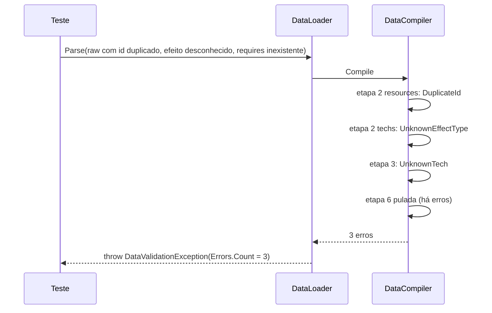

# AI-SPEC: Foundation — Fase 3: Dados (carregador e validador de `resources.json` e `techs.json`)

**Data**: 2026-11-23
**Status**: Proposta
**Modulo**: `src/Sim` (`Data` novo; `State/GameState.cs` modificado), `src/Sim.Tests` (`Data`, `State`, `Architecture`, `Fixtures`), `game/data/` (novo: `resources.json`, `techs.json`)
**Pre-requisitos**:
- Fase 1 (Base): Implementado e revisado (`Review_Phase_1.md`: APPROVED_WITH_OBSERVATIONS). `Fixed`, `SimRandom`, `GameState.Create(GameSetup, int)`, ids fortes `ResourceId`/`TechId`.
- Fase 2 (Ciclo): Implementado e revisado (`Review_Phase_2.md`: APPROVED_WITH_OBSERVATIONS, 153 testes verdes). `StateHasher`, `Simulation`, `ForbiddenApiScanner` (reusado aqui).
- .NET 8 SDK 8.0.428: Implementado no host (`~/.dotnet`; rodar com `zsh -ic '...'`).
**Dependencias externas**: nenhuma nova. `System.Text.Json` (`JsonDocument`) vem no .NET 8. Pacotes de teste inalterados (`xunit` 2.9.3, `xunit.runner.visualstudio` 2.8.2, `Microsoft.NET.Test.Sdk` 17.12.0).
**Proposal**: `docs/features/Foundation/Proposal_Foundation.md` (Fase 3 da §16: história E0-8)
**ADRs relacionados**: ADR-005 (orientado a dados, validação, efeitos declarativos) é o principal. Também ADR-001 (a Sim recebe o caminho dos dados como `string`, sem Godot) e ADR-002 (sem `float`; quantidades viram `Fixed`; ordem determinística). ADR-003, 004, 006, 007 e 008 não se aplicam a esta fase.

---

## 2. Descricao

Esta fase cria a porta de entrada de todo o conteúdo do jogo. `DataLoader.Load(dataDir)` lê `resources.json` e `techs.json` e entrega um `DataSet` imutável com dois registries (`ResourceRegistry`, `TechRegistry`). Neles, cada id textual do JSON vira um índice denso (`ResourceId`, `TechId`). Antes de montar o `DataSet`, o validador confere estrutura, ids, referências, ciclos na árvore, coerência de revelação e alcançabilidade. Ele **coleta todos os erros** e os lança juntos numa `DataValidationException`, cada um com arquivo, caminho JSON, id, código e texto. Também cria o conjunto de exemplo em `game/data/` (5 recursos, 4 techs) e a sobrecarga `GameState.Create(GameSetup, DataSet)`.

O objetivo é cumprir o ADR-005 e o RF-06: conteúdo só entra por JSON validado, e nenhum id de conteúdo fica no código. Assim os épicos seguintes (economia, tecnologia, IA) partem de dados já garantidos, e um erro de digitação no JSON aparece no carregamento com mensagem clara, não como bug no meio da partida (RNF-05, risco F8).

**Capacidades**
1. Ler `resources.json` e `techs.json` de um diretório (até 1 MiB cada) ou de texto em memória (`RawData`), sem disco nos testes.
2. Validar estrutura estrita: propriedades obrigatórias, desconhecidas e duplicadas, tipos JSON, inteiros de 32 bits, enums, formato de id e ids únicos.
3. Validar referências (`requires`, `cost`, `revealedBy`, efeitos com recurso), ciclos com o caminho (`a → b → a`), coerência `revealedBy` ⇔ `revealResource` e alcançabilidade de todo recurso e toda tech.
4. Reconhecer os 8 tipos de efeito do design como registros tipados, sem handlers (E8-2).
5. Registrar como **aviso** as referências a construções, unidades e receitas, que ainda não têm arquivo (DD-05 da proposta), e guardá-las para validação cruzada futura.
6. Montar registries imutáveis com ids densos na ordem do arquivo, e criar o estado inicial a partir do `DataSet`.
7. Verificar automaticamente que nenhum id de conteúdo de `game/data` aparece como literal em `src/Sim` (ADR-005).

## 3. Escopo

### 3.1 In Scope (Fase 3 da proposta, §16)

1. **E0-8**: `RawData`, `DataLoader`, `DataValidator`, `DataSet`, `ResourceRegistry`, `TechRegistry`, `ResourceDef`, `TechDef`, `ResourceAmount`, `TechEffect` e os 8 registros de efeito, `DataError`, `DataErrorCode`, `DataSeverity`, `DataValidationException`, `PendingReference`, `ContentKind`, `DataLimits`, `DataFiles` (RN-18 a RN-24 da proposta).
2. Sobrecarga `GameState.Create(GameSetup, DataSet)` (DD-P1-02 da Fase 1).
3. `game/data/resources.json` (5 recursos) e `game/data/techs.json` (4 techs), com o conteúdo exato da §12.2.
4. Testes headless do validador, do carregador, do conjunto de exemplo, do encapsulamento e da varredura de literais de id de conteúdo (ADR-005).

### 3.2 Out of Scope

1. **`recipes.json`, `buildings.json`, `units.json`, `doctrines.json`, `maps/*.json`**: épicos E5, E6 e E1. As referências a construção, unidade e receita ficam como `PendingReference` com aviso (DD-05 da proposta). A alcançabilidade de construções (RF-06, "toda construção alcançável") entra com `buildings.json` no E5.
2. **Handlers de efeito** (`IEffectHandler`, aplicar efeito ao país): E8-2. Aqui os efeitos são só dados validados.
3. **Estado por país derivado do conteúdo** (techs pesquisadas, recursos revelados, limites de coleta): E8/E9 e E4.
4. **Sistema de pesquisa** (fila, custo crescente de 10% por tier, cancelamento): E8-1.
5. **`eraLabels`** do exemplo do design: dependem da tela da árvore e da era exibida (E8/E12). Não há arquivo nem campo nesta fase.
6. **Guardar o `DataSet` no `GameState` ou no hash**: `GameState` só usa `Resources.Count`. Uma impressão digital do conteúdo para multiplayer é Fase 2+ do jogo.
7. **Godot** (`SimHost` chamando `DataLoader.Load(ProjectSettings.GlobalizePath("res://data"))`, HUD com as contagens, filtro de exportação `data/*.json`): Fase 4.
8. **CLI `tools/DataValidator`**: opcional no CLAUDE.md §4. Não entra no M0.
9. **Versão de schema, recarga em tempo de execução, nomes de exibição e tradução**: não pedidos para a Fase 1 do jogo (ADR-005 cita schema versionado "quando o formato estabilizar").
10. **Cota estratégica** (regra de vagas): `[Depois]` (Risk_Analysis §8, D2–D7). O validador só aceita `storage: "quota"` e `quotaPerSource` como dados.
11. **Regras de conteúdo dependentes de id** (ex.: "custo do tier 1 só em conhecimento"): exigiriam conhecer um id de conteúdo no código (proibido, P-03).

## 4. Situacao Atual

| Aspecto | Estado | Caminho/Referencia |
|---|---|---|
| Solução e projetos | Existe | `Rts.sln`, `src/Sim/Rts.Sim.csproj` (sem pacotes, `InternalsVisibleTo("Rts.Sim.Tests")`), `src/Sim.Tests/Rts.Sim.Tests.csproj` |
| Flags de build | Existe | `src/Directory.Build.props` (`Nullable`, `TreatWarningsAsErrors`, `ImplicitUsings=disable`, `LangVersion 12.0`) |
| Ids de conteúdo | Existe (só o tipo) | `src/Sim/State/Ids.cs`: `ResourceId(int Value)`, `TechId(int Value)`, com o comentário "resolvido pelos registries na Fase 3" |
| `GameState.Create(GameSetup, int resourceCount)` | Existe, aprovado | `src/Sim/State/GameState.cs`; `ResourceCount` define o tamanho do estoque de cada país |
| `Fixed.FromInt` | Existe | `src/Sim/Core/Fixed.cs` (exato para qualquer `int`) |
| JSON | Existe para comandos | `src/Sim/Commands/CommandCodec.cs` usa `JsonSerializer` por instância. **Não é reusado aqui** (ver DD-P3-01) |
| Pasta `src/Sim/Data/` | Não existe | — |
| `game/` | Não existe | o projeto Godot é a Fase 4; esta fase cria só `game/data/*.json` |
| Varredura de APIs proibidas | Existe | `src/Sim.Tests/Architecture/ForbiddenApiScanner.cs` (`StripComments`, `ListSourceFiles`, `ScanDirectory`, `FindRepoRoot`). UT-BE-112 vai varrer também os novos arquivos de `src/Sim/Data` |
| Fixtures | Existe | `src/Sim.Tests/Fixtures/SetupFactory.cs` (`OneSystemThreeCountries(42)`) — **reusar sem modificar** |
| Hash de referência | Existe | `StateHasher.Compute(GameState.Create(OneSystemThreeCountries(42), 5)) == 210089492672693724UL` (RN-P2-52) |

Comportamento de `System.Text.Json` no SDK 8.0.428, verificado em experimento descartável em 2026-11-23 (base para 5.5 e 5.7):
- `JsonElement.TryGetInt32` devolve `true` para `50`, `-5`, `-0` e `false` para `50.0`, `5e1`, `5E0`, `1.5`, `0.0`, `2147483648`.
- `JsonDocument.Parse` aceita propriedade duplicada (`{"a":1,"a":2}`) e `EnumerateObject` devolve as duas, em ordem de documento. Por isso a duplicata é detectada à mão.
- Com as opções padrão, vírgula final, comentário, texto vazio, lixo depois do valor e BOM (`U+FEFF`) no início da `string` lançam `JsonException` (o tipo concreto é interno e derivado de `JsonException`).
- `File.ReadAllText(path, Encoding.UTF8)` remove o BOM UTF-8.

**Arquivo modificado:** só `src/Sim/State/GameState.cs` (nova sobrecarga; nada removido). Todo o resto é novo.

## 5. Solucao

### 5.1 Arquitetura Geral

```
 game/data/resources.json ─┐
 game/data/techs.json ─────┤  (Fase 4: SimHost passa ProjectSettings.GlobalizePath("res://data"))
                           ▼
 DataLoader.Load(dataDir) ── File.Exists? FileInfo.Length <= 1 MiB? File.ReadAllText(UTF-8)
        │                                      │
        │  RawData(ResourcesJson?, TechsJson?) ◄┘     testes: RawData em memória
        ▼                                             │
 DataCompiler.Compile(raw, flags) ◄───────────────────┴── DataLoader.Parse(raw) / DataValidator.Validate(raw)
   Etapa 1  arquivo: existe, tamanho, JSON válido, raiz {"resources":[..]} / {"techs":[..]}
   Etapa 2  entradas: propriedades, tipos, inteiros, enums, ids, unicidade, regras entre campos
   Etapa 3  referências: revealedBy, cost, requires, efeitos (recurso → erro; construção/unidade/receita → aviso)
   Etapa 4  coerência: revealedBy ⇔ revealResource
   Etapa 5  ciclos em requires (DFS, caminho na mensagem)
   Etapa 6  alcançabilidade (ponto fixo) — só se 1..5 não tiveram erro
        │
        ├─ erros > 0 ─► DataValidationException(Errors, Warnings)      (Load/Parse)
        │               IReadOnlyList<DataError>                        (Validate)
        └─ erros = 0 ─► DataSet { ResourceRegistry, TechRegistry, Warnings, PendingReferences }
                              │
                              ▼
                 GameState.Create(GameSetup, DataSet) ─► Create(setup, data.Resources.Count)  (Fase 1)
```

Integração com as fases anteriores: só `GameState.Create` muda (nova sobrecarga que delega). `Simulation`, `StateHasher` e os comandos não dependem de `DataSet` nesta fase. Os épicos seguintes recebem o `DataSet` como contexto de leitura (E4, E5, E6, E8).

### 5.2 Estrutura de Arquivos

```
game/
└── data/
    ├── resources.json                    # NOVO (§12.2)
    └── techs.json                        # NOVO (§12.2)
src/
├── Sim/
│   ├── State/
│   │   └── GameState.cs                  # MODIFY: + Create(GameSetup, DataSet)
│   └── Data/
│       ├── DataFiles.cs                  # NOVO: nomes dos arquivos
│       ├── DataLimits.cs                 # NOVO: limites
│       ├── RawData.cs                    # NOVO
│       ├── DataLoader.cs                 # NOVO: Load, Parse
│       ├── DataValidator.cs              # NOVO: Validate
│       ├── DataCompiler.cs               # NOVO (internal): etapas 1–6 e montagem do DataSet
│       ├── JsonPath.cs                   # NOVO (internal): monta "$.techs[1].cost.ore"
│       ├── DataError.cs                  # NOVO: DataError, DataSeverity, DataErrorCode
│       ├── DataValidationException.cs    # NOVO
│       ├── DataSet.cs                    # NOVO
│       ├── PendingReference.cs           # NOVO: PendingReference, ContentKind
│       ├── ResourceDef.cs                # NOVO: ResourceDef, ResourceCategory, ResourceStorage
│       ├── ResourceRegistry.cs           # NOVO
│       ├── TechDef.cs                    # NOVO: TechDef, ResourceAmount
│       ├── TechEffects.cs                # NOVO: TechEffectType, TechEffect + 8 registros, StatModifierKind
│       └── TechRegistry.cs               # NOVO
└── Sim.Tests/
    ├── Fixtures/
    │   ├── SetupFactory.cs               # EXISTENTE — não modificar
    │   └── DataFixtures.cs               # NOVO: JSON base, Raw(..), Dump(DataSet), TempDataDir
    ├── Data/
    │   ├── DataValidSetTests.cs          # NOVO: UT-BE-120..123
    │   ├── DataStructureTests.cs         # NOVO: UT-BE-124..127
    │   ├── DataReferenceTests.cs         # NOVO: UT-BE-128..132
    │   ├── DataErrorReportingTests.cs    # NOVO: UT-BE-133, 134
    │   ├── DataLoaderTests.cs            # NOVO: UT-BE-135..138
    │   ├── DataDeterminismTests.cs       # NOVO: UT-BE-143
    │   └── GameDataTests.cs              # NOVO: E2E-BE-10, 11
    ├── State/
    │   └── GameStateCreateWithDataTests.cs  # NOVO: UT-BE-139
    └── Architecture/
        ├── ForbiddenApiScanner.cs        # EXISTENTE — não modificar (reusado)
        ├── DataEncapsulationTests.cs     # NOVO: UT-BE-140
        ├── ContentIdScanner.cs           # NOVO (só em testes)
        └── ContentIdScannerTests.cs      # NOVO: UT-BE-141, 142
```

Nenhum `.csproj` ou `.props` muda. Os testes de disco criam diretórios temporários (`Directory.CreateTempSubdirectory("rts-data-")`) e não usam arquivos copiados para a saída. Convenções mantidas: `ImplicitUsings` desligado (cada arquivo declara `using`), tipos públicos `sealed` (exceto o `abstract record TechEffect`), **sem LINQ em `src/Sim`**, sem `Regex` em `src/Sim/Data` (validação de id por laço de caracteres), comentários só onde a regra não é óbvia, com referência ao design ou ao ADR. Mapeamento de texto para enum só por `switch` (nunca por tabela `static readonly` de coleção mutável, ver DD-P2-09).

### 5.3 Modelos de Dados

Não há banco nem migração. Os modelos são tipos C# imutáveis montados só pelo `DataCompiler`. Namespace `Rts.Sim.Data`.

#### 5.3.1 Constantes — `DataFiles.cs`, `DataLimits.cs`

```csharp
namespace Rts.Sim.Data;

public static class DataFiles
{
    public const string Resources = "resources.json";
    public const string Techs = "techs.json";
}

public static class DataLimits
{
    public const int MaxFileBytes = 1_048_576;   // proposta §7: 1 MiB por arquivo
    public const int MaxIdLength = 64;
    public const int MaxJsonDepth = 16;
}
```

#### 5.3.2 Entrada — `RawData.cs`

```csharp
namespace Rts.Sim.Data;

// Conteúdo textual dos arquivos. null = arquivo ausente (FileMissing).
public sealed record RawData(string? ResourcesJson, string? TechsJson);
```

#### 5.3.3 Recursos — `ResourceDef.cs`, `ResourceRegistry.cs`

```csharp
using Rts.Sim.State;

namespace Rts.Sim.Data;

public enum ResourceCategory : byte
{
    Basic = 1,        // "basic"
    RawHidden = 2,    // "raw_hidden"
    Refined = 3,      // "refined"
    Strategic = 4,    // "strategic"
    Abstract = 5,     // "abstract"
}

public enum ResourceStorage : byte
{
    Stock = 1,        // "stock"
    Quota = 2,        // "quota"
}

public sealed class ResourceDef
{
    internal ResourceDef(ResourceId id, string key, ResourceCategory category, ResourceStorage storage,
        bool renewable, bool depletes, TechId? revealedBy, string? extractedBy, int quotaPerSource);

    public ResourceId Id { get; }
    public string Key { get; }                 // id textual do JSON
    public ResourceCategory Category { get; }
    public ResourceStorage Storage { get; }
    public bool Renewable { get; }             // ausente ⇒ false
    public bool Depletes { get; }              // ausente ⇒ false
    public TechId? RevealedBy { get; }         // ausente ⇒ null (visível desde o início)
    public string? ExtractedBy { get; }        // id de construção, pendente (E5)
    public int QuotaPerSource { get; }         // 0 se Storage == Stock; >= 1 se Quota
}

public sealed class ResourceRegistry
{
    internal ResourceRegistry(ResourceDef[] defs);   // defs[i].Id.Value == i

    public int Count { get; }
    public IReadOnlyList<ResourceDef> All { get; }   // Array.AsReadOnly; ordem de ResourceId
    public ResourceDef this[ResourceId id] { get; }  // ArgumentOutOfRangeException fora de [0, Count)
    public bool TryFind(string key, out ResourceId id);  // ArgumentNullException se key == null
}
```

Armazenamento interno do registry: `ResourceDef[]` e `Dictionary<string, ResourceId>` com `StringComparer.Ordinal`, **só para busca** (nunca iterado). `TryFind` existe para a borda (apresentação, testes, carregadores futuros); a lógica da Sim nunca o chama com literal (P-03).

#### 5.3.4 Techs — `TechDef.cs`, `TechEffects.cs`, `TechRegistry.cs`

```csharp
using System.Collections.Generic;
using Rts.Sim.Core;
using Rts.Sim.State;

namespace Rts.Sim.Data;

public readonly record struct ResourceAmount(ResourceId Resource, Fixed Amount);

public sealed class TechDef
{
    internal TechDef(TechId id, string key, int tier, ResourceAmount[] cost, int researchTicks,
        TechId[] requires, TechEffect[] effects);

    public TechId Id { get; }
    public string Key { get; }
    public int Tier { get; }                            // >= 0
    public IReadOnlyList<ResourceAmount> Cost { get; }  // ordem crescente de ResourceId; Amount = Fixed.FromInt(n), n >= 1
    public int ResearchTicks { get; }                   // >= 1
    public IReadOnlyList<TechId> Requires { get; }      // ordem crescente de TechId, sem repetição
    public IReadOnlyList<TechEffect> Effects { get; }   // ordem do arquivo
}

public sealed class TechRegistry
{
    internal TechRegistry(TechDef[] defs);
    public int Count { get; }
    public IReadOnlyList<TechDef> All { get; }
    public TechDef this[TechId id] { get; }             // ArgumentOutOfRangeException fora de [0, Count)
    public bool TryFind(string key, out TechId id);     // ArgumentNullException se key == null
}
```

```csharp
using Rts.Sim.State;

namespace Rts.Sim.Data;

// design: Árvore de tecnologia > Efeitos declarativos. Um handler por tipo virá no E8-2.
public enum TechEffectType : byte
{
    RevealResource = 1,      // "revealResource"
    UnlockBuilding = 2,      // "unlockBuilding"
    UnlockUnit = 3,          // "unlockUnit"
    UnlockRecipe = 4,        // "unlockRecipe"
    ModifyStat = 5,          // "modifyStat"
    RaiseGatherCap = 6,      // "raiseGatherCap"
    ReplaceRequirement = 7,  // "replaceRequirement"
    Obsolete = 8,            // "obsolete"
}

public enum StatModifierKind : byte { Add = 1, Percent = 2 }

public abstract record TechEffect
{
    private protected TechEffect() { }
    public abstract TechEffectType Type { get; }
}

public sealed record RevealResourceEffect(ResourceId Resource) : TechEffect
{ public override TechEffectType Type => TechEffectType.RevealResource; }

public sealed record UnlockBuildingEffect(string Building) : TechEffect
{ public override TechEffectType Type => TechEffectType.UnlockBuilding; }

public sealed record UnlockUnitEffect(string Unit) : TechEffect
{ public override TechEffectType Type => TechEffectType.UnlockUnit; }

public sealed record UnlockRecipeEffect(string Recipe) : TechEffect
{ public override TechEffectType Type => TechEffectType.UnlockRecipe; }

// TargetKind ∈ {Unit, Building}; Value != 0.
public sealed record ModifyStatEffect(ContentKind TargetKind, string Target, string Stat,
    StatModifierKind Modifier, int Value) : TechEffect
{ public override TechEffectType Type => TechEffectType.ModifyStat; }

public sealed record RaiseGatherCapEffect(ResourceId Resource, int Percent) : TechEffect
{ public override TechEffectType Type => TechEffectType.RaiseGatherCap; }

public sealed record ReplaceRequirementEffect(ResourceId From, ResourceId To) : TechEffect
{ public override TechEffectType Type => TechEffectType.ReplaceRequirement; }

// TargetKind ∈ {Unit, Recipe}.
public sealed record ObsoleteEffect(ContentKind TargetKind, string Target) : TechEffect
{ public override TechEffectType Type => TechEffectType.Obsolete; }
```

Os registros de efeito têm construtor público (são valores, como `ResourceAmount`); só o `DataCompiler` os põe num `TechDef`. `TechEffect` tem construtor `private protected`, então nenhum tipo fora do assembly deriva dele.

#### 5.3.5 Referências pendentes — `PendingReference.cs`

```csharp
namespace Rts.Sim.Data;

public enum ContentKind : byte
{
    Building = 1,   // validado quando buildings.json existir (E5)
    Unit = 2,       // units.json (E5)
    Recipe = 3,     // recipes.json (E5)
}

// File: DataFiles.*; Path: caminho JSON do valor; OwnerKey: id da entrada que contém a referência.
public sealed record PendingReference(ContentKind Kind, string TargetKey, string File, string Path, string OwnerKey);
```

#### 5.3.6 Conjunto — `DataSet.cs`

```csharp
using System.Collections.Generic;

namespace Rts.Sim.Data;

public sealed class DataSet
{
    internal DataSet(ResourceRegistry resources, TechRegistry techs,
        DataError[] warnings, PendingReference[] pendingReferences);

    public ResourceRegistry Resources { get; }
    public TechRegistry Techs { get; }
    public IReadOnlyList<DataError> Warnings { get; }                    // só Severity == Warning
    public IReadOnlyList<PendingReference> PendingReferences { get; }   // mesma ordem dos avisos
}
```

#### 5.3.7 Erros — `DataError.cs`, `DataValidationException.cs`

```csharp
namespace Rts.Sim.Data;

public enum DataSeverity : byte { Error = 1, Warning = 2 }

public enum DataErrorCode
{
    FileMissing = 1,
    FileTooLarge = 2,
    InvalidJson = 3,
    UnexpectedType = 4,
    MissingProperty = 5,
    UnknownProperty = 6,
    DuplicateProperty = 7,
    InvalidId = 8,
    DuplicateId = 9,
    InvalidEnumValue = 10,
    InvalidNumber = 11,
    OutOfRange = 12,
    UnknownEffectType = 13,
    ExactlyOneRequired = 14,
    QuotaMismatch = 15,
    MissingRevealedBy = 16,
    UnknownResource = 17,
    UnknownTech = 18,
    DuplicateReference = 19,
    MissingRevealEffect = 20,
    RevealEffectMismatch = 21,
    TechCycle = 22,
    UnreachableResource = 23,
    UnresearchableTech = 24,
    PendingReference = 25,   // único código de Severity Warning
}

// Id: id da entrada dona do Path, se tiver formato válido (mesmo se duplicado); senão null.
public sealed record DataError(DataSeverity Severity, DataErrorCode Code, string File, string Path,
    string? Id, string Message)
{
    // "error resources.json $.resources[1].id id=r_a DuplicateId: duplicate id 'r_a' (first at index 0)"
    public override string ToString();
}
```

`ToString()` exato: `$"{sev} {File} {Path} id={Id ?? "-"} {Code}: {Message}"`, com `sev` = `"error"` ou `"warning"`.

```csharp
using System;
using System.Collections.Generic;

namespace Rts.Sim.Data;

public sealed class DataValidationException : Exception
{
    internal DataValidationException(DataError[] errors, DataError[] warnings);
    public IReadOnlyList<DataError> Errors { get; }     // Count >= 1; só Severity == Error
    public IReadOnlyList<DataError> Warnings { get; }
}
```

`Message` exato: `"data validation failed with {n} error(s):"` seguido, para cada erro na ordem de `Errors`, de `"\n" + erro.ToString()`. `n` formatado com `CultureInfo.InvariantCulture`.

#### 5.3.8 Invariantes do `DataSet`

- `INV-DS-01`: `∀ i: Resources.All[i].Id.Value == i && Techs.All[i].Id.Value == i`.
- `INV-DS-02`: chaves únicas por registry e `∀ key: IsValidId(key)` (RN-P3-10).
- `INV-DS-03`: todo `ResourceId`/`TechId` dentro de `ResourceDef`, `TechDef` e efeitos está em `[0, Count)`.
- `INV-DS-04`: o grafo `t → t.Requires` é acíclico.
- `INV-DS-05`: `r.RevealedBy == t.Id ⇔ t.Effects` contém `RevealResourceEffect(r.Id)`.
- `INV-DS-06`: `Cost` em ordem estritamente crescente de `Resource.Value`, todo `Amount >= Fixed.One` e inteiro; `Requires` em ordem estritamente crescente de `Value`.
- `INV-DS-07`: `Category == RawHidden ⇒ RevealedBy != null`; `Storage == Quota ⇔ QuotaPerSource >= 1`; `Storage == Stock ⇔ QuotaPerSource == 0`.
- `INV-DS-08`: todo recurso alcançável e toda tech pesquisável (RN-P3-50).
- `INV-DS-09`: existe `DataSet` ⇔ a validação produziu 0 erros; `∀ w ∈ Warnings: w.Severity == Warning && w.Code == PendingReference`; `Warnings.Count == PendingReferences.Count`.

### 5.4 API pública (substitui "Endpoints"; não há HTTP)

| Membro | Descrição | Sucesso | Erros |
|---|---|---|---|
| `DataLoader.Load(string dataDir)` | Lê `dataDir/resources.json` e `dataDir/techs.json`, valida e monta | `DataSet` | `ArgumentNullException`; `DataValidationException` (todos os erros); `IOException`/`UnauthorizedAccessException` de leitura propagam |
| `DataLoader.Parse(RawData raw)` | Igual, a partir de texto em memória | `DataSet` | `ArgumentNullException`; `DataValidationException` |
| `DataValidator.Validate(RawData raw)` | Validação pura, sem lançar por erro de dados | `IReadOnlyList<DataError>` (erros e avisos, na ordem de emissão) | `ArgumentNullException` |
| `ResourceRegistry.this[ResourceId]`, `TechRegistry.this[TechId]` | Acesso por índice | def | `ArgumentOutOfRangeException` (`paramName = "id"`) |
| `ResourceRegistry.TryFind`, `TechRegistry.TryFind` | Busca por chave textual (ordinal) | `bool` | `ArgumentNullException` (`paramName = "key"`) |
| `GameState.Create(GameSetup, DataSet)` | Estado inicial com `ResourceCount = data.Resources.Count` | `GameState` | `ArgumentNullException` (`setup`, `data`); as de `Create(GameSetup, int)` |
| `DataError.ToString()`, `DataValidationException.Message` | Texto para o dev e para a apresentação | `string` | — |

Construtores de `DataSet`, registries, `ResourceDef`, `TechDef` e `DataValidationException` são `internal`.

`Validate` e `Parse` executam o mesmo `DataCompiler.Compile` e produzem a mesma lista: `Parse` lança `DataValidationException` se houver erro; senão devolve o `DataSet`, cujos `Warnings` são os avisos dessa lista.

`DataLoader.Load(dataDir)`, passo a passo:
1. `ArgumentNullException.ThrowIfNull(dataDir)`.
2. Para cada arquivo (`resources.json`, depois `techs.json`), com `path = Path.Combine(dataDir, nome)`: se `!File.Exists(path)`, o conteúdo é `null`; senão, se `new FileInfo(path).Length > DataLimits.MaxFileBytes`, marca o arquivo como grande demais com esse tamanho e **não o lê**; senão `File.ReadAllText(path, Encoding.UTF8)`.
3. Chama o `internal static DataCompiler.Compile(RawData raw, long resourcesOversizeBytes, long techsOversizeBytes)`; `-1` significa "não está grande demais". `Parse` e `Validate` passam `-1, -1`.
4. Diretório inexistente: os dois arquivos ficam ausentes, o que dá dois `FileMissing` (sem exceção de IO).

### 5.5 Formato JSON e contrato de entrada (substitui "DTOs")

**Parse**: `JsonDocument.Parse(text, new JsonDocumentOptions { AllowTrailingCommas = false, CommentHandling = JsonCommentHandling.Disallow, MaxDepth = DataLimits.MaxJsonDepth })`. JSON estrito: sem comentário, sem vírgula final, sem BOM no texto em memória (o `Load` remove o BOM ao ler). Nomes de propriedade sensíveis a maiúsculas. `null` nunca é aceito como valor: para omitir um campo opcional, não o escreva.

**Tipos de campo** usados abaixo:
- `id`: string que satisfaz RN-P3-10.
- `int`: número JSON em que `TryGetInt32` dá `true`. Outro número ⇒ `InvalidNumber`. Outro tipo JSON ⇒ `UnexpectedType`.
- `bool`: `true`/`false`.
- `enum`: string de uma lista fechada.

**`resources.json`**

Raiz: objeto com exatamente a propriedade `resources` (array). Cada elemento:

| Propriedade | Tipo | Obrig. | Regra |
|---|---|---|---|
| `id` | id | sim | único no arquivo |
| `category` | enum | sim | `basic` \| `raw_hidden` \| `refined` \| `strategic` \| `abstract` |
| `storage` | enum | sim | `stock` \| `quota` |
| `renewable` | bool | não | padrão `false` |
| `depletes` | bool | não | padrão `false` |
| `revealedBy` | id | não; **obrigatório se `category == "raw_hidden"`** | tech existente que tenha `revealResource` deste recurso |
| `extractedBy` | id | não | construção (pendente, aviso) |
| `quotaPerSource` | int | **obrigatório se e só se `storage == "quota"`** | `>= 1` |

**`techs.json`**

Raiz: objeto com exatamente a propriedade `techs` (array). Cada elemento:

| Propriedade | Tipo | Obrig. | Regra |
|---|---|---|---|
| `id` | id | sim | único no arquivo |
| `tier` | int | sim | `>= 0` |
| `cost` | objeto `{ <id de recurso>: int }` | sim | pode ser `{}`; cada chave é id válido de recurso existente, sem repetição; cada valor `>= 1` |
| `researchTicks` | int | sim | `>= 1` |
| `requires` | array de id | sim | pode ser `[]`; techs existentes, sem repetição; sem ciclo |
| `effects` | array de objeto efeito | sim | pode ser `[]` |

**Efeitos** (cada objeto tem `type` e só as propriedades da sua linha):

| `type` | Propriedades | Regras |
|---|---|---|
| `revealResource` | `resource` (id) | recurso existente cujo `revealedBy` é esta tech |
| `unlockBuilding` | `building` (id) | pendente (aviso) |
| `unlockUnit` | `unit` (id) | pendente (aviso) |
| `unlockRecipe` | `recipe` (id) | pendente (aviso) |
| `modifyStat` | `stat` (id, obrig.); exatamente um de `unit`/`building` (id); exatamente um de `add`/`percent` (int) | `add != 0`, `percent != 0`; alvo pendente (aviso) |
| `raiseGatherCap` | `resource` (id), `percent` (int) | recurso existente; `percent >= 1` |
| `replaceRequirement` | `from` (id), `to` (id) | recursos existentes; `from != to` |
| `obsolete` | exatamente um de `unit`/`recipe` (id) | pendente (aviso) |

Os esquemas de `modifyStat`, `replaceRequirement` e `obsolete` são provisórios (DD-P3-04): o design define o que fazem, não os campos.

### 5.6 Tratamento de erros

**Exceções de API** (erro de programação, não de dados):

| Membro | Exceção | Condição | `paramName` |
|---|---|---|---|
| `Load` | `ArgumentNullException` | `dataDir == null` | `dataDir` |
| `Parse`, `Validate` | `ArgumentNullException` | `raw == null` | `raw` |
| `GameState.Create(GameSetup, DataSet)` | `ArgumentNullException` | `setup` ou `data` nulo | o do argumento |
| indexadores | `ArgumentOutOfRangeException` | `id.Value < 0 \|\| id.Value >= Count` | `id` |
| `TryFind` | `ArgumentNullException` | `key == null` | `key` |

**Erros de dados**: `DataError` com `Severity = Error`, exceto `PendingReference` (`Warning`). Caminho (`Path`): `$` na raiz; `.nome` para propriedade; `[i]` para índice de array; chave de `cost` como `.cost.<chave crua>` (mesmo inválida). Ex.: `$.techs[1].effects[0].resource`.

| Código | Etapa | Condição | `Path` | Mensagem exata |
|---|---|---|---|---|
| `FileMissing` | 1 | conteúdo `null` | `$` | `file not found` |
| `FileTooLarge` | 1 | tamanho em disco `> 1048576` (Load) ou `Encoding.UTF8.GetByteCount(texto) > 1048576` | `$` | `file has {n} bytes (max 1048576)` |
| `InvalidJson` | 1 | `JsonDocument.Parse` lança `JsonException` | `$` | `invalid JSON: {ex.Message}` |
| `UnexpectedType` | 1, 2 | tipo JSON errado (raiz, array, elemento, campo) | do valor | `expected {object\|array\|string\|integer\|boolean}, got {kind}`; `kind` = `JsonValueKind` em minúsculas (`object`, `array`, `string`, `number`, `true`, `false`, `null`) |
| `MissingProperty` | 1, 2 | propriedade obrigatória ausente | `{objeto}.{nome}` | `missing required property '{nome}'` |
| `UnknownProperty` | 1, 2 | propriedade fora do esquema | `{objeto}.{nome}` | `unknown property '{nome}'` |
| `DuplicateProperty` | 1, 2 | nome repetido no mesmo objeto (a 2ª e as seguintes; vale a 1ª) | `{objeto}.{nome}` | `duplicate property '{nome}'` |
| `InvalidId` | 2 | string fora de RN-P3-10 (id de entrada, referência ou chave de `cost`) | do valor | `invalid id '{valor}'` |
| `DuplicateId` | 2 | `id` igual ao de entrada anterior do mesmo arquivo | `$.{lista}[i].id` | `duplicate id '{id}' (first at index {k})` |
| `InvalidEnumValue` | 2 | `category`/`storage` fora da lista | do valor | `invalid value '{v}' for '{nome}'` |
| `InvalidNumber` | 2 | número que não é `int` de 32 bits | do valor | `expected a 32-bit integer, got {texto cru}` |
| `OutOfRange` | 2 | limite numérico violado | do valor | `{nome} must be >= {min}, got {v}` ou `{nome} must not be 0` |
| `UnknownEffectType` | 2 | `type` não está entre os 8 | `...effects[j].type` | `unknown effect type '{v}'` |
| `ExactlyOneRequired` | 2 | nenhum ou mais de um do par (`unit`/`building`, `add`/`percent`, `unit`/`recipe`) | `...effects[j]` | `exactly one of '{a}', '{b}' is required` |
| `QuotaMismatch` | 2 | `quotaPerSource` com `stock` / `quota` sem `quotaPerSource` | `.quotaPerSource` / do elemento | `quotaPerSource is only allowed with storage 'quota'` / `storage 'quota' requires quotaPerSource` |
| `MissingRevealedBy` | 2 | `raw_hidden` sem `revealedBy` | `$.resources[i]` | `category 'raw_hidden' requires revealedBy` |
| `UnknownResource` | 3 | chave de `cost`, `resource`, `from` ou `to` sem recurso | do valor (ou da chave) | `unknown resource '{id}'` |
| `UnknownTech` | 3 | `revealedBy` ou item de `requires` sem tech | do valor | `unknown tech '{id}'` |
| `DuplicateReference` | 2 | item repetido em `requires` (a 2ª ocorrência) / `to == from` | do item / `...effects[j].to` | `duplicate reference '{id}'` |
| `MissingRevealEffect` | 4 | `r.revealedBy = t`, mas `t` não tem `revealResource` de `r` | `$.resources[i].revealedBy` | `tech '{t}' has no revealResource effect for '{r}'` |
| `RevealEffectMismatch` | 4 | `t` tem `revealResource` de `r`, mas `r.revealedBy != t` (ausente ou outra) | `$.techs[i].effects[j]` | `resource '{r}' is not revealedBy '{t}'` |
| `TechCycle` | 5 | aresta de retorno no DFS (RN-P3-40) | `$.techs[u].requires[j]` | `cycle: {k0} → {k1} → … → {k0}` |
| `UnreachableResource` | 6 | recurso não alcançável (RN-P3-50) | `$.resources[i]` | `resource is revealed by unresearchable tech '{t}'` |
| `UnresearchableTech` | 6 | tech não pesquisável (RN-P3-50) | `$.techs[i]` | `tech cannot be researched: requires unresearchable tech '{x}'` ou `tech cannot be researched: cost uses unreachable resource '{r}'` |
| `PendingReference` (aviso) | 3 | referência a construção, unidade ou receita | do valor | `{building\|unit\|recipe} '{id}' is not validated yet` |

Números nas mensagens: `CultureInfo.InvariantCulture`. A seta do ciclo é `" → "` (espaço, U+2192, espaço). Na mensagem de `InvalidJson`, o texto vem do .NET; os testes só conferem o prefixo `invalid JSON: `.

### 5.7 Regras de Negocio

Mapeamento com a proposta: RN-P3-01..05 ⇐ RN-23, §7 (1 MiB); RN-P3-10..12 ⇐ RN-18; RN-P3-20..27 ⇐ RN-19, CA-08; RN-P3-30..33 ⇐ RN-20, RN-21, RN-24; RN-P3-40 ⇐ RN-20 (ciclo com caminho); RN-P3-50, 51 ⇐ RN-22; RN-P3-60..63 ⇐ P-03, P-07, DD-P1-02, ADR-005.

**Etapas e coleta** (`DataCompiler`)

- `RN-P3-01 [BLOCK]`: coleta total. Expression: `Compile` nunca para no primeiro erro; percorre as etapas 1 → 6 e emite todos os itens na ordem de RN-P3-02. `Parse(raw)` lança `DataValidationException` com `Errors.Count == (itens com Severity Error)` se esse número for `>= 1`. Violação: UT-BE-133 falha.
- `RN-P3-02 [BLOCK]`: ordem de emissão determinística:
  1. Etapa 1 e 2 de `resources.json`, depois etapa 1 e 2 de `techs.json`. Dentro de um arquivo: raiz e depois elementos em ordem de índice. Dentro de um objeto: as propriedades **em ordem de documento** (`UnexpectedType`, `UnknownProperty`, `DuplicateProperty`, `InvalidId`, `InvalidEnumValue`, `InvalidNumber`, `OutOfRange`, `UnknownEffectType`, `DuplicateReference` do próprio valor); depois `MissingProperty` na **ordem das tabelas da §5.5**; depois as regras entre campos (`ExactlyOneRequired` na ordem da tabela de efeitos, `QuotaMismatch`, `MissingRevealedBy`); por fim `DuplicateId` do elemento. Os sub-objetos (`cost`, itens de `requires`, efeitos) são tratados quando a propriedade aparece na ordem de documento.
  2. Etapa 3: recursos em ordem de índice (`revealedBy`, `extractedBy`); depois techs em ordem de índice e, dentro de cada uma, `cost` (ordem de documento), `requires` (ordem do array), `effects` (ordem do array, propriedades na ordem de documento).
  3. Etapa 4: primeiro `MissingRevealEffect` por recurso, em ordem; depois `RevealEffectMismatch` por tech e efeito, em ordem.
  4. Etapa 5: RN-P3-40.
  5. Etapa 6: `UnreachableResource` em ordem de recurso, depois `UnresearchableTech` em ordem de tech.
  O `Id` de todos os itens de um elemento é lido antes de processar o objeto: é o valor da primeira propriedade `id` do elemento se ela for string com formato válido (RN-P3-10), senão `null`. Erros de raiz e de arquivo têm `Id = null`.
  Violação: UT-BE-133 falha (sequência exata).
- `RN-P3-03 [BLOCK]`: arquivo utilizável. Expression: `usable(f) = conteúdo != null && !grande && parse ok && raiz é objeto && raiz tem a propriedade da lista (resources/techs) e ela é array`. Raiz com propriedade extra dá `UnknownProperty`, mas o arquivo continua utilizável. Arquivo não utilizável não passa da etapa 1. Violação: UT-BE-124 falha.
- `RN-P3-04 [BLOCK]`: supressão de cascata. Expression: etapas 3 e 4 rodam só se `usable(resources) && usable(techs)`; a etapa 5 roda se `usable(techs)`; a etapa 6 roda só se o número de erros das etapas 1..5 for `== 0`. Violação: UT-BE-132 falha.
- `RN-P3-05 [BLOCK]`: tamanho. Expression: `bytes > DataLimits.MaxFileBytes ⇒ FileTooLarge` e o arquivo não é parseado (o `Load` nem lê o conteúdo). Exatamente `1048576` bytes passa. Violação: UT-BE-137 falha.

**Ids e mapas**

- `RN-P3-10 [BLOCK]`: formato de id. Expression: `s.Length >= 1 && s.Length <= 64 && s[0] ∈ 'a'..'z' && ∀ c ∈ s[1..]: c ∈ 'a'..'z' ∪ '0'..'9' ∪ {'_'}`. Vale para `id`, referências e chaves de `cost`. Violação: `InvalidId`.
- `RN-P3-11 [BLOCK]`: unicidade por arquivo. Expression: entrada `i` com `id` válido igual ao de `k < i` ⇒ `DuplicateId` em `i` (`k` = primeira ocorrência). Recursos e techs são espaços de nomes separados (um recurso e uma tech podem ter a mesma chave). Violação: UT-BE-125/126 falham.
- `RN-P3-12 [BLOCK]`: mapas de chave. Expression: o mapa chave → índice de cada arquivo contém só entradas com `id` válido, na primeira ocorrência. Entradas com outros erros estruturais entram no mapa, para não gerar `UnknownX` em cascata. Índice = posição no array do arquivo (DD-P3-07). Violação: UT-BE-128 falha.

**Estrutura** (etapa 2)

- `RN-P3-20 [BLOCK]`: propriedades. Expression: toda propriedade fora do esquema ⇒ `UnknownProperty`; nome repetido ⇒ `DuplicateProperty` (vale a primeira); obrigatória ausente ⇒ `MissingProperty`. Violação: UT-BE-125..127 falham.
- `RN-P3-21 [BLOCK]`: tipos. Expression: valor com `JsonValueKind` diferente do tipo da §5.5 (incluindo `null`) ⇒ `UnexpectedType`; número que não é `int` ⇒ `InvalidNumber`. Violação: UT-BE-125..127 falham.
- `RN-P3-22 [BLOCK]`: enums. Expression: `category ∈ {basic, raw_hidden, refined, strategic, abstract}`, `storage ∈ {stock, quota}` (comparação ordinal, sensível a maiúsculas). Violação: `InvalidEnumValue`.
- `RN-P3-23 [BLOCK]`: limites. Expression: `tier >= 0`, `researchTicks >= 1`, cada valor de `cost >= 1`, `raiseGatherCap.percent >= 1`, `quotaPerSource >= 1`, `modifyStat.add != 0`, `modifyStat.percent != 0`. Violação: `OutOfRange`.
- `RN-P3-24 [BLOCK]`: efeitos. Expression: `type` obrigatório (senão `MissingProperty` e o resto do efeito é ignorado); `type` fora dos 8 ⇒ `UnknownEffectType` e o resto do efeito é ignorado; senão as propriedades seguem a tabela de efeitos da §5.5. Violação: UT-BE-127 falha.
- `RN-P3-25 [BLOCK]`: pares exclusivos. Expression: `modifyStat`: `count(unit, building) == 1 && count(add, percent) == 1`; `obsolete`: `count(unit, recipe) == 1`. Cada par violado gera um `ExactlyOneRequired` no objeto do efeito. Violação: UT-BE-127 falha.
- `RN-P3-26 [BLOCK]`: cota. Expression: `has(quotaPerSource) ⇔ storage == "quota"` (avaliado só se `storage` for válido). Violação: `QuotaMismatch` (DD-P3-06).
- `RN-P3-27 [BLOCK]`: recurso oculto. Expression: `category == "raw_hidden" ⇒ has(revealedBy)`. Violação: `MissingRevealedBy` (DD-P3-05).
- `RN-P3-28 [BLOCK]`: repetição em listas. Expression: em `requires`, a 2ª ocorrência de uma chave ⇒ `DuplicateReference` e é ignorada nas etapas 3..6; em `replaceRequirement`, `from == to` (ambos válidos) ⇒ `DuplicateReference` em `.to`. Chave repetida em `cost` é `DuplicateProperty`. Violação: UT-BE-126/127 falham.

**Referências e coerência** (etapas 3 e 4)

- `RN-P3-30 [BLOCK]`: referências a recurso e tech. Expression: `revealedBy`, itens de `requires` ∈ mapa de techs; chaves de `cost`, `revealResource.resource`, `raiseGatherCap.resource`, `replaceRequirement.from/to` ∈ mapa de recursos. Só ids com formato válido são procurados (inválidos já deram `InvalidId`). Violação: `UnknownTech` / `UnknownResource`.
- `RN-P3-31 [WARN]`: referências pendentes. Expression: cada `extractedBy`, `unlockBuilding.building`, `unlockUnit.unit`, `unlockRecipe.recipe`, `modifyStat.unit/building` e `obsolete.unit/recipe` com formato válido gera um `PendingReference(kind, chave, arquivo, path, dono)` e um `DataError(Warning, PendingReference, ...)`, nessa ordem de etapa 3. Não impede o `DataSet`. Violação: UT-BE-122 falha.
- `RN-P3-32 [BLOCK]`: `revealedBy` exige o efeito. Expression: `r.revealedBy == t` resolvido ⇒ `∃ j: t.effects[j] == revealResource(r)` (comparação de chave). Violação: `MissingRevealEffect`.
- `RN-P3-33 [BLOCK]`: o efeito exige `revealedBy`. Expression: `t.effects[j] == revealResource(r)` com `r` resolvido ⇒ `r.revealedBy == t.key`. Violação: `RevealEffectMismatch`.

**Ciclos** (etapa 5)

- `RN-P3-40 [BLOCK]`: DFS determinística sobre as arestas resolvidas de `requires` (ignora as não resolvidas e as repetidas), na ordem do array:
  ```
  cor[t] = Branco para todo t; pilha = []
  para t = 0 .. T-1: se cor[t] == Branco: visitar(t)
  visitar(u): cor[u] = Cinza; pilha.push(u)
      para cada (j, v) em requires(u), na ordem:
          se cor[v] == Cinza: emitir TechCycle
                 Path = $.techs[u].requires[j]; Id = chave(u)
                 Message = "cycle: " + join(" → ", chaves de pilha[indexOf(v) ..] + [chave(v)])
          senão se cor[v] == Branco: visitar(v)
      pilha.pop(); cor[u] = Preto
  ```
  Implementação recursiva ou iterativa, com o mesmo resultado. Exemplos: `t_a → t_b`, `t_b → t_a` ⇒ um erro em `$.techs[1].requires[0]`, `id=t_b`, `cycle: t_a → t_b → t_a`; auto-referência ⇒ `cycle: t_a → t_a`. Violação: UT-BE-130 falha.

**Alcançabilidade** (etapa 6)

- `RN-P3-50 [BLOCK]`: ponto fixo em ordem de id:
  ```
  alcançável[r] = (r não tem revealedBy)          para todo recurso
  pesquisável[t] = false                           para toda tech
  repetir:
      mudou = false
      para t = 0 .. T-1:
          se !pesquisável[t] && ∀ q ∈ requires(t): pesquisável[q] && ∀ r ∈ chaves(cost(t)): alcançável[r]:
              pesquisável[t] = true; mudou = true
              para cada revealResource(r) em effects(t): alcançável[r] = true
  até !mudou
  ```
  Depois: cada recurso não alcançável ⇒ `UnreachableResource` (mensagem com a tech de `revealedBy`); cada tech não pesquisável ⇒ `UnresearchableTech`, com o **primeiro** motivo: o primeiro item de `requires` (ordem do array) não pesquisável; senão a primeira chave de `cost` (ordem crescente de índice de recurso) não alcançável. Recursos sem `revealedBy` (básicos, abstratos, refinados por receita) são alcançáveis por definição nesta fase; as receitas entram no E5 (DD-05 da proposta). Violação: UT-BE-131 falha.
- `RN-P3-51 [BLOCK]`: a etapa 6 só roda sem erros anteriores (RN-P3-04), então as etapas 4 e 5 garantem que `revealResource` ⇔ `revealedBy` e que o grafo é acíclico. Violação: UT-BE-132 falha.

**Montagem e integração**

- `RN-P3-60 [BLOCK]`: montagem canônica. Expression: `ResourceId(i)`/`TechId(i)` = posição no arquivo; `Cost` ordenado por `ResourceId` (o `List.Sort`/`Array.Sort` instável é seguro porque as chaves não se repetem); `Requires` ordenado por `TechId`; `Effects` na ordem do arquivo; `Amount = Fixed.FromInt(valor)`. Mudar a ordem das propriedades dentro de um objeto ou das chaves de `cost` não muda o `DataSet`. Violação: UT-BE-121 falha.
- `RN-P3-61 [BLOCK]`: imutabilidade. Expression: listas públicas são `ReadOnlyCollection` sobre arrays próprios (cast para `IList<T>` e `Add` lança `NotSupportedException`); nenhum setter público; construtores `internal`. Violação: UT-BE-140 falha.
- `RN-P3-62 [BLOCK]`: `GameState.Create(setup, data)`. Expression: `ArgumentNullException.ThrowIfNull(data)` (depois de `setup`) e `return Create(setup, data.Resources.Count)`. O estado criado tem o mesmo hash de `Create(setup, data.Resources.Count)`. Violação: UT-BE-139 falha.
- `RN-P3-63 [BLOCK]`: nenhum id de conteúdo em `src/Sim` (P-03, ADR-005). Expression: nenhum literal de string em `src/Sim/**/*.cs` (depois de remover comentários) contém, como token (`(?<![a-z0-9_])chave(?![a-z0-9_])`), alguma chave de entrada ou alvo de `PendingReference` do `DataSet` carregado de `game/data`. Os nomes de esquema (`"resources"`, `"category"`, `"raw_hidden"`, `"revealResource"`, ...) não são ids de conteúdo e são permitidos. Violação: UT-BE-142 falha.
- `RN-P3-64 [BLOCK]`: determinismo e pureza. Expression: `Compile` não usa `float`/`double`, relógio, RNG nem iteração de `Dictionary`; duas chamadas com o mesmo `RawData` dão listas de erros iguais (mesma sequência de `DataError`) e `DataSet` com o mesmo `Dump` (§11.1). Violação: UT-BE-143 e UT-BE-112 falham.

### 5.8 Fluxos e Diagramas de Sequencia

#### 5.8.1 Caminho feliz

```mermaid
sequenceDiagram
  participant H as Host (teste; SimHost na Fase 4)
  participant L as DataLoader
  participant C as DataCompiler
  participant G as GameState
  H->>L: Load(dataDir)
  L->>L: File.Exists / FileInfo.Length / ReadAllText (2 arquivos)
  L->>C: Compile(RawData, -1, -1)
  C->>C: etapas 1..5 sem erro; etapa 6 sem erro
  C-->>L: (itens = 4 avisos, DataSet)
  L-->>H: DataSet (Resources.Count = 5, Techs.Count = 4, Warnings.Count = 4)
  H->>G: Create(setup, data)
  G->>G: Create(setup, data.Resources.Count)
  G-->>H: GameState (hash igual a Create(setup, 5))
```

#### 5.8.2 Caminho de erro: três erros distintos



#### 5.8.3 Máquina de estados

Nenhuma entidade desta fase tem ciclo de vida: `DataSet` e registries são imutáveis desde a criação. O único "estado" é a etapa do `DataCompiler`, uma sequência fixa `E1 → E2 → E3 → E4 → E5 → E6 → Fim`, com os guardas de RN-P3-04: `E2 → E3 [usable(resources) && usable(techs)]`, `E2 → E5 [!usable(resources) && usable(techs)]` (pula E3 e E4), `E5 → E6 [erros == 0]`, `E5 → Fim [erros > 0]`. Não há transição para trás.

## 6. Frontend

Não há frontend nesta fase. A Fase 4 chama `DataLoader.Load(ProjectSettings.GlobalizePath("res://data"))`, mostra `Resources.Count` e `Techs.Count` no HUD e, em `DataValidationException`, mostra `ex.Message`. `capabilities.i18n = false`.

## 7. Integracoes

| Módulo | Tipo | Direção | Ponto | Payload |
|---|---|---|---|---|
| `State` (Fase 1) | Código | Estende | `GameState.Create(GameSetup, DataSet)` → `Create(setup, int)` | `Resources.Count` |
| Fase 2 (Ciclo) | Nenhuma | — | `Simulation`, `StateHasher`, comandos não mudam | — |
| Fase 4 (Apresentação) | Contrato | Emite | `DataLoader.Load(string)`; contagens; `DataValidationException.Message` | `DataSet` |
| E4, E5, E8 (economia, construções, tech) | Contrato | Emite | `DataSet` como contexto de leitura; `PendingReferences` para validação cruzada quando `buildings.json`/`units.json`/`recipes.json` existirem; `TechEffect` para os handlers (E8-2) | `DataSet` |
| E6 (IA) | Contrato | Emite | grafo de dados (`Requires`, `Cost`, `RevealedBy`, efeitos) para o planejador de ADR-008, sem ids no código | `DataSet` |

Nenhum evento é emitido; idempotência não se aplica (carregar duas vezes dá o mesmo resultado, RN-P3-64).

## 8. Seguranca

### 8.1 Data Isolation
Não aplicável (`capabilities.multiTenant = false`).

### 8.2 Authorization
Sem RBAC nem autenticação. Só o assembly `Rts.Sim` cria `DataSet`, registries e defs (construtores `internal`, RN-P3-61). A apresentação só lê.

### 8.3 Data Sensitivity
Nenhum campo sensível. Os arquivos JSON são **entrada não confiável**: tamanho limitado a 1 MiB (verificado antes da leitura no `Load`), profundidade máxima 16, JSON estrito, propriedades desconhecidas recusadas, inteiros só de 32 bits. O caminho `dataDir` vem do host; a Sim só concatena os dois nomes fixos de `DataFiles` (sem entrada externa no nome do arquivo).

## 9. Performance

### 9.1 Índices (estruturas de busca)

| Estrutura | Chave | Operação | Custo | Justificativa |
|---|---|---|---|---|
| `ResourceRegistry` (`ResourceDef[]`) | `ResourceId.Value` | indexador | O(1) | id denso |
| `ResourceRegistry` (`Dictionary<string, ResourceId>`, ordinal) | chave textual | `TryFind` | O(1) | só busca, nunca iterado |
| `TechRegistry` | idem | idem | O(1) | idem |
| `DataCompiler` (mapas chave → índice) | chave textual | etapa 3 | O(1) por referência | só busca; iteração sempre sobre arrays em ordem de índice |

### 9.2 Paginação
Não aplicável.

### 9.3 Padrões de risco

| Risco | Mitigação |
|---|---|
| Arquivo enorme | `FileInfo.Length` checado antes de ler; 1 MiB |
| JSON profundo demais | `MaxDepth = 16` ⇒ `InvalidJson` |
| Ponto fixo de alcançabilidade quadrático | no pior caso O(T² · (R + E)); com ~10 techs é desprezível; com 1 MiB de dados o limite prático fica em poucos milhares de techs |
| Recursão do DFS | profundidade ≤ número de techs; aceito |
| Alocação | o carregamento acontece uma vez, fora do tick; sem restrição de alocação |

Orçamento informativo (registrar o valor medido em `docs/history.md`, sem falhar teste; `assumed` na proposta §8): `DataLoader.Load` de `game/data` < 50 ms.

## 10. Observabilidade

### 10.1 Domain Events
Nenhum evento nesta fase. O resultado do carregamento é o `DataSet` (com `Warnings`) ou a `DataValidationException`.

### 10.2 Logging
A Sim não loga. Diagnóstico por `DataError.ToString()` e `DataValidationException.Message`; a apresentação (Fase 4) decide onde mostrar.

### 10.3 Auditoria
Nenhuma ação auditável nesta fase.

## 11. Testes

Framework xUnit 2.9.3. Comando: `zsh -ic 'cd ~/workspace/oaks/vilhight && dotnet test src/Sim.Tests'`. **Ordem obrigatória (CLAUDE.md §8, passo 4)**: escrever os testes primeiro e confirmar que falham (não compilam ou falham por `NotImplementedException` nos esqueletos); depois implementar até passarem. Convenções das Fases 1–2: `public sealed class XxxTests`, nomes `Metodo_Condicao_Resultado`, `[Fact]`/`[Theory]`, **primeira linha de cada teste com o comentário `// UT-BE-xx`** (ou `// E2E-BE-xx`).

### 11.0 Fixtures — `src/Sim.Tests/Fixtures/DataFixtures.cs`

Ids próprios (`r_*`, `t_*`, `b_*`, `u_*`, `x_*`), nunca os de `game/data`.

```csharp
public static class DataFixtures
{
    public const string BaseResources = """
        {"resources":[
          {"id":"r_grain","category":"basic","storage":"stock","renewable":true},
          {"id":"r_lore","category":"abstract","storage":"stock"},
          {"id":"r_rock","category":"raw_hidden","storage":"stock","revealedBy":"t_dig","extractedBy":"b_pit","depletes":true},
          {"id":"r_alloy","category":"refined","storage":"stock"},
          {"id":"r_gem","category":"strategic","storage":"quota","revealedBy":"t_gem","quotaPerSource":4}
        ]}
        """;

    public const string BaseTechs = """
        {"techs":[
          {"id":"t_dig","tier":1,"cost":{"r_lore":50},"researchTicks":600,"requires":[],
           "effects":[{"type":"revealResource","resource":"r_rock"},{"type":"unlockBuilding","building":"b_pit"}]},
          {"id":"t_melt","tier":2,"cost":{"r_rock":50,"r_lore":120},"researchTicks":900,"requires":["t_dig"],
           "effects":[{"type":"unlockRecipe","recipe":"x_melt"},{"type":"raiseGatherCap","resource":"r_grain","percent":25},
                      {"type":"unlockUnit","unit":"u_guard"}]},
          {"id":"t_gem","tier":3,"cost":{"r_lore":200,"r_alloy":10},"researchTicks":1200,"requires":["t_melt"],
           "effects":[{"type":"revealResource","resource":"r_gem"},
                      {"type":"modifyStat","unit":"u_guard","stat":"armor","add":1},
                      {"type":"replaceRequirement","from":"r_grain","to":"r_alloy"},
                      {"type":"obsolete","unit":"u_guard"}]}
        ]}
        """;

    // Um recurso básico e nenhuma tech: base mínima válida para os casos de erro.
    public const string OneResource = """{"resources":[{"id":"r_a","category":"basic","storage":"stock"}]}""";
    public const string NoTechs = """{"techs":[]}""";

    public static RawData Raw(string? resources, string? techs) => new(resources, techs);
    public static RawData Base() => new(BaseResources, BaseTechs);

    // Resources(itens) e Techs(itens): envolvem uma lista de objetos JSON em {"resources":[...]} / {"techs":[...]}.
    public static string Resources(params string[] items);
    public static string Techs(params string[] items);

    // Texto canônico do DataSet, uma linha por def, efeito e aviso (formato livre, mas estável e completo:
    // todos os campos de ResourceDef, TechDef, efeitos, Warnings e PendingReferences).
    public static string Dump(DataSet data);

    // Cria um diretório temporário com os arquivos dados (null = não cria) e apaga no Dispose.
    public static TempDataDir WriteTemp(string? resources, string? techs);
}

public sealed class TempDataDir : IDisposable { public string Path { get; } public void Dispose(); }
```

Abreviações: `Codes(list)` = sequência de `Code` de `list` filtrando `Severity == Error`; `E(code, file, path, id)` = asserção de `Code`, `File`, `Path` e `Id` de um `DataError`; `V(raw)` = `DataValidator.Validate(raw)`; `R` = `DataFiles.Resources`, `T` = `DataFiles.Techs`; `T1(...)` = uma tech mínima válida `{"id":"t_a","tier":0,"cost":{},"researchTicks":1,"requires":[],"effects":[]}`, com os campos indicados trocados.

### 11.1 Unit Tests — Sim

**Conjunto válido** (`Data/DataValidSetTests.cs`)

```
UT-BE-120: Parse_BaseFixture_BuildsRegistries
  - Dado: data = DataLoader.Parse(DataFixtures.Base())
  - Assert: data.Resources.Count == 5; data.Techs.Count == 3 (t_dig, t_melt, t_gem)
  - Assert: chaves de Resources.All em ordem == [r_grain, r_lore, r_rock, r_alloy, r_gem]; Id.Value == índice
  - Assert: r_grain: Basic, Stock, Renewable true, Depletes false, RevealedBy null, ExtractedBy null, QuotaPerSource 0
  - Assert: r_rock: RawHidden, Stock, Depletes true, RevealedBy == TechId(0), ExtractedBy == "b_pit"
  - Assert: r_gem: Strategic, Quota, RevealedBy == TechId(2), QuotaPerSource == 4
  - Assert: t_dig: Tier 1, ResearchTicks 600, Requires == [], Cost == [(ResourceId(1), FromInt(50))],
            Effects == [RevealResourceEffect(ResourceId(2)), UnlockBuildingEffect("b_pit")]
  - Assert: t_melt: Tier 2, ResearchTicks 900, Requires == [TechId(0)],
            Cost == [(ResourceId(1), FromInt(120)), (ResourceId(2), FromInt(50))]   (ordenado por ResourceId)
  - Assert: Resources.TryFind("r_alloy", out id) == true && id == ResourceId(3); TryFind("nope", out _) == false;
            Techs.TryFind("t_gem", out t) && t == TechId(2)
  - Assert: Resources[new ResourceId(5)] e Techs[new TechId(-1)] lançam ArgumentOutOfRangeException;
            TryFind(null!, out _) lança ArgumentNullException
  - Assert: V(Base()) não tem item com Severity == Error

UT-BE-121: Parse_IsCanonical (RN-P3-60)
  - Dado: a mesma base com (1) as propriedades de cada objeto em ordem inversa, (2) "cost" de t_melt
          escrito {"r_lore":120,"r_rock":50}, (3) espaços e quebras de linha diferentes
  - Assert: Dump(Parse(variante)) == Dump(Parse(Base()))
  - Assert: trocar a ordem de t_dig e t_melt no array muda os TechId (t_melt == TechId(0)) e o Dump

UT-BE-122: Parse_RecordsPendingReferencesAsWarnings (RN-P3-31)
  - Dado: data = Parse(Base())
  - Assert: data.PendingReferences == [
      (Building, "b_pit",   R, "$.resources[2].extractedBy",   "r_rock"),
      (Building, "b_pit",   T, "$.techs[0].effects[1].building", "t_dig"),
      (Recipe,   "x_melt",  T, "$.techs[1].effects[0].recipe",   "t_melt"),
      (Unit,     "u_guard", T, "$.techs[1].effects[2].unit",     "t_melt"),
      (Unit,     "u_guard", T, "$.techs[2].effects[1].unit",     "t_gem"),
      (Unit,     "u_guard", T, "$.techs[2].effects[3].unit",     "t_gem") ]
  - Assert: data.Warnings.Count == 6; todos Severity == Warning e Code == PendingReference;
            Warnings[0].ToString() == "warning resources.json $.resources[2].extractedBy id=r_rock PendingReference: building 'b_pit' is not validated yet"
  - Assert: V(Base()).Count == 6 (só os avisos)

UT-BE-123: Parse_AllEightEffectTypes (RN-P3-24)
  - Dado: t_gem = Parse(Base()).Techs[new TechId(2)]
  - Assert: t_gem.Effects == [ RevealResourceEffect(ResourceId(4)),
                               ModifyStatEffect(ContentKind.Unit, "u_guard", "armor", StatModifierKind.Add, 1),
                               ReplaceRequirementEffect(ResourceId(0), ResourceId(3)),
                               ObsoleteEffect(ContentKind.Unit, "u_guard") ]
  - Assert: t_melt.Effects == [ UnlockRecipeEffect("x_melt"), RaiseGatherCapEffect(ResourceId(0), 25), UnlockUnitEffect("u_guard") ]
  - Assert: Effects[k].Type corresponde (RevealResource=1 … Obsolete=8); Enum.GetValues<TechEffectType>().Length == 8
  - Dado: T1 com effects [{"type":"modifyStat","building":"b_x","stat":"hp","percent":-10},{"type":"obsolete","recipe":"x_y"}]
  - Assert: ModifyStatEffect(Building, "b_x", "hp", Percent, -10); ObsoleteEffect(Recipe, "x_y")
```

**Estrutura** (`Data/DataStructureTests.cs`). Cada caso: `errs = V(raw).Where(Severity == Error)`, e a asserção compara a lista **exata** de `(Code, File, Path, Id)`.

```
UT-BE-124: FileAndRootErrors (Theory; RN-P3-03, RN-P3-05)
  1. Raw(null, NoTechs)                                   → [(FileMissing, R, "$", null)]
  2. Raw(OneResource, null)                               → [(FileMissing, T, "$", null)]
  3. Raw("{", NoTechs)                                    → [(InvalidJson, R, "$", null)]; Message começa com "invalid JSON: "
  4. Raw("", NoTechs) e Raw("" + OneResource, NoTechs) → [(InvalidJson, R, "$", null)]
  5. Raw("[]", NoTechs)                                   → [(UnexpectedType, R, "$", null)]; Message "expected object, got array"
  6. Raw("{}", NoTechs)                                   → [(MissingProperty, R, "$.resources", null)]
  7. Raw("""{"resources":{}}""", NoTechs)                 → [(UnexpectedType, R, "$.resources", null)]
  8. Raw("""{"resources":[],"extra":1}""", NoTechs)       → [(UnknownProperty, R, "$.extra", null)]  (arquivo utilizável)
  9. Raw("""{"resources":[1]}""", NoTechs)                → [(UnexpectedType, R, "$.resources[0]", null)]
 10. Raw(OneResource, """{"techs":[], "techs":[]}""")      → [(DuplicateProperty, T, "$.techs", null)]
 11. Raw(OneResource + new string(' ', 1048576 - OneResource.Length), NoTechs) → [] (exatamente 1048576 bytes passa)
 12. Raw(OneResource + new string(' ', 1048577 - OneResource.Length), NoTechs) → [(FileTooLarge, R, "$", null)];
     Message == "file has 1048577 bytes (max 1048576)"
 13. Raw("""{"resources":[]}""", NoTechs)                 → [] e Parse dá Resources.Count == 0, Techs.Count == 0
 14. Profundidade: Raw("""{"resources":[{"id":"r_a","category":"basic","storage":"stock","x":[[[[[[[[[[[[[[[[1]]]]]]]]]]]]]]]]}]}""", NoTechs)
     → [(InvalidJson, R, "$", null)]  (profundidade > 16)

UT-BE-125: ResourceEntryErrors (Theory; Resources(item) com NoTechs, salvo indicação)
  1. {"id":"r_a","category":"basic","storage":"stock"},{"id":"r_a","category":"basic","storage":"stock"}
     → [(DuplicateId, R, "$.resources[1].id", "r_a")]; Message "duplicate id 'r_a' (first at index 0)"
  2. {"id":"R-a","category":"basic","storage":"stock"}          → [(InvalidId, R, "$.resources[0].id", null)]
  3. {"id":"","category":"basic","storage":"stock"}             → [(InvalidId, R, "$.resources[0].id", null)]
  4. id com 65 × 'a'                                            → [(InvalidId, …, null)]; com 64 × 'a' → []
  5. {"id":"r_a","storage":"stock"}                             → [(MissingProperty, R, "$.resources[0].category", "r_a")]
  6. {"category":"basic","storage":"stock"}                     → [(MissingProperty, R, "$.resources[0].id", null)]
  7. {"id":"r_a","category":"gas","storage":"stock"}            → [(InvalidEnumValue, R, "$.resources[0].category", "r_a")]
  8. {"id":"r_a","category":"Basic","storage":"stock"}          → [(InvalidEnumValue, …category, "r_a")]
  9. {"id":"r_a","category":"basic","storage":"bag"}            → [(InvalidEnumValue, R, "$.resources[0].storage", "r_a")]
 10. {"id":"r_a","category":"basic","storage":"stock","colour":"red"} → [(UnknownProperty, R, "$.resources[0].colour", "r_a")]
 11. {"id":"r_a","category":"basic","category":"refined","storage":"stock"} → [(DuplicateProperty, R, "$.resources[0].category", "r_a")]
     e Parse do mesmo com techs vazias lança (há erro)
 12. {"id":"r_a","category":"basic","storage":"stock","renewable":"yes"} → [(UnexpectedType, …renewable, "r_a")]; Message "expected boolean, got string"
 13. {"id":"r_a","category":"basic","storage":"stock","extractedBy":null} → [(UnexpectedType, …extractedBy, "r_a")]; Message "expected string, got null"
 14. {"id":"r_a","category":"raw_hidden","storage":"stock"}     → [(MissingRevealedBy, R, "$.resources[0]", "r_a")]
 15. {"id":"r_a","category":"basic","storage":"stock","quotaPerSource":2} → [(QuotaMismatch, R, "$.resources[0].quotaPerSource", "r_a")]
 16. {"id":"r_a","category":"strategic","storage":"quota"}      → [(QuotaMismatch, R, "$.resources[0]", "r_a")]
 17. {"id":"r_a","category":"strategic","storage":"quota","quotaPerSource":0}   → [(OutOfRange, …quotaPerSource, "r_a")]
 18. {"id":"r_a","category":"strategic","storage":"quota","quotaPerSource":2.5} → [(InvalidNumber, …quotaPerSource, "r_a")]
 19. {"id":"r_a","category":"basic","storage":"stock","extractedBy":"Mine"}     → [(InvalidId, …extractedBy, "r_a")] e nenhum aviso
 20. Ordem dentro do objeto (RN-P3-02): {"colour":1,"id":"r_a","storage":"bag"}
     → [(UnknownProperty, …colour, "r_a"), (InvalidEnumValue, …storage, "r_a"), (MissingProperty, …category, "r_a")]

UT-BE-126: TechEntryErrors (Theory; Raw(OneResource, Techs(item)))
  1. T1 com "tier":-1             → [(OutOfRange, T, "$.techs[0].tier", "t_a")]; Message "tier must be >= 0, got -1"
  2. T1 com "tier":1.5            → [(InvalidNumber, …tier, "t_a")]; Message "expected a 32-bit integer, got 1.5"
  3. T1 com "tier":"1"            → [(UnexpectedType, …tier, "t_a")]; Message "expected integer, got string"
  4. T1 com "tier":2147483648     → [(InvalidNumber, …tier, "t_a")]
  5. T1 com "researchTicks":0     → [(OutOfRange, T, "$.techs[0].researchTicks", "t_a")]
  6. T1 com "cost":{"r_a":0}      → [(OutOfRange, T, "$.techs[0].cost.r_a", "t_a")]
  7. T1 com "cost":{"R":1}        → [(InvalidId, T, "$.techs[0].cost.R", "t_a")]
  8. T1 com "cost":{"r_a":1,"r_a":2} → [(DuplicateProperty, T, "$.techs[0].cost.r_a", "t_a")]
  9. T1 com "cost":[]             → [(UnexpectedType, T, "$.techs[0].cost", "t_a")]
 10. T1 com "requires":"t_b"      → [(UnexpectedType, T, "$.techs[0].requires", "t_a")]
 11. T1 com "requires":[5]        → [(UnexpectedType, T, "$.techs[0].requires[0]", "t_a")]
 12. dois techs: T1 e T1 com "id":"t_b" e "requires":["t_a","t_a"] → [(DuplicateReference, T, "$.techs[1].requires[1]", "t_b")]
 13. T1 sem "effects"             → [(MissingProperty, T, "$.techs[0].effects", "t_a")]
 14. T1 com "name":"x"            → [(UnknownProperty, T, "$.techs[0].name", "t_a")]
 15. T1 duas vezes (mesmo id)     → [(DuplicateId, T, "$.techs[1].id", "t_a")]
 16. Recurso e tech com a mesma chave: Raw(Resources({"id":"same","category":"basic","storage":"stock"}),
     Techs(T1 com "id":"same")) → [] (espaços de nomes separados)

UT-BE-127: EffectErrors (Theory; Raw(OneResource, Techs(T1 com "effects":[efeito])))
  1. {"resource":"r_a"}                          → [(MissingProperty, T, "$.techs[0].effects[0].type", "t_a")]
  2. {"type":"teleport","to":"x"}                → [(UnknownEffectType, T, "$.techs[0].effects[0].type", "t_a")]  (resto ignorado)
  3. {"type":"revealresource","resource":"r_a"}  → [(UnknownEffectType, …)]  (sensível a maiúsculas)
  4. {"type":"unlockBuilding"}                   → [(MissingProperty, …effects[0].building, "t_a")]
  5. {"type":"unlockBuilding","building":"b_x","unit":"u_y"} → [(UnknownProperty, …effects[0].unit, "t_a")]
  6. {"type":"raiseGatherCap","resource":"r_a","percent":0}  → [(OutOfRange, …effects[0].percent, "t_a")]
  7. {"type":"raiseGatherCap","resource":"r_a"}  → [(MissingProperty, …effects[0].percent, "t_a")]
  8. {"type":"modifyStat","stat":"armor","add":1} → [(ExactlyOneRequired, T, "$.techs[0].effects[0]", "t_a")];
     Message "exactly one of 'unit', 'building' is required"
  9. {"type":"modifyStat","unit":"u_x","stat":"armor","add":1,"percent":5} → [(ExactlyOneRequired, …effects[0], "t_a")];
     Message "exactly one of 'add', 'percent' is required"
 10. {"type":"modifyStat","unit":"u_x","stat":"armor","add":0} → [(OutOfRange, …effects[0].add, "t_a")]; Message "add must not be 0"
 11. {"type":"modifyStat","unit":"u_x","add":1}  → [(MissingProperty, …effects[0].stat, "t_a")]
 12. {"type":"obsolete","unit":"u_x","recipe":"x_y"} → [(ExactlyOneRequired, …effects[0], "t_a")]
 13. {"type":"replaceRequirement","from":"r_a","to":"r_a"} → [(DuplicateReference, …effects[0].to, "t_a")]
 14. efeito que não é objeto ("effects":[1])      → [(UnexpectedType, T, "$.techs[0].effects[0]", "t_a")]
```

**Referências, coerência, ciclos e alcançabilidade** (`Data/DataReferenceTests.cs`)

```
UT-BE-128: UnknownReferences (Theory; RN-P3-30)
  1. Raw(OneResource, Techs(T1 com "requires":["t_zz"]))              → [(UnknownTech, T, "$.techs[0].requires[0]", "t_a")]
  2. Raw(OneResource, Techs(T1 com "cost":{"r_zz":5}))                → [(UnknownResource, T, "$.techs[0].cost.r_zz", "t_a")]
  3. Raw(Resources({"id":"r_h","category":"raw_hidden","storage":"stock","revealedBy":"t_zz"}), NoTechs)
                                                                      → [(UnknownTech, R, "$.resources[0].revealedBy", "r_h")]
  4. Raw(OneResource, Techs(T1 com effects [{"type":"revealResource","resource":"r_zz"}]))
                                                                      → [(UnknownResource, T, "$.techs[0].effects[0].resource", "t_a")]
  5. Raw(OneResource, Techs(T1 com effects [{"type":"replaceRequirement","from":"r_a","to":"r_zz"}]))
                                                                      → [(UnknownResource, …effects[0].to, "t_a")]
  6. Mapa (RN-P3-12): Raw(Resources({"id":"r_a","category":"gas","storage":"stock"}), Techs(T1 com "cost":{"r_a":1}))
     → [(InvalidEnumValue, R, "$.resources[0].category", "r_a")] (sem UnknownResource em cascata)

UT-BE-129: RevealConsistency (RN-P3-32, RN-P3-33)
  1. Raw(Resources({"id":"r_h","category":"raw_hidden","storage":"stock","revealedBy":"t_a"}), Techs(T1))
     → [(MissingRevealEffect, R, "$.resources[0].revealedBy", "r_h")]; Message "tech 't_a' has no revealResource effect for 'r_h'"
  2. Raw(OneResource, Techs(T1 com effects [{"type":"revealResource","resource":"r_a"}]))
     → [(RevealEffectMismatch, T, "$.techs[0].effects[0]", "t_a")]; Message "resource 'r_a' is not revealedBy 't_a'"
  3. Raw(Resources({"id":"r_h","category":"raw_hidden","storage":"stock","revealedBy":"t_b"}),
         Techs(T1 com effects [{"type":"revealResource","resource":"r_h"}], T1 com "id":"t_b"))
     → [(MissingRevealEffect, R, …revealedBy, "r_h"), (RevealEffectMismatch, T, "$.techs[0].effects[0]", "t_a")]

UT-BE-130: Cycles (RN-P3-40)
  1. t_a requires [t_b]; t_b requires [t_a]
     → [(TechCycle, T, "$.techs[1].requires[0]", "t_b")]; Message "cycle: t_a → t_b → t_a"
  2. t_a requires [t_a]           → [(TechCycle, T, "$.techs[0].requires[0]", "t_a")]; Message "cycle: t_a → t_a"
  3. t_a→[t_b], t_b→[t_c], t_c→[t_a] → [(TechCycle, T, "$.techs[2].requires[0]", "t_c")]; Message "cycle: t_a → t_b → t_c → t_a"
  4. Diamante sem ciclo: t_d→[t_b,t_c], t_b→[t_a], t_c→[t_a], t_a→[] → []
  5. Ciclo com recurso inválido (Raw("{", Techs(caso 1))) → [(InvalidJson, R, "$", null), (TechCycle, T, "$.techs[1].requires[0]", "t_b")]
     (etapa 5 roda porque techs é utilizável; etapas 3–4 não)

UT-BE-131: Reachability (RN-P3-50)
  1. Recurso r_h raw_hidden revealedBy t_a; t_a cost {"r_h":1}, effects [revealResource r_h]
     → [(UnreachableResource, R, "$.resources[0]", "r_h"), (UnresearchableTech, T, "$.techs[0]", "t_a")]
     Messages: "resource is revealed by unresearchable tech 't_a'"; "tech cannot be researched: cost uses unreachable resource 'r_h'"
  2. Além do caso 1, t_b requires [t_a] e cost {}
     → [(UnreachableResource, …, "r_h"), (UnresearchableTech, …techs[0], "t_a"), (UnresearchableTech, T, "$.techs[1]", "t_b")];
     Message de t_b: "tech cannot be researched: requires unresearchable tech 't_a'"
  3. Cadeia válida em ordem invertida no arquivo: t_b (requires t_a, cost {"r_h":1}) antes de t_a (reveals r_h, cost {})
     → [] (o ponto fixo itera até estabilizar)
  4. Base() → nenhum erro (r_rock revelado por t_dig; r_gem por t_gem, que precisa de r_alloy, que não tem revealedBy)

UT-BE-132: StageSuppression (RN-P3-04, RN-P3-51)
  1. Raw("{", Techs(T1 com "cost":{"r_zz":1}))      → [(InvalidJson, R, "$", null)]  (sem UnknownResource)
  2. Raw(null, Techs(T1 com "requires":["t_zz"]))   → [(FileMissing, R, "$", null)]  (sem UnknownTech)
  3. Ciclo t_a↔t_b + recurso r_h raw_hidden revealedBy t_a, com t_a revelando r_h
     → [(TechCycle, …)] apenas (sem UnreachableResource/UnresearchableTech, pois a etapa 6 não roda)
  4. Raw(Resources({"id":"r_a","category":"gas","storage":"stock"},
                   {"id":"r_h","category":"raw_hidden","storage":"stock","revealedBy":"t_a"}),
         Techs(T1 com "cost":{"r_h":1} e effects [{"type":"revealResource","resource":"r_h"}]))
     → [(InvalidEnumValue, R, "$.resources[0].category", "r_a")] apenas (r_h seria inalcançável, mas a etapa 6 não roda)
```

**Relato de erros** (`Data/DataErrorReportingTests.cs`)

```
UT-BE-133: Parse_ThrowsWithAllErrors (RN-P3-01, RN-P3-02, CA-09 da proposta)
  - Dado: raw = Raw(
      Resources({"id":"r_a","category":"basic","storage":"stock"},{"id":"r_a","category":"basic","storage":"stock"}),
      Techs({"id":"t_a","tier":1,"cost":{"r_a":1},"researchTicks":1,"requires":["t_zz"],"effects":[{"type":"teleport"}]}))
  - Quando: ex = Assert.Throws<DataValidationException>(() => DataLoader.Parse(raw))
  - Assert: ex.Errors.Count == 3; sequência ==
      [(DuplicateId, R, "$.resources[1].id", "r_a"), (UnknownEffectType, T, "$.techs[0].effects[0].type", "t_a"),
       (UnknownTech, T, "$.techs[0].requires[0]", "t_a")]
  - Assert: ex.Message ==
      "data validation failed with 3 error(s):\n" +
      "error resources.json $.resources[1].id id=r_a DuplicateId: duplicate id 'r_a' (first at index 0)\n" +
      "error techs.json $.techs[0].effects[0].type id=t_a UnknownEffectType: unknown effect type 'teleport'\n" +
      "error techs.json $.techs[0].requires[0] id=t_a UnknownTech: unknown tech 't_zz'"
  - Assert: ex.Warnings.Count == 0
  - Assert: V(raw) tem os mesmos 3 erros na mesma ordem
  - Assert: Parse(Base()) não lança; Parse(null!) e Validate(null!) lançam ArgumentNullException

UT-BE-134: DataError_ToString
  - Assert: new DataError(Error, InvalidId, "techs.json", "$.techs[0].id", null, "invalid id 'X'").ToString()
            == "error techs.json $.techs[0].id id=- InvalidId: invalid id 'X'"
  - Assert: o mesmo com Severity Warning começa com "warning "
```

**Carregador** (`Data/DataLoaderTests.cs`)

```
UT-BE-135: Load_ReadsDirectory
  - Dado: using dir = WriteTemp(BaseResources, BaseTechs)
  - Assert: Dump(DataLoader.Load(dir.Path)) == Dump(DataLoader.Parse(Base()))
  - Dado: arquivos gravados com BOM UTF-8 (File.WriteAllText(path, texto, new UTF8Encoding(true)))
  - Assert: Load funciona e dá o mesmo Dump

UT-BE-136: Load_MissingFiles
  - Dado: WriteTemp(BaseResources, null) ⇒ ex.Errors == [(FileMissing, T, "$", null)]
  - Dado: diretório inexistente (Path.Combine(dir.Path, "nope")) ⇒ ex.Errors == [(FileMissing, R, …), (FileMissing, T, …)]

UT-BE-137: Load_TooLargeFileIsNotParsed (RN-P3-05)
  - Dado: resources.json = "{" seguido de 1048576 espaços (1048577 bytes, JSON inválido); techs = NoTechs
  - Assert: ex.Errors == [(FileTooLarge, R, "$", null)]; Message == "file has 1048577 bytes (max 1048576)" (sem InvalidJson)

UT-BE-138: Load_NullArgument
  - Assert: Throws<ArgumentNullException>(() => DataLoader.Load(null!)), ParamName == "dataDir"
```

**Estado** (`State/GameStateCreateWithDataTests.cs`)

```
UT-BE-139: Create_WithDataSet_DelegatesToResourceCount (RN-P3-62)
  - Dado: data = Parse(Base()) (5 recursos); s = GameState.Create(SetupFactory.OneSystemThreeCountries(42), data)
  - Assert: s.ResourceCount == 5; s.Countries[0].Stock.Length == 5
  - Assert: StateHasher.Compute(s) == 210089492672693724UL (igual a Create(setup, 5), RN-P2-52)
  - Assert: Throws<ArgumentNullException>(() => GameState.Create(setup, (DataSet)null!)), ParamName == "data"
  - Assert: Throws<ArgumentNullException>(() => GameState.Create(null!, data)), ParamName == "setup"
  - Assert: Parse(Raw("""{"resources":[]}""", NoTechs)) com o mesmo setup ⇒ ResourceCount == 0
```

**Encapsulamento e varredura** (`Architecture/*.cs`)

```
UT-BE-140: DataTypes_AreReadOnly (RN-P3-61)
  - Assert: typeof(DataSet), ResourceRegistry, TechRegistry, ResourceDef, TechDef, DataValidationException
            não têm construtor público (GetConstructors() vazio)
  - Assert: nenhuma propriedade pública desses tipos tem SetMethod público
  - Assert: Resources.All, Techs.All, TechDef.Cost/Requires/Effects, DataSet.Warnings/PendingReferences não são arrays
            nem List<T>; ((IList<T>)x).Add(default!) lança NotSupportedException
  - Assert: typeof(TechEffect).IsAbstract; seu único construtor não é público nem protected (IsFamilyAndAssembly)
```

`ContentIdScanner` (estático, só em testes, ao lado de `ForbiddenApiScanner`):
- `public sealed record Literal(int Line, string Value)`.
- `public static IReadOnlyList<Literal> FindStringLiterals(string strippedSource)`: percorre o texto já sem comentários (`ForbiddenApiScanner.StripComments`). Em modo código, `"` abre string regular até o próximo `"` não escapado. `\x` vira o caractere `x` no `Value` (basta para nomes ASCII). Char `'...'` é pulado. Strings verbatim, interpoladas e raw são tratadas como regulares (mesma limitação de DD-P2-09); o prefixo `$`/`@` não entra no `Value`.
- `public static IReadOnlyList<string> ContentKeys(DataSet data)`: chaves de recursos e techs, mais os `TargetKey` de `PendingReferences`, sem repetição, em ordem ordinal.
- `public static IReadOnlyList<string> Scan(string repoRoot, string relativeDir, IReadOnlyList<string> keys)`: para cada arquivo de `ForbiddenApiScanner.ListSourceFiles`, para cada literal e cada chave que case com `(?<![a-z0-9_])` + `Regex.Escape(chave)` + `(?![a-z0-9_])`, produz `"{path}:{line}: CID {chave} in \"{literal}\""`; ordem por arquivo, linha e chave.

```
UT-BE-141: ContentIdScanner_FindsLiterals (Theory)
  - "var a = \"wood\";"             → [Literal(1, "wood")]
  - "x(\"a\\\"b\", 'c', \"d\");"    → [Literal(1, "a\"b"), Literal(1, "d")]
  - "var s = $\"n {v}\";"           → [Literal(1, "n {v}")]
  - "int a;\nvar b = \"x\";"        → [Literal(2, "x")]
  - "// \"ore\"" (passado por StripComments) → []
  - Assert de token: chave "ore" casa com "ore" e com "unknown ore" e não casa com "before", "ore_x" nem "core"

UT-BE-142: SimSources_HaveNoContentIdLiterals (RN-P3-63, ADR-005)
  - Dado: root = ForbiddenApiScanner.FindRepoRoot(); data = DataLoader.Load(Path.Combine(root, "game", "data"))
  - Dado: keys = ContentKeys(data) (== food, knowledge, metal, mine, ore, smelt_metal, smelter, tech_agriculture,
          tech_forestry, tech_mining, tech_smelting, wood — 12 chaves)
  - Assert: keys.Count == 12
  - Assert: Scan(root, "src/Sim", keys) vazio; mensagem de falha = string.Join("\n", violações)
```

**Determinismo** (`Data/DataDeterminismTests.cs`)

```
UT-BE-143: Compile_IsDeterministic (RN-P3-64)
  - Assert: Dump(Parse(Base())) == Dump(Parse(Base())) (duas chamadas)
  - Assert: V(raw de UT-BE-133) chamado 2× dá sequências iguais de DataError (igualdade de record)
  - Assert: Dump(Load(game/data)) chamado 2× é igual
```

### 11.2 Unit Tests — Frontend
Sem frontend nesta fase (Fase 4).

### 11.3 Unit Tests — outros serviços
Não se aplica.

### 11.4 E2E Tests — Sim headless (`Data/GameDataTests.cs`)

```
E2E-BE-10: GameData_LoadsSampleSet (CA-07 da proposta)
  - Dado: data = DataLoader.Load(Path.Combine(FindRepoRoot(), "game", "data"))
  - Assert: Resources.Count == 5; chaves em ordem == [food, wood, knowledge, ore, metal]
  - Assert: Techs.Count == 4; chaves em ordem == [tech_mining, tech_smelting, tech_agriculture, tech_forestry]
  - Assert: ore: RawHidden, Stock, Depletes, RevealedBy == TechId(0), ExtractedBy == "mine"
  - Assert: tech_smelting: Requires == [TechId(0)], Cost == [(ResourceId(2), FromInt(120)), (ResourceId(3), FromInt(50))],
            Effects == [UnlockBuildingEffect("smelter"), UnlockRecipeEffect("smelt_metal"), RaiseGatherCapEffect(ResourceId(1), 25)]
  - Assert: Warnings.Count == 4; PendingReferences: (Building, "mine", R), (Building, "mine", T), (Building, "smelter", T),
            (Recipe, "smelt_metal", T), nessa ordem
  - Assert: DataValidator.Validate(RawData lido dos mesmos arquivos) não tem erro

E2E-BE-11: GameData_StateRunsWithLoadedData
  - Dado: data (como acima); sim = new Simulation(GameState.Create(SetupFactory.OneSystemThreeCountries(42), data),
          Array.Empty<ISimSystem>(), TestCommands.CreateRegistry())
  - Assert: sim.ComputeHash() == 210089492672693724UL
  - Quando: Step([AddStock(1, Human1, data.Resources.TryFind("ore") ⇒ ResourceId(3), FromInt(7))])
            (o teste busca o id pela chave; o código da Sim nunca faz isso)
  - Assert: AppliedCount == 1; FindCountry(1).GetStock(ResourceId(3)) == FromInt(7)
```

### 11.5 / 11.6
Não se aplica.

## 12. Migracao / Seed

### 12.1 Migration
Nenhuma.

### 12.2 Seed Data — `game/data/` (conteúdo exato)

Conteúdo de **exemplo provisório** para o M0: o catálogo real de techs é uma questão em aberto (CLAUDE.md §10). Os ids seguem o design (§Modelo de dados, §Economia: progressão tiers 0–2) e a proposta (5 recursos, 4 techs: a cadeia mineração → fundição e mais duas independentes). Indentação de 2 espaços, UTF-8 sem BOM, `\n` no fim.

`game/data/resources.json`:

```json
{
  "resources": [
    { "id": "food", "category": "basic", "storage": "stock", "renewable": true },
    { "id": "wood", "category": "basic", "storage": "stock", "renewable": true },
    { "id": "knowledge", "category": "abstract", "storage": "stock" },
    { "id": "ore", "category": "raw_hidden", "storage": "stock",
      "revealedBy": "tech_mining", "extractedBy": "mine", "depletes": true },
    { "id": "metal", "category": "refined", "storage": "stock" }
  ]
}
```

`game/data/techs.json`:

```json
{
  "techs": [
    { "id": "tech_mining", "tier": 1, "cost": { "knowledge": 50 }, "researchTicks": 600, "requires": [],
      "effects": [
        { "type": "revealResource", "resource": "ore" },
        { "type": "unlockBuilding", "building": "mine" } ] },
    { "id": "tech_smelting", "tier": 2, "cost": { "knowledge": 120, "ore": 50 }, "researchTicks": 900,
      "requires": ["tech_mining"],
      "effects": [
        { "type": "unlockBuilding", "building": "smelter" },
        { "type": "unlockRecipe", "recipe": "smelt_metal" },
        { "type": "raiseGatherCap", "resource": "wood", "percent": 25 } ] },
    { "id": "tech_agriculture", "tier": 1, "cost": { "knowledge": 40 }, "researchTicks": 500, "requires": [],
      "effects": [
        { "type": "raiseGatherCap", "resource": "food", "percent": 20 } ] },
    { "id": "tech_forestry", "tier": 1, "cost": { "knowledge": 40 }, "researchTicks": 500, "requires": [],
      "effects": [
        { "type": "raiseGatherCap", "resource": "wood", "percent": 15 } ] }
  ]
}
```

Resultado esperado: 5 recursos (`food`=0, `wood`=1, `knowledge`=2, `ore`=3, `metal`=4), 4 techs (`tech_mining`=0 … `tech_forestry`=3), 0 erros e 4 avisos (`mine` ×2, `smelter`, `smelt_metal`).

Fixtures de teste: só em `src/Sim.Tests/Fixtures/DataFixtures.cs` (§11.0), com ids próprios.

### 12.3 Environment Variables
Nenhuma nova variável de ambiente.

## 13. Dependencias de Pacotes

Nenhum novo pacote. `System.Text.Json` faz parte do .NET 8 (DD-09 da proposta). `Rts.Sim` continua sem `PackageReference`.

## 14. Fases de Implementacao

Esta spec é a **Fase 3** das quatro da proposta (§16):

| Fase | Escopo | Dependências | Entregável | Spec |
|---|---|---|---|---|
| Fase 1: Base | E0-1, E0-2, E0-3, E0-4 | — | `Fixed`, `SimRandom`, `GameState` | `AI-SPEC_Foundation_Phase_1.md` (implementada) |
| Fase 2: Ciclo | E0-5, E0-6, E0-7 | Fase 1 | `Step`, comandos, controladores, hash | `AI-SPEC_Foundation_Phase_2.md` (implementada) |
| **Fase 3: Dados** | E0-8 | Fase 1 (E2E-BE-11 usa a Fase 2) | carregador/validador, `game/data`, `Create(GameSetup, DataSet)` | **este documento** |
| Fase 4: Apresentação | E0-9 e projeto Godot | Fases 2 e 3 | jogo roda a Sim a 20 ticks/s | `AI-SPEC_Foundation_Phase_4.md` |

Ordem de trabalho (cada passo: testes primeiro, confirmar que falham, implementar, passam):
1. Esqueletos com `throw new NotImplementedException()` de todos os tipos públicos da §5.3 e da sobrecarga de `Create` (para os testes compilarem). Criar `game/data/*.json` (§12.2).
2. `DataFixtures` e todos os testes da §11 (devem falhar). Registrar quantos falham.
3. `DataError`, `DataValidationException`, `JsonPath` (UT-BE-134).
4. Etapa 1 e o esqueleto do `DataCompiler`, `DataLoader`, `DataValidator` (UT-BE-124, 135..138).
5. Etapa 2: recursos (UT-BE-125), techs (UT-BE-126), efeitos (UT-BE-127).
6. Etapas 3 e 4 (UT-BE-128, 129, 122).
7. Etapa 5 (UT-BE-130) e etapa 6 (UT-BE-131, 132).
8. Montagem dos registries e do `DataSet` (UT-BE-120, 121, 123, 133, 140, 143); sobrecarga de `GameState.Create` (UT-BE-139).
9. `ContentIdScanner` (UT-BE-141, 142); E2E-BE-10, 11.
10. `dotnet build`, `dotnet test`, `dotnet format --verify-no-changes`; medir o tempo de `Load(game/data)` uma vez e registrar START/END, tempo real e a medição em `docs/history.md`.

### Decisões de design desta fase e divergências da proposta (para aprovação)

Cada item abaixo diverge da proposta (`Proposal_Foundation.md`) ou a completa onde ela é omissa. Nenhum contradiz ADR.

- **DD-P3-01 · Leitura por `JsonDocument`, não por `JsonSerializer`.** A proposta (DD-09) diz só "System.Text.Json". O `CommandCodec` da Fase 2 usa `JsonSerializer`, que para no primeiro erro, não informa o caminho de forma estável e aceita propriedade duplicada. A spec percorre o `JsonDocument` à mão para coletar todos os erros com caminho e código (P-05, RN-23). Continua sem pacote.
- **DD-P3-02 · `RawData` é o texto dos dois arquivos; acréscimo de `DataLoader.Parse(RawData)`.** A proposta cita `DataValidator.Validate(RawData)` sem definir `RawData`. Spec: `RawData(string? ResourcesJson, string? TechsJson)`, com `null` = arquivo ausente. Acrescenta `DataLoader.Parse(RawData) → DataSet` para testes e para hosts sem disco. `Validate` devolve erros **e avisos** na mesma lista, distinguidos por `Severity`.
- **DD-P3-03 · Forma do `DataError` e aviso no mesmo tipo.** A proposta pede "arquivo, id, código e texto" e "aviso, não erro" (RN-24). Spec: `DataError(Severity, Code, File, Path, Id, Message)`, com o caminho JSON acrescentado e um único tipo para erro e aviso. `DataValidationException` leva `Errors` e `Warnings`; um `DataSet` válido expõe `Warnings` e `PendingReferences`. A lista de códigos (`DataErrorCode`, 25 valores) e as mensagens exatas são fixadas aqui.
- **DD-P3-04 · Efeitos tipados e esquemas provisórios para 3 tipos.** A proposta diz só "o validador reconhece os 8 tipos". O design dá os campos de `revealResource`, `unlockBuilding`, `unlockRecipe` e `raiseGatherCap`; `unlockUnit` segue o mesmo padrão (`unit`). **Para `modifyStat`, `replaceRequirement` e `obsolete` o design não define campos**, então a spec propõe: `modifyStat {stat, unit|building, add|percent}`, `replaceRequirement {from, to}` (recursos, `from != to`) e `obsolete {unit|recipe}`. Nenhum deles é usado em `game/data`, e os handlers são do E8-2, que pode revisar o esquema. **Precisa de confirmação do operador.**
- **DD-P3-05 · `raw_hidden` exige `revealedBy` (regra nova).** Não está na proposta. O design define "bruto oculto" como "depósito revelado por tecnologia". Sem `revealedBy`, o recurso nunca fica oculto e a categoria perde sentido. Outras categorias podem ter `revealedBy` (o design mostra metal e cristal revelados por tech). **Precisa de confirmação.**
- **DD-P3-06 · `quotaPerSource` obrigatório se e só se `storage == "quota"`.** A proposta lista `storage ∈ {stock, quota}` sem o campo; o design mostra `quotaPerSource: 4` no cristal. A regra de cota é `[Depois]`; aqui só se valida o dado.
- **DD-P3-07 · Ids densos na ordem do arquivo.** A proposta diz "índices densos resolvidos pelos registries" sem fixar a ordem. A spec usa a posição no array, que é determinística e dá ao autor controle sobre a ordem de exibição (barra de recursos). `Cost` e `Requires` são guardados em ordem de id (P-07); `Effects`, na ordem do arquivo.
- **DD-P3-08 · Tech não pesquisável é erro (`UnresearchableTech`).** A proposta (RN-22) só fala de recurso inalcançável. Uma tech que nunca pode ser pesquisada é conteúdo morto e costuma ser a causa do recurso inalcançável, então a mensagem a aponta. Segue o design ("validação: ... todo recurso alcançável") e o RF-06.
- **DD-P3-09 · Supressão de cascata entre etapas.** A proposta diz "coleta todos os erros". A spec coleta todos os erros de cada etapa, mas não roda referências/coerência quando um arquivo é inutilizável, nem a alcançabilidade quando já há erro (RN-P3-04). Sem isso, um único erro de digitação geraria dezenas de erros derivados e esconderia a causa.
- **DD-P3-10 · JSON estrito.** Não estava na proposta: sem comentários, sem vírgula final, `null` recusado, propriedade duplicada é erro, inteiros só de 32 bits (números como `50.0` ou `5e1` são recusados, coerente com DD-09: "números só como inteiros"), profundidade máxima 16. Custo: arquivos de dados sem comentários.
- **DD-P3-11 · `cost` e `effects` podem ser vazios; `requires` vazio já era o caso no design.** A proposta não diz. Não há regra de jogo que os proíba; uma regra como "tier ≥ 2 exige custo além de conhecimento" exigiria um id de conteúdo no código (P-03) e fica fora.
- **DD-P3-12 · Varredura automática de literais de id de conteúdo (ADR-005).** A proposta não a lista no E0, mas o ADR-005 exige "teste que procura literais de id de conteúdo nos fontes da Sim". Entra agora (UT-BE-142), porque é barato e protege as próximas fases. A varredura da IA (E6-2) vai reusar o `ContentIdScanner`.
- **DD-P3-13 · Conteúdo das duas techs independentes.** A proposta pede "mais duas independentes" sem nomeá-las. A spec usa `tech_agriculture` e `tech_forestry`, só com `raiseGatherCap`, como **placeholder** (catálogo de techs é questão em aberto, CLAUDE.md §10). Podem ser trocadas sem mudar código; só os testes E2E-BE-10/UT-BE-142 citam as chaves.
- **DD-P3-14 · `GameState` não guarda o `DataSet` e o hash não muda.** Confirma o DD-P1-02 (a sobrecarga só delega). O conteúdo carregado não entra no hash nesta fase; um fingerprint de dados para multiplayer é Fase 2+ do jogo.

## 15. Criterios de Aceitacao

### 15.1 Fase 3

- `CA-F3-01`: `zsh -ic 'dotnet build Rts.sln'` termina com 0 erros e 0 avisos; nenhum `.csproj`/`.props` mudou; `Rts.Sim` continua sem `PackageReference`. (CA-01 da proposta)
- `CA-F3-02`: `zsh -ic 'dotnet test src/Sim.Tests'` passa os 153 testes das Fases 1–2 e os desta fase: UT-BE-120..143, E2E-BE-10, E2E-BE-11. UT-BE-112 (APIs proibidas) continua verde com os novos arquivos de `src/Sim/Data`. (CA-02)
- `CA-F3-03`: `zsh -ic 'dotnet format Rts.sln --verify-no-changes'` termina com código 0.
- `CA-F3-04`: o conjunto de `game/data` carrega com 5 recursos e 4 techs nas ordens da §12.2, 0 erros e 4 avisos (E2E-BE-10). (CA-07, E0-8 "aceita o conjunto válido")
- `CA-F3-05`: o validador recusa, com código, caminho e mensagem da §5.6, cada um de: id duplicado, referência quebrada (recurso e tech), ciclo (com o caminho `a → b → a`), recurso inalcançável, tipo de efeito desconhecido e propriedade desconhecida (UT-BE-125..131). (CA-08, E0-8)
- `CA-F3-06`: um conjunto com 3 erros distintos lança uma única `DataValidationException` com os 3, na ordem e com a mensagem exata de UT-BE-133. (CA-09, RN-23)
- `CA-F3-07`: referências a construção, unidade e receita viram avisos e `PendingReferences`, sem impedir o carregamento (UT-BE-122). (RN-24, DD-05)
- `CA-F3-08`: arquivo ausente, grande demais (> 1 MiB, sem ser lido) e JSON inválido dão `FileMissing`, `FileTooLarge` e `InvalidJson` sem exceção de outro tipo (UT-BE-124, 136, 137).
- `CA-F3-09`: `GameState.Create(setup, data)` dá o mesmo estado e o mesmo hash que `Create(setup, data.Resources.Count)` (UT-BE-139, E2E-BE-11).
- `CA-F3-10`: nenhum literal de `src/Sim` contém id de conteúdo de `game/data` (UT-BE-142). Verificação manual: acrescentar `var x = "ore";` num arquivo de `src/Sim`, ver UT-BE-142 falhar com `caminho:linha: CID ore in "ore"` e desfazer. (P-03, ADR-005)
- `CA-F3-11`: `DataSet`, registries e defs não têm construtor nem setter público, e suas listas são somente leitura (UT-BE-140).
- `CA-F3-12`: o carregamento é determinístico: mesma entrada ⇒ mesma lista de erros e mesmo `DataSet`, independente da ordem das propriedades nos objetos (UT-BE-121, 143).
- `CA-F3-13`: `docs/history.md` recebe START/END da implementação da fase, com o tempo real gasto e o tempo medido de `Load(game/data)` (§9.3). (Definição de pronto, gate G-3)

### 15.2 Final (feature Foundation, após as 4 fases)

- `CA-FINAL-01`: os CA-01 a CA-15 da proposta estão verdes, cada um verificado na spec da fase correspondente (CA-07, CA-08 e CA-09 nesta fase).
- `CA-FINAL-02`: i18n não se aplica (`capabilities.i18n = false`).
- `CA-FINAL-03`: `dotnet test src/Sim.Tests` passa, incluindo determinismo (Fase 2) e validação de dados (esta fase).
- `CA-FINAL-04`: `dotnet build Rts.sln` e `godot --headless --path game --build-solutions --quit` compilam sem erros; o HUD mostra as contagens carregadas de `game/data` (5 recursos, 4 techs) (Fase 4, CA-12 da proposta).

## 16. Cross-Layer Mapping

Não há banco, DTO HTTP nem frontend. Mapeamento equivalente: requisito → JSON → tipo → regra → consumidor.

| Requisito | JSON (`game/data`) | Tipo / membro | Regra | Consumidor |
|---|---|---|---|---|
| RF-06 / RN-18 (ids únicos) | `resources[].id`, `techs[].id` | `ResourceDef.Key`, `TechDef.Key`, `TryFind` | RN-P3-10, 11 | registries; apresentação (rótulos) |
| ADR-005 (ids densos) | posição no array | `ResourceId`, `TechId` | RN-P3-12, 60 | `Country.Stock` (índice), E4/E8 |
| RN-19 (categoria, armazenamento) | `category`, `storage`, `quotaPerSource` | `ResourceCategory`, `ResourceStorage`, `QuotaPerSource` | RN-P3-22, 26 | E4 (barra de recursos) |
| Visibilidade por país | `revealedBy` | `ResourceDef.RevealedBy` | RN-P3-27, 30, 32 | E9 (recursos ocultos) |
| Extração | `extractedBy` | `ResourceDef.ExtractedBy`, `PendingReference(Building)` | RN-P3-31 | E5 (validação cruzada) |
| Custo da tech | `cost` | `TechDef.Cost` (`ResourceAmount`, `Fixed`) | RN-P3-23, 30, 60 | E8-1 (pesquisa) |
| Árvore sem ciclo | `requires` | `TechDef.Requires` | RN-P3-28, 30, 40 | E8, E6 (planejador) |
| Efeitos declarativos | `effects[].type` + campos | `TechEffect` e 8 registros | RN-P3-24, 25, 33 | E8-2 (handlers) |
| Alcançabilidade | grafo inteiro | — | RN-P3-50 | validação |
| RNF-05 (erro claro) | — | `DataError`, `DataValidationException` | RN-P3-01, 02 | dev; HUD (Fase 4) |
| Estado inicial | — | `GameState.Create(GameSetup, DataSet)` | RN-P3-62 | `SimHost` (Fase 4) |

---

## Checklist de qualidade (autoverificação)

- [x] Invariantes `INV-DS-*` como predicados
- [x] Toda regra com id, severidade e expressão (`RN-P3-*`); a única `[WARN]` é RN-P3-31
- [x] Máquina de estados: não há entidade com ciclo de vida; etapas do compilador enumeradas com guardas (5.8.3)
- [x] Auditoria: "nenhuma"
- [x] Sem termos vagos: limites numéricos (1 MiB, 64 caracteres, profundidade 16, mínimos por campo) e mensagens exatas
- [x] Rastreio: E0-8 → RN-18..24 da proposta → RN-P3 → UT-BE/E2E-BE → arquivo
- [x] Estrutura de arquivos exata; só `GameState.cs` modificado
- [x] Nenhum pacote novo; fora de escopo explícito
- [x] Divergências da proposta registradas (DD-P3-01..14); DD-P3-04 e DD-P3-05 pedem confirmação explícita
- [x] Módulo-alvo: sem descritores de módulo; feature em `docs/features/Foundation/`
