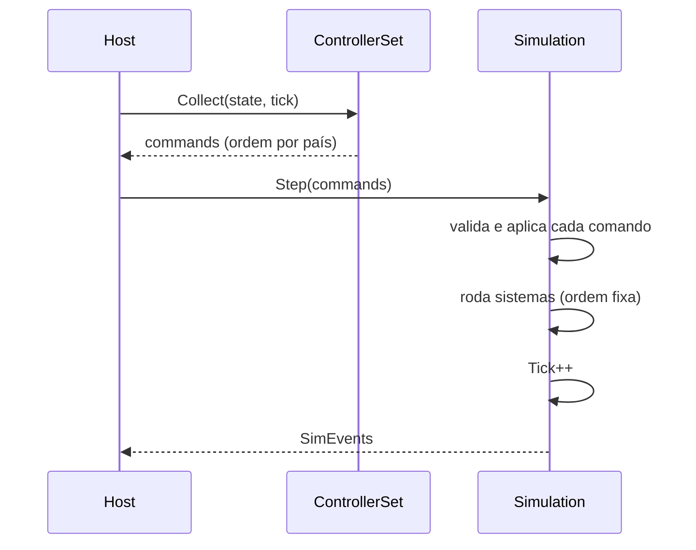

# Proposta: Foundation — Fundação da simulação determinística e do projeto

**Data**: 2026-11-18
**Status**: Implementado (2026-11-24)

> **Nota de reconciliação (2026-11-24, FUP-foundation-03).** Esta proposta foi aprovada em 2026-11-22 e implementada em 4 fases. Onde ela diverge do código, **valem as AI-SPECs e suas decisões de design**: `AI-SPEC_Foundation_Phase_1..4.md` (DD-P1-01..07, DD-P2-01..10, DD-P3-01..14, DD-P4-01..16) e o ADR-009. Diferenças principais em relação ao texto abaixo: `Universe.StarSystems` (não `Systems`); `GameState.Random` é `internal` e o estoque do país é só leitura por fora (`GetStock`, `SetStock` interno); `GameState.Create(GameSetup, int resourceCount)` e `Create(GameSetup, DataSet)`; handlers de comando `CommandHandler<T>(GameState, SimContext, T)` que devolvem `CommandRejectReason`; `CommandCodec` por instância; `SimEvents.CompletedTick` (não `TickCompleted`); `GameSetupException` para erro de setup; o relógio de ticks fica em `src/Sim/Hosting` (`TickClock`, `SimLoop`); os dados do jogo são lidos de `res://data` como texto (ADR-009, no lugar de `GlobalizePath`); .NET 8.0.428 e Godot 4.7.2 estão instalados (R-01 resolvido). O corpo desta proposta não foi reescrito.
**Modulos afetados**: `src/Sim` (Core, Data, State, Control), `src/Sim.Tests`, `game/` (Presentation), `game/data/`, raiz (`Rts.sln`, `.gitignore`)
**Pre-requisitos**: Inception concluída (Implementado: `docs/inception/`, ADR-001 a ADR-005). **.NET 8 SDK e Godot 4 .NET: Pendente (não instalados neste host, ver R-01).** Nenhum módulo de código existe ainda.
**Dependencias externas**: .NET 8 SDK; Godot 4.x edição .NET (versão estável exata fixada no E0-1); pacotes NuGet de teste `xunit`, `xunit.runner.visualstudio` e `Microsoft.NET.Test.Sdk` (versões estáveis compatíveis com `net8.0`, fixadas em `Directory.Packages.props`; justificativa na §12 e aprovação no gate desta proposta, conforme CLAUDE.md §8). `System.Text.Json` vem no .NET 8 (sem pacote).
**Complexidade estimada**: Média (9 histórias, soma ≈ 18–24 dias de dev solo, `assumed`)
**Épico**: E0 · Marco 0 (`docs/inception/Backlog.md`)
**Contexto da inception**: [Product_Definition](../../inception/Product_Definition.md) · [Scope_and_Phasing](../../inception/Scope_and_Phasing.md) · [Requirements](../../inception/Requirements.md) · [Risk_Analysis](../../inception/Risk_Analysis.md) · [Architecture_Overview](../../inception/Architecture_Overview.md)

---

## 1. Problema e Motivacao

**Estado atual.** O repositório tem só documentos: design, inception, ADRs e o harness. Não há solução .NET, projeto Godot, tipo numérico, aleatoriedade, estado, comandos nem carregador de dados. Todo o restante da Fase 1 (E1–E8) depende desta base.

**Cenários que precisam ser atendidos**

- **SC-01**: O dev precisa compilar e testar a simulação sem abrir o Godot (ADR-001, RNF-01).
- **SC-02**: O dev precisa de aritmética e aleatoriedade determinísticas para que "mesma semente + mesmos comandos ⇒ mesmo estado" valha desde o primeiro commit (ADR-002, D1 da inception, RF-07).
- **SC-03**: O dev precisa de um estado com a hierarquia Universo → Sistema → Mundo → País e de comandos serializáveis que só o controlador do país pode emitir (ADR-004, RF-02 a RF-05).
- **SC-04**: O dev precisa que conteúdo (recursos, techs) entre só por JSON validado, com erro claro para ciclo, referência quebrada ou recurso inalcançável (ADR-005, RF-06, RNF-05).
- **SC-05**: O jogador (autor) precisa abrir o jogo e ver uma grade isométrica rodando a Sim a 20 ticks/s, como prova de que a camada de apresentação está ligada à Sim (critério de saída do M0).
- **SC-06**: O dev precisa de uma rede de segurança automática contra regressões de determinismo (hash + varredura de APIs proibidas), porque o risco F4 (score 12) é de quebra acidental.

**Consequências de não fazer.** Sem esta base nada compila nem roda; e deixar o determinismo para depois obriga reescrever o núcleo (decisão D1, `Risk_Analysis.md` §8).

**Código existente.** Nenhum. Greenfield.

## 2. Visao da Solucao

Entregar o **esqueleto executável da arquitetura aprovada**, sem nenhuma regra de jogo: a solução .NET com a Sim em C# puro, os tipos de base determinísticos, o estado hierárquico, o ciclo de comandos e `Step`, os controladores, o hash de estado, o carregador/validador de JSON e uma cena Godot mínima que roda a Sim a 20 ticks/s. Cada peça tem teste headless. O conjunto é pequeno, mas fixa as fronteiras que os demais épicos vão usar.

| Pilar | Entrega | Histórias |
|---|---|---|
| Projeto | Solução, projetos, `.gitignore`, flags de compilação | E0-1 |
| Determinismo | `Fixed`, `SimRandom`, hash de estado, testes | E0-2, E0-3, E0-7 |
| Modelo | `GameState`, ids fortes | E0-4 |
| Ciclo | `Command`, `Simulation.Step`, `IController` | E0-5, E0-6 |
| Dados | Carregador e validador de `resources.json` e `techs.json` | E0-8 |
| Apresentação | Cena Godot com grade, câmera mínima e tick visível | E0-9 |

```
 game/ (Godot)                       src/Sim (C# puro)                    game/data
 ┌───────────────┐  Command[]   ┌──────────────────────────────┐   lê   ┌───────────────┐
 │ SimHost       │─────────────►│ Simulation.Step(commands)    │◄───────│ resources.json│
 │ (acumula 50ms)│◄─────────────│  valida → aplica → sistemas  │        │ techs.json    │
 │ IsoGrid, Hud  │ State/Events │  → tick++ → SimEvents        │        └───────────────┘
 └───────────────┘              │ GameState · SimRandom · Fixed│
                                │ DataLoader/Validator · Hash  │
                                └──────────────────────────────┘
```

**Princípios**

- **P-01**: `src/Sim` não referencia Godot e não usa `float`/`double`, `System.Random`, relógio de parede, `Dictionary`/`HashSet` com ordem relevante, estado estático mutável nem threads (ADR-001, ADR-002).
- **P-02**: Todo estado muda só dentro de `Simulation.Step`, por comando ou por sistema (ADR-004).
- **P-03**: Nenhum id de conteúdo no código de `src/Sim`; ids existem só em JSON e em fixtures de teste (ADR-005).
- **P-04**: Rejeição de comando não lança exceção nem altera estado; gera evento (ADR-004).
- **P-05**: Todo erro de dados é coletado e reportado junto, com arquivo, id e código (RNF-05).
- **P-06**: A apresentação só lê estado e envia comandos; a conversão `Fixed → float` acontece só em `game/` (RNF-06).
- **P-07**: Tudo que é hasheado tem ordem canônica de campos e de iteração por id.

**Dentro do escopo (IN)**: as 9 histórias E0-1 a E0-9 do Backlog.

**Fora do escopo (OUT)**

| Item | Justificativa |
|---|---|
| Mapa, terreno, depósitos, conversão de coordenadas | Épico E1 |
| Câmera com bordas, arrasto e limites | E1-4; aqui só o mínimo (ver §12 DD-06) |
| Entidades (unidades/construções), movimento | E3, ADR-006 |
| Estoque efetivo, coleta, população | E4; aqui o país só tem o vetor de estoque, sem regras |
| `recipes.json`, `buildings.json`, `units.json`, `doctrines.json` | Épicos E5/E6; o validador é extensível (ver DD-05) |
| Handlers de efeito de tecnologia | E8-2; aqui o validador só reconhece os 8 tipos |
| Troca de controle, eventos por país, "o que aconteceu" | E7 |
| IA | E6; `AiController` é um stub vazio |
| Interpolação visual de entidades | Não há entidades; entra com E3 |
| Salvar/carregar e replay em arquivo | Fase 2+ (Q4 da arquitetura). Só a serialização de comando entra |
| Banned API Analyzers (pacote Roslyn) | Ver DD-04; avaliar depois |

## 3. Situacao Atual

| Aspecto | Estado | Caminho/Referencia |
|---|---|---|
| Solução e projetos .NET | Não existe | `Rts.sln`, `src/Sim`, `src/Sim.Tests` |
| Projeto Godot | Não existe | `game/` |
| .NET 8 SDK | **Não instalado no host** (`dotnet` ausente; só `~/.dotnet/corefx`) | verificado em 2026-11-18 |
| Godot 4 .NET | **Não instalado no host** (`godot` e `godot4` ausentes) | verificado em 2026-11-18 |
| Dados JSON | Não existe | `game/data/` |
| Testes | Não existe | `src/Sim.Tests` |
| `.gitignore` | Parcial: só entradas do harness (`.harness-db/`, `.harness-output/`, …) | `.gitignore` |
| Decisões de arquitetura | Existe | `docs/architecture/adr/ADR-001` a `ADR-008` |
| Requisitos e backlog | Existe | `docs/inception/Requirements.md`, `Backlog.md` |
| Design | Existe; ainda marca determinismo como `[Depois]` (decisão D1 o torna obrigatório; vale a inception) | `docs/design.md` |

Nada a modificar; tudo a criar. O `.gitignore` será **estendido**, não substituído.

## 4. Arquitetura Proposta

### 4.1 Modelo de Dados

Esta feature usa tipos C# e JSON (não há banco). Definições principais, em C# (nomes em inglês, CLAUDE.md §2):

```csharp
namespace Rts.Sim.Core;

// Q32.32 em long. Valor real = Raw / 2^32.
public readonly record struct Fixed(long Raw) : IComparable<Fixed>
{
    public const int FractionBits = 32;
    public static readonly Fixed Zero = new(0);
    public static readonly Fixed One  = new(1L << FractionBits);
    public static Fixed FromInt(int v);                 // exato
    public static Fixed FromRaw(long raw);
    public static Fixed FromRatio(long num, long den);  // num/den, trunca para zero
    public int ToIntFloor();
    public static Fixed operator +(Fixed a, Fixed b);   // checked
    public static Fixed operator -(Fixed a, Fixed b);   // checked
    public static Fixed operator -(Fixed a);
    public static Fixed operator *(Fixed a, Fixed b);   // 128 bits, piso (floor)
    public static Fixed operator /(Fixed a, Fixed b);   // 128 bits, trunca para zero
    public static Fixed Sqrt(Fixed x);                  // piso, x >= 0
    public static Fixed Abs(Fixed x);
    public static Fixed Min(Fixed a, Fixed b);
    public static Fixed Max(Fixed a, Fixed b);
    public static Fixed Clamp(Fixed v, Fixed lo, Fixed hi);
    // comparação por Raw; ToString para depuração em decimal exato (sem double)
}

public sealed class SimRandom   // xoshiro256**, semeado via SplitMix64
{
    public SimRandom(ulong seed);
    public ulong NextU64();
    public int   NextInt(int exclusiveMax);   // sem viés (rejeição)
    public Fixed NextFixed();                 // [0, 1)
    public (ulong S0, ulong S1, ulong S2, ulong S3) Snapshot(); // para hash
}
```

```csharp
namespace Rts.Sim.State;

public readonly record struct PlayerId(int Value);
public readonly record struct StarSystemId(int Value);
public readonly record struct WorldId(int Value);
public readonly record struct CountryId(int Value);
public readonly record struct ResourceId(int Value);   // índice denso, resolvido pelo registry
public readonly record struct TechId(int Value);

public enum ControllerKind : byte { Human = 1, Ai = 2 }
public readonly record struct ControllerRef(ControllerKind Kind, PlayerId Player);

public sealed class GameState
{
    public long Tick { get; internal set; }
    public SimRandom Random { get; }
    public Universe Universe { get; }
    public IReadOnlyList<Player> Players { get; }
    public static GameState Create(GameSetup setup, DataSet data);   // valida limites
}
public sealed class Universe   { public IReadOnlyList<StarSystem> Systems { get; } }
public sealed class StarSystem { public StarSystemId Id; public PlayerId Owner; public IReadOnlyList<World> Worlds { get; } }
public sealed class World      { public WorldId Id; public IReadOnlyList<Country> Countries { get; } }  // máx. 8
public sealed class Country
{
    public CountryId Id; public string Name;
    public ControllerRef Controller { get; internal set; }
    public Fixed[] Stock;   // indexado por ResourceId; só vetor em E0, sem regras
}
```

`GameSetup` descreve o estado inicial (semente, jogadores, sistemas, mundos, países, controlador de cada país). O MVP usa 1 sistema com 1 mundo, mas **nenhum tipo assume isso** (P-01 da arquitetura). Ids de conteúdo são índices densos resolvidos pelos registries no carregamento; o nome em JSON serve a humanos.

**Formato JSON (conteúdo)**

```json
// game/data/resources.json
{ "resources": [
  { "id": "wood", "category": "basic", "storage": "stock", "renewable": true },
  { "id": "knowledge", "category": "abstract", "storage": "stock" },
  { "id": "ore", "category": "raw_hidden", "storage": "stock",
    "revealedBy": "tech_mining", "extractedBy": "mine", "depletes": true },
  { "id": "metal", "category": "refined", "storage": "stock" } ] }

// game/data/techs.json
{ "techs": [
  { "id": "tech_mining", "tier": 1, "cost": { "knowledge": 50 }, "researchTicks": 600, "requires": [],
    "effects": [ { "type": "revealResource", "resource": "ore" },
                 { "type": "unlockBuilding", "building": "mine" } ] },
  { "id": "tech_smelting", "tier": 2, "cost": { "knowledge": 120, "ore": 50 }, "researchTicks": 900,
    "requires": ["tech_mining"],
    "effects": [ { "type": "unlockBuilding", "building": "smelter" },
                 { "type": "unlockRecipe", "recipe": "smelt_metal" },
                 { "type": "raiseGatherCap", "resource": "wood", "percent": 25 } ] } ] }
```

O conjunto de exemplo final terá 5 recursos (comida, madeira, conhecimento, minério, metal) e 4 técnicas (cadeia mineração → fundição, mais duas independentes). **Esses ids existem só nos arquivos de dados e nas fixtures de teste**, nunca em `src/Sim` (P-03). `extractedBy`, `building`, `recipe` são referências a arquivos que ainda não existem (ver DD-05).

**Alternativas para onde guardar o estoque do país**

| Criterio | Opção A: `Fixed[]` por país (proposta) | Opção B: `Dictionary<ResourceId, Fixed>` |
|---|---|---|
| Simplicidade | Alta | Média |
| Determinismo | Ordem natural por índice | Exige cuidado de ordem |
| Performance | Sem alocação por acesso | Hash por acesso |
| Extensibilidade | Tamanho fixo no carregamento | Flexível, mas desnecessário |
| Impacto em código existente | Nenhum | Nenhum |

**Recomendação**: Opção A (P-07, CLAUDE.md §5.4).

### 4.2 Fluxo de Dados

```
Host (Godot ou teste)
  1. ControllerSet.Collect(state, tick) → List<Command>   (países em ordem de id)
  2. sim.Step(commands)
       a. para cada comando, na ordem recebida:
            país existe?  issuer == country.Controller?  tipo registrado?
            não → evento CommandRejected(motivo), segue sem alterar estado
            sim → handler aplica ao estado
       b. sistemas registrados em ordem fixa (nenhum em E0)
       c. State.Tick++
       d. SimEvents (reutilizado) devolvido
  3. host lê State e SimEvents; opcional: sim.ComputeHash()
```



Caminho de erro: um comando de `issuer` que não controla o país → `CommandRejected(NotController)`; estado e hash idênticos aos de antes.

### 4.3 Integracoes

| Módulo | Tipo | Direção | Descrição |
|---|---|---|---|
| `Rts.Game` → `Rts.Sim` | Referência de projeto | Consome | O Godot lê `GameState`, envia `Command` |
| `Rts.Sim.Tests` → `Rts.Sim` | Referência de projeto | Consome | Testes headless |
| `Sim.Data` ← `game/data/*.json` | Arquivo | Lê | Caminho recebido como `string` (ADR-001) |
| Épicos E1–E8 | Contrato | Emite | Interfaces desta feature (`Command`, `ISimSystem`, `IController`, `DataSet`) são a base deles |

Eventos de domínio: nenhum em E0 além de `SimEvents` (`CommandRejected`, `TickCompleted`). Não há handlers a reexecutar, então idempotência não se aplica. Não há chamada entre módulos de jogo.

## 5. Componentes da Solucao

### 5.1 Simulação (`src/Sim`)

```
Rts.sln
Directory.Build.props         # Nullable, TreatWarningsAsErrors, LangVersion, ImplicitUsings off
Directory.Packages.props      # versões centrais de NuGet (só em Sim.Tests)
src/
├── Sim/
│   ├── Rts.Sim.csproj        # net8.0, sem referência ao Godot
│   ├── Core/                 # Fixed, SimRandom, StateHasher, Simulation, SimContext, SimEvents
│   ├── Commands/             # Command, CommandRegistry, CommandCodec (JSON), CommandRejectReason
│   ├── State/                # ids fortes, GameState, Universe, StarSystem, World, Country, GameSetup
│   ├── Control/              # IController, HumanController, AiController, ControllerSet
│   ├── Data/                 # DataLoader, DataValidator, DataSet, ResourceRegistry, TechRegistry, DataError
│   └── Systems/              # ISimSystem (vazio em E0; um sistema por pasta nos épicos seguintes)
└── Sim.Tests/
    ├── Rts.Sim.Tests.csproj
    ├── Core/ State/ Commands/ Control/ Data/ Determinism/ Architecture/
    └── Fixtures/             # JSON válidos e inválidos, ids próprios (nunca de game/data)
```

**API pública (substitui a tabela de endpoints)**

| Tipo/Método | Descrição | Erros |
|---|---|---|
| `Simulation(GameState, IReadOnlyList<ISimSystem>, CommandRegistry)` | Cria a simulação | `ArgumentNullException` |
| `SimEvents Step(IReadOnlyList<Command> commands)` | Avança 1 tick; devolve eventos (buffer reutilizado, válido até o próximo `Step`) | nunca lança por comando inválido (P-04) |
| `ulong ComputeHash()` | Hash canônico do estado atual | — |
| `GameState State { get; }` | Estado somente leitura para a apresentação | — |
| `CommandRegistry.Register<T>(string typeName, Action<GameState, T> handler)` | Registra um tipo de comando e seu handler | `InvalidOperationException` se o nome repetir |
| `CommandCodec.Serialize(Command) → string` / `Deserialize(string) → Command` | JSON estável com `"type"` | `FormatException` |
| `IController.Collect(GameState, CountryId, long tick, List<Command> output)` | Emite comandos do país | — |
| `HumanController.Enqueue(Command)` | Recebe a entrada da apresentação | — |
| `DataLoader.Load(string dataDir) → DataSet` | Lê, valida e monta registries | `DataValidationException` com **todos** os `DataError` |
| `DataValidator.Validate(RawData) → IReadOnlyList<DataError>` | Validação pura, testável sem disco | — |
| `GameState.Create(GameSetup, DataSet)` | Constrói o estado inicial | `ArgumentException` se > 8 países por mundo ou controlador inválido |

`Command` carrega `CountryId Country` e `ControllerRef Issuer`. `SimEvents` expõe `TickCompleted(long tick)` e `CommandRejected(CountryId, string type, CommandRejectReason)` em listas reutilizadas, sem alocação por tick no caminho sem rejeições (ADR-006 em espírito; RNF-03).

**Controle de acesso aos comandos (equivalente à autorização):** só o controlador atual do país emite comandos para ele (RF-03).

### 5.2 Apresentação (`game/`)

```
game/
├── project.godot
├── Rts.Game.csproj              # referencia ../src/Sim/Rts.Sim.csproj
├── data/                        # resources.json, techs.json
├── scenes/Main.tscn
└── scripts/
    ├── SimHost.cs               # nó: acumula tempo real, chama Step a 50 ms, limita catch-up
    ├── IsoGrid.cs               # _Draw de uma grade em losangos 2:1 (placeholder)
    ├── CameraRig.cs             # Camera2D com WASD e zoom (mínimo)
    └── HudTick.cs               # Label: tick, hash curto, nº de recursos/techs carregados
```

```
Main (Node2D)
├── SimHost
├── IsoGrid (Node2D)
├── CameraRig (Camera2D)
└── Hud (CanvasLayer)
    └── HudTick (Label)
```

| Script | Lê | Envia |
|---|---|---|
| SimHost | `Simulation`, caminho `ProjectSettings.GlobalizePath("res://data")` | `Step(commands)` |
| HudTick | `State.Tick`, `ComputeHash()`, contagens dos registries | nada |

Sem rotas, sem stores, sem menu. **Navegação**: a cena `Main` é a cena inicial do projeto.

## 6. Regras de Negocio

**Fixed**
- RN-01: `Fixed` usa Q32.32 em `long`; `FromInt(n)` é exato e `ToIntFloor` é o piso.
- RN-02: `*` usa produto de 128 bits e arredonda por **piso**; `/` usa 128 bits e **trunca para zero**. `+`, `-`, `*` e `/` fora do intervalo lançam `OverflowException`; divisão por zero lança `DivideByZeroException`.
- RN-03: `Sqrt(x)` devolve o piso da raiz em unidades Raw; `x < 0` lança `ArgumentOutOfRangeException`.
- RN-04: nenhuma operação de `Fixed` usa `float`/`double`, nem na conversão de texto.

**SimRandom**
- RN-05: mesma semente ⇒ mesma sequência; sementes diferentes divergem nos primeiros 8 valores. Semente 0 é válida.
- RN-06: `NextInt(n)` com `n <= 0` lança `ArgumentOutOfRangeException`; para `n > 0` é sem viés e fica em `[0, n)`.
- RN-07: `NextFixed()` fica em `[0, 1)`.

**Estado e ids**
- RN-08: `GameState.Create` recusa mundo com mais de 8 países, ids duplicados e país sem controlador válido.
- RN-09: `Tick` começa em 0 e só cresce de 1 em 1 dentro de `Step`.
- RN-10: nenhum tipo assume um sistema ou um mundo; teste cria 2 sistemas, 2 mundos e 3 países.

**Comandos**
- RN-11: comandos são aplicados **na ordem recebida**; o host (via `ControllerSet`) fornece ordem canônica por `CountryId`.
- RN-12: comando para país inexistente ⇒ `CommandRejected(UnknownCountry)`. Para país cujo `Controller` difere do `Issuer` ⇒ `CommandRejected(NotController)`. Tipo sem handler ⇒ `CommandRejected(UnknownCommandType)`. Em todos, o estado fica idêntico (mesmo hash) e `Step` não lança.
- RN-13: `CommandCodec` serializa e desserializa sem perda (`Deserialize(Serialize(c))` é igual a `c`); JSON com `type` desconhecido lança `FormatException`.

**Hash e determinismo**
- RN-14: `ComputeHash` é FNV-1a de 64 bits sobre bytes little-endian numa ordem canônica (tick, estado do RNG, jogadores, sistemas, mundos e países por id, controlador, estoque).
- RN-15: duas simulações com a mesma semente, o mesmo setup e a mesma lista de comandos por tick têm o mesmo hash em **todos** os ticks de uma execução de 1000 ticks.
- RN-16: alterar um estoque, a semente ou um comando muda o hash (controle negativo do teste).
- RN-17: varredura de fontes: arquivos de `src/Sim` não contêm `float`, `double`, `System.Random`, `DateTime`, `Stopwatch`, `Guid.NewGuid`, `using Godot`, `static` mutável nem `Thread`/`Task.Run`; o teste falha nomeando arquivo e linha.

**Dados**
- RN-18: ids de recurso e tech seguem `^[a-z][a-z0-9_]*$` e são únicos por arquivo.
- RN-19: `category` ∈ {`basic`, `raw_hidden`, `refined`, `strategic`, `abstract`}; `storage` ∈ {`stock`, `quota`}; propriedades desconhecidas no JSON são erro (pega erro de digitação).
- RN-20: `requires` e `cost` referenciam ids existentes; o grafo de techs é acíclico e o erro de ciclo mostra o caminho (`a → b → a`).
- RN-21: tipos de efeito ∈ os 8 do design; `revealResource` aponta para recurso que existe e cujo `revealedBy` é a própria tech; todo recurso com `revealedBy: T` exige que `T` tenha o efeito `revealResource` correspondente.
- RN-22: alcançabilidade: recurso sem `revealedBy` é alcançável (produzido por coleta ou receita; receitas serão validadas no E5); recurso com `revealedBy` é alcançável se a tech é pesquisável a partir do início, isto é, todos os seus `requires` são pesquisáveis e todos os recursos do `cost` são alcançáveis antes (ponto fixo, iteração em ordem de id). Recurso inalcançável ⇒ erro.
- RN-23: o validador **coleta todos os erros** e `DataLoader.Load` lança uma única `DataValidationException` com a lista; mensagem inclui arquivo, id, código e texto.
- RN-24: referências a conteúdo de arquivos ainda inexistentes (`building`, `recipe`, `extractedBy`) são aceitas como texto e ficam pendentes de validação cruzada (DD-05); isso é registrado como aviso, não erro.

**Apresentação**
- RN-25: `SimHost` executa no máximo 5 ticks por quadro; o excesso de tempo acumulado é descartado (evita espiral de morte) e o contador do HUD continua correto.
- RN-26: nenhum script de `game/` altera `GameState` diretamente (verificado por revisão e por busca de setters internos em `/review`).

## 7. Seguranca e Modelo de Acesso

O projeto é single-tenant e sem papéis (`capabilities` todas falsas em `harness.project.json`). Pontos aplicáveis:

- **Autorização de comandos**: só o controlador atual do país emite comandos para ele; rejeição por evento (RN-12). É a base do RF-03.
- **Sensibilidade de dados**: nenhuma. Não há credencial, rede nem dado pessoal.
- **Validação de entrada**: arquivos JSON são tratados como não confiáveis (RN-18 a RN-24); leitura com limite de tamanho (1 MiB por arquivo, configurável em constante da Sim) para evitar carga acidental enorme.
- **Cross-scope**: não aplicável nesta fase (um jogador por mundo; multi-sistema só no modelo).

## 8. Performance e Escalabilidade

- **Alocação por tick**: `Step` sem comandos e sem sistemas não aloca (listas reutilizadas). Medido em teste com `GC.GetAllocatedBytesForCurrentThread()` (apenas em teste, não na Sim).
- **Orçamento (assumed)**: `Step` vazio < 0,1 ms; `ComputeHash` com 3 países < 0,05 ms; carregamento de dados < 50 ms. Medidos e registrados; o orçamento global do tick (ADR-003, ≤ 15 ms com 300 unidades) é validado em E3-3.
- **Volume**: 1 sistema, 1 mundo, 2–3 países, ~10 recursos e ~10 techs. Triviais.
- **Cache**: nenhum.
- **Hash**: calculado sob demanda; a opção de hash a cada tick fica no host/teste, não no `Step`.

## 9. Analise de Impacto

| Módulo/Arquivo | Mudança | Risco | Descrição |
|---|---|---|---|
| `Rts.sln`, `Directory.*.props`, `src/**` | Adição | Baixo | Greenfield |
| `game/**` | Adição | Médio | Depende de instalar o Godot .NET; mexe em `project.godot` |
| `.gitignore` | Modificação | Baixo | Adiciona `.godot/`, `.import/`, `bin/`, `obj/`, `*.user`; mantém as linhas do harness |
| `docs/design.md` | Nenhuma | — | Divergência de D1 já registrada na inception |
| `CLAUDE.md` | Nenhuma | — | |

- **Breaking changes**: nenhum (nada existia).
- **Migração**: não há dados anteriores.
- **Rollback**: reverter o commit; sem efeitos externos.
- **Compatibilidade futura**: `Command`, `ISimSystem`, `IController` e `DataSet` serão usados por E1–E8; mudar o contrato depois afeta todos. Por isso entram em ADR quando surgir a primeira divergência.

## 10. Riscos e Mitigacoes

| # | Risco | Prob. | Impacto | Mitigação |
|---|---|---|---|---|
| R-01 | **.NET 8 SDK e Godot 4 .NET não estão instalados**; nenhuma história compila sem eles | Alta (confirmado) | Alto | Instalar antes do `/implement`; documentar versões e comandos no E0-1; E0-1 é o primeiro gate |
| R-02 | Matemática `Fixed` incorreta (overflow, arredondamento) contamina todo o jogo (F4) | Média | Alto | Testes de propriedade (comutatividade, identidade, ida e volta), tabela de casos de borda, overflow lança |
| R-03 | Não determinismo acidental passar despercebido | Média | Alto | Hash por tick, controle negativo, varredura de APIs proibidas (RN-17) |
| R-04 | Escopo do E0 crescer (ex.: já fazer câmera completa, estoque efetivo) | Média | Médio | Lista OUT explícita; qualquer adição vira história nova |
| R-05 | Contrato de `Command`/`IController` errado e caro de mudar depois | Média | Médio | Manter pequeno; revisar na spec; ADR se mudar |
| R-06 | Validação de alcançabilidade (RN-22) incompleta sem receitas | Média | Baixo | Limitar a RN-22 e estender no E5 (DD-05); documentar |
| R-07 | Estimativa subestimada (L/M, solo) | Média | Médio | Registrar tempo real em `docs/history.md` (gate G-3) |
| R-08 | Build do Godot .NET falhar por versão do SDK | Média | Médio | Fixar versões no E0-1 e documentar em README curto |

## 11. Observabilidade

- **Eventos**: `TickCompleted(tick)` a cada `Step`; `CommandRejected(country, type, reason)` quando aplicável.
- **Logging**: a Sim não loga (sem `GD.Print`, sem relógio). Erros de dados vão em `DataValidationException` com a lista completa; a apresentação mostra a mensagem.
- **Métricas**: o HUD mostra tick, hash curto (8 hex) e contagens; medições de tempo ficam nos testes de desempenho e no `history.md`.

## 12. Decisoes de Design

- **DD-01 · `checked` em `Fixed`**: overflow lança em vez de saturar ou dar a volta, para que um bug de escala apareça nos testes. Alternativa (saturar) esconderia erros; (voltar) quebra silenciosamente. Custo: uma exceção possível no jogo; aceitável, pois o intervalo ±2,1 bilhões cobre estoques e distâncias previstos. Reavaliar se o E3 estourar em cálculos de pathfinding.
- **DD-02 · xoshiro256\*\***: rápido, bom estatisticamente, estado de 4 `ulong` fácil de hashear; semeado por SplitMix64. Alternativa PCG32 (estado menor); sem diferença relevante aqui.
- **DD-03 · Hash FNV-1a 64**: simples, sem pacote, sem alocação. Não é criptográfico e não precisa ser; o objetivo é detectar divergência. Alternativa xxHash exigiria pacote.
- **DD-04 · Varredura de fontes em vez de Roslyn BannedApiAnalyzers**: um teste xUnit que lê `src/Sim/**/*.cs` evita pacote novo (CLAUDE.md §8). Limitação: texto, não semântica; pode ter falso positivo em comentário (o teste ignora linhas de comentário). Recomendo reavaliar o analisador quando a Sim crescer.
- **DD-05 · Validador extensível por arquivo**: E0 valida `resources.json` e `techs.json`; cada épico seguinte acrescenta o seu arquivo e as validações cruzadas (`building`, `recipe`, `extractedBy`). Até lá, referências a esses ids passam com aviso (RN-24).
- **DD-06 · Câmera mínima no E0 (divergência explícita)**: o CLAUDE.md §9 (Marco 0) lista câmera com bordas, WASD, arrasto e zoom, mas o Backlog aprovado separa a câmera completa em E1-4. Esta proposta entrega apenas **WASD + zoom** em E0-9 e deixa bordas, arrasto e limites para E1-4. Se o operador preferir a câmera completa no M0, E1-4 passa para esta feature (+M, ≈2–3 dias).
- **DD-07 · Comandos de teste fora da Sim**: nenhum comando de jogo é criado em E0. Os testes registram comandos próprios no `CommandRegistry`, o que prova o contrato sem criar código a remover depois.
- **DD-08 · Commands na ordem recebida**: simples e suficiente; a ordem canônica por país é responsabilidade do `ControllerSet`. Alternativa (ordenar dentro de `Step`) esconderia bugs do host.
- **DD-09 · `System.Text.Json`** para comandos e dados (já no .NET 8): números só como inteiros; `Fixed` serializa por `Raw`, sem `double`.
- **DD-10 · NuGet de teste**: `xunit` (padrão do CLAUDE.md §3), `xunit.runner.visualstudio` (descoberta pelo `dotnet test`) e `Microsoft.NET.Test.Sdk` (necessário para o host de testes). Sem pacotes na Sim nem em `game/`. A aprovação desta proposta vale como a pergunta exigida pelo CLAUDE.md.
- **ADRs**: respeita ADR-001 a ADR-005. Nenhum ADR novo é necessário agora; DD-01 e DD-03 podem virar um ADR curto de "convenções numéricas" se o operador preferir.

## 13. Beneficios Esperados

- B-01: Compilar e testar a Sim sem Godot, em segundos. Resolve SC-01.
- B-02: Determinismo verificado desde o primeiro commit, com rede de segurança automática. Resolve SC-02, SC-06.
- B-03: Contratos de estado, comando e controlador prontos para E1–E8. Resolve SC-03.
- B-04: Erros de dados claros e completos antes de qualquer partida. Resolve SC-04.
- B-05: Prova visual de que Godot e Sim estão ligados a 20 ticks/s. Resolve SC-05.

## 14. Casos de Uso Propostos

| UC | Título (objetivo) | Ator (superfície) | Trigger | Prioridade | Garantia de sucesso | CA / SC |
|---|---|---|---|---|---|---|
| UC-DEV-01 | Compilar e testar a Sim sem o Godot | Dev | `dotnet build` e `dotnet test` | Alta | Compila e testes passam sem referência ao Godot | CA-01, CA-02 / SC-01 |
| UC-DEV-02 | Reproduzir uma execução com a mesma semente | Dev | Rodar o teste de determinismo | Alta | Hash igual em todos os ticks | CA-03, CA-04 / SC-02, SC-06 |
| UC-DEV-03 | Emitir um comando como controlador do país | Dev (via teste) | `Step` com comando válido | Alta | Estado muda e comando é serializável | CA-05 / SC-03 |
| UC-DEV-04 | Ver um comando inválido ser rejeitado | Dev (via teste) | `Step` com emissor errado | Alta | Evento de rejeição e estado inalterado | CA-06 / SC-03 |
| UC-DEV-05 | Carregar dados válidos | Dev | `DataLoader.Load` | Alta | Registries montados | CA-07 / SC-04 |
| UC-DEV-06 | Descobrir todos os erros de um conjunto de dados inválido | Dev | `DataLoader.Load` com ciclo e referência quebrada | Alta | Exceção com a lista completa | CA-08, CA-09 / SC-04 |
| UC-DEV-07 | Ser avisado de uso de API proibida na Sim | Dev | `dotnet test` após inserir `float` | Média | Teste falha nomeando arquivo e linha | CA-10 / SC-06 |
| UC-PLY-01 | Abrir o jogo e ver a grade e o tick | Jogador (Godot) | Executar o projeto | Alta | Grade visível; tick sobe a 20/s; HUD mostra contagens | CA-11, CA-12 / SC-05 |
| UC-PLY-02 | Mover a câmera | Jogador (Godot) | WASD e roda do mouse | Média | Câmera desloca e dá zoom | CA-13 / SC-05 |

## 15. Criterios de Aceitacao (alto nivel)

- **CA-01**: `dotnet build Rts.sln` e `dotnet format --verify-no-changes` terminam sem erros nem avisos (`TreatWarningsAsErrors`); `Rts.Sim` não referencia Godot.
- **CA-02**: `dotnet test src/Sim.Tests` roda headless e passa.
- **CA-03**: Duas simulações com a mesma semente, setup e lista de comandos têm o mesmo hash em cada um dos 1000 ticks.
- **CA-04**: Semente diferente, comando diferente ou estoque alterado muda o hash (controle negativo).
- **CA-05**: Um comando válido altera o estado e passa por `Serialize`/`Deserialize` sem perda.
- **CA-06**: Um comando de emissor que não controla o país é rejeitado com evento; o hash antes e depois é idêntico; `Step` não lança.
- **CA-07**: O conjunto de exemplo (5 recursos, 4 techs) carrega e produz registries com as contagens esperadas.
- **CA-08**: O validador recusa, com mensagem clara, cada um de: id duplicado, referência quebrada, ciclo, recurso inalcançável, efeito de tipo desconhecido, propriedade desconhecida.
- **CA-09**: Um conjunto com 3 erros distintos devolve os 3 numa só `DataValidationException`.
- **CA-10**: Inserir `float`, `System.Random`, `DateTime` ou `using Godot` em `src/Sim` faz o teste de arquitetura falhar com arquivo e linha.
- **CA-11**: O jogo abre e mostra a grade isométrica com o contador de ticks aumentando a 20/s (± 1 tick/s em 60 s de medição).
- **CA-12**: O HUD mostra o hash curto e as contagens carregadas de `game/data` (5 recursos, 4 techs).
- **CA-13**: WASD desloca a câmera e a roda do mouse altera o zoom sem alterar a Sim.
- **CA-14**: Testes de `Fixed` e `SimRandom` cobrem as RN-01 a RN-07, incluindo overflow, divisão por zero e `Sqrt`.
- **CA-15**: `Step` sem comandos e sem sistemas não aloca memória gerenciada (medido em teste).

Cada CA é verificado por pelo menos um UC da §14, e cada UC cita ao menos um CA.

## 16. Proximos Passos

Cada fase termina com `dotnet build`, `dotnet test` e `dotnet format` verdes e pode ser integrada sozinha.

| Fase | Escopo (histórias) | Dependências | Entregável |
|---|---|---|---|
| **Fase 1: Base** | E0-1 (solução, props, `.gitignore`), E0-2 (`Fixed`), E0-3 (`SimRandom`), E0-4 (`GameState`, ids) | .NET 8 SDK instalado | Sim compila e testa; tipos de base |
| **Fase 2: Ciclo** | E0-5 (`Command`, `Step`), E0-6 (`IController`), E0-7 (hash, determinismo, varredura de APIs) | Fase 1 | Ciclo determinístico verificado |
| **Fase 3: Dados** | E0-8 (carregador e validador de `resources.json`/`techs.json`, exemplo em `game/data`) | Fase 1 | Dados validados |
| **Fase 4: Apresentação** | E0-9 (projeto Godot, cena, `SimHost`, grade, câmera mínima, HUD) | Fases 2 e 3; Godot 4 .NET instalado | Jogo abre rodando a Sim |

1. Aprovar esta proposta (inclui os pacotes NuGet de teste e a divergência DD-06).
2. Instalar .NET 8 SDK e Godot 4 .NET (R-01).
3. `/ai-spec Foundation`, uma AI-SPEC por fase (4), com aprovação de cada uma.
4. `/implement` com **testes primeiro**, depois `/review` por fase.
5. Registrar o tempo real de cada fase em `docs/history.md` (gate G-3).

## 17. Deprecations

#### Nenhuma

Esta feature cria a base do projeto sem substituir nem tocar funcionalidade existente; nada se torna obsoleto. Os comandos de teste ficam apenas em `Sim.Tests` (DD-07), de propósito, para não criar código descartável.

## Glossario

| Termo | Definição |
|---|---|
| Q32.32 | Ponto fixo com 32 bits inteiros e 32 fracionários dentro de um `long` |
| Tick | Passo fixo da simulação (50 ms de tempo de jogo, 20 por segundo) |
| Controlador | Quem emite comandos para um país: humano ou IA |
| Registry | Tabela imutável de conteúdo carregado do JSON, com ids densos |
| Hash de estado | Valor de 64 bits que resume o estado; igualdade entre execuções prova determinismo |
